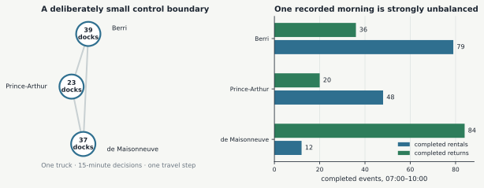
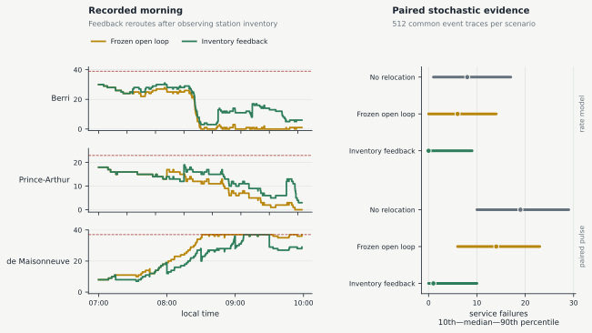
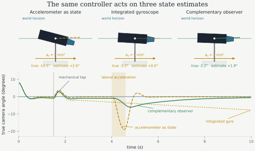

> **Cours de Pierre-Luc Bacon — 04.** [Page publiée](https://pierrelucbacon.com/rlbook/stochastic-dynamics-observation) · [Source numérotée](../04-stochastic-dynamics-observation.md)
> Extraction HTML → Markdown, effectuée le 2026-10-11. Les formules LaTeX, figures statiques, solutions et liens sont conservés ; les animations nécessitent le site original.

<a id="skip-to-frontmatter"></a>

# Stochastic Dynamics and Partial Observation

<a id="skip-to-article"></a>

Deterministic dynamics assign one next state to each state-action pair. Process noise, uncertain inflow, and unmodeled interactions instead produce a distribution of possible next states. This distinction changes the decision problem: a controller may need to compare expected cost, failure probability, or risk across those possible outcomes rather than optimize one nominal trajectory.

How should prediction and action selection be defined when the next state is a distribution and the controller may not observe the realized state directly?

One representation makes the source of randomness explicit:

<a id="nLw6QfOhGK"></a>

$$
x_{t+1}=f_t(x_t,u_t,\xi_t),
\qquad
\xi_t\mid x_t,u_t\sim p_t(\cdot\mid x_t,u_t).
$$

[(1)](#nLw6QfOhGK "Link to this Equation")

For a realized disturbance $\xi_t$, the function $f_t$ still returns one next state. The conditional law of $\xi_t$ determines how likely the different realizations are and therefore induces a distribution over $x_{t+1}$. The familiar additive Gaussian model assumes an independent noise sequence with a fixed covariance:

<a id="PheJeGABzN"></a>

$$
x_{t+1}=Ax_t+Bu_t+\xi_t,
\qquad
\xi_t\sim\mathcal N(0,Q).
$$

[(2)](#PheJeGABzN "Link to this Equation")

The induced dynamics can also be represented directly by a transition kernel,

<a id="UVMLTY0gA0"></a>

$$
P_t(A\mid x,u)
=\Pr(x_{t+1}\in A\mid x_t=x,u_t=u).
$$

[(3)](#UVMLTY0gA0 "Link to this Equation")

For any set $A$ of possible next states, $P_t(A\mid x,u)$ is the probability that the next state lies in $A$ after action $u$ is applied in state $x$. This object is called a **transition kernel**. The function-plus-noise representation exposes how randomness enters and may permit pathwise differentiation, in which a sampled transition is differentiated while holding its random draw fixed. The kernel requires only the conditional distribution of the next state, so it also covers simulators whose internal random variables are hidden.

Continuous-time noise must be scaled consistently with the duration of a time interval. A stochastic differential equation separates the deterministic rate of change, called the drift, from rapidly fluctuating random increments, called the diffusion:

<a id="j0CHaL1xcS"></a>

$$
dX_t=f(X_t,U_t)\,dt+\sigma(X_t,U_t)\,dW_t.
$$

[(4)](#j0CHaL1xcS "Link to this Equation")

Here $f$ is the drift, $W_t$ is standard Brownian motion, and $\sigma$ maps its increments into the state. Over an interval of length $\Delta t$, Brownian motion satisfies

<a id="BZQmO1FnIz"></a>

$$
W_{t+\Delta t}-W_t\sim\mathcal N(0,\Delta t I).
$$

[(5)](#BZQmO1FnIz "Link to this Equation")

The increment variance is proportional to elapsed time. The stochastic analogue of a forward Euler step, called Euler--Maruyama, therefore has the form

<a id="oIJ1TDNNHI"></a>

$$
X_{k+1}\approx X_k+f(X_k,U_k)\Delta t
+\sigma(X_k,U_k)\sqrt{\Delta t}\,\varepsilon_k,
\qquad \varepsilon_k\sim\mathcal N(0,I).
$$

[(6)](#oIJ1TDNNHI "Link to this Equation")

The random increment’s standard deviation therefore scales as $\sqrt{\Delta t}$ and its covariance as $\Delta t$. Halving the sampling interval does not mean adding the same covariance twice as often. A full treatment of stochastic differential equations lies outside this book; these relations record the scaling needed to construct a consistent sampled model. The later [path-integral stochastic control chapter](17-path-integral-stochastic-control.md#sec-path-integral-control) uses these Brownian moments to extend dynamic programming to continuous time and express optimal feedback through expectations over trajectories.

<a id="bicycle-inventory-and-stochastic-demand"></a>

### Bicycle Inventory and Stochastic Demand

Inventory provides a concrete transition model in which random events and hard constraints interact. A rental can occur only when a bicycle is present, and a return can occur only when a dock is open. Relocation decisions change those conditions before the next random arrivals are realized.

Between 07:00 and 10:00 on 4 July 2024, the BIXI stations at Berri--Cherrier and Prince-Arthur--St-Urbain recorded many more completed rentals than returns. The station at de Maisonneuve--Aylmer recorded the opposite flow. The three stations are less than 1.6 km apart, so a small relocation truck can move bicycles among them within one 15-minute interval. This deliberately local boundary lets us study inventory feedback without also having to choose routes across the full Montreal network.

<a id="fig-bixi-model-interface"></a>

<a id="oYfpWfZmDb"></a>


[Figure 1:](#fig-bixi-model-interface "Link to this figure")The three-station boundary contains 99 docks. Berri recorded 79 completed rentals and 36 returns, Prince-Arthur recorded 48 and 20, and de Maisonneuve recorded 12 and 84. The events come from the 2024 BIXI trip archive; capacities come from a station-information snapshot retrieved on 2 September 2026.

The simulation uses the station capacities recorded in a 2 September 2026 station-information snapshot for every run. Those values make the example reproducible, but they need not equal the capacities in service on 4 July 2024.

| station | ID | capacity |
| --- | --- | --- |
| Berri / Cherrier | 173 | 39 |
| Prince-Arthur / St-Urbain | 404 | 23 |
| de Maisonneuve / Aylmer (ouest) | 68 | 37 |

Let $s_{i,k}$ be the number of bicycles at station $i$, $c_i$ its capacity, and $b_k$ the truck inventory. A transfer $\rho_{i,k}$ is positive when the truck unloads bicycles at its current station and negative when it loads them. The post-transfer stock at the start of an interval is $q_{i,0}=s_{i,k}+\rho_{i,k}$.

Attempted rentals and returns then arrive as a chronological event sequence. For event $e$, let $R_{i,e}$ indicate a served rental and $A_{i,e}$ an accepted return. Their values depend on the stock immediately before the event:

<a id="q3B3DHW9Hw"></a>

$$
\begin{aligned}
R_{i,e}
&=\mathbf 1\{\text{event $e$ is a rental at $i$}\}
  \mathbf 1\{q_{i,e-1}\geq 1\},\\
A_{i,e}
&=\mathbf 1\{\text{event $e$ is a return at $i$}\}
  \mathbf 1\{q_{i,e-1}<c_i\},\\
q_{i,e}&=q_{i,e-1}-R_{i,e}+A_{i,e}.
\end{aligned}
$$

[(7)](#q3B3DHW9Hw "Link to this Equation")

If interval $k$ contains $N_k$ events, its inventory balance is

<a id="d8kShgX15F"></a>

$$
s_{i,k+1}=q_{i,N_k},
\qquad
b_{k+1}=b_k-\sum_i\rho_{i,k}.
$$

[(8)](#d8kShgX15F "Link to this Equation")

Relocation cancels when station and truck inventories are added. Customer trips can still change the total inside this three-station boundary because their other endpoint may lie elsewhere in the network.

The teaching plant begins with station inventories $(30,18,8)$ and an empty 16-bike truck at de Maisonneuve. Decisions occur every 15 minutes. A stop may transfer at most eight bicycles, and travel between any two of the three stations consumes one decision interval. At a common station and timestamp, the simulator processes returns before rentals. It records lost rentals and rejected returns instead of silently clipping attempted events.

Three controllers receive the same event trace. The first never relocates a bike. The second freezes a schedule computed before 07:00 from mean completed trip counts. The third reevaluates a deterministic, hand-written rule every 15 minutes using the observed inventories. It does not solve an optimization problem at each decision time. Here _feedback_ means that the current observation enters the rule; it does not imply optimization or learning.

Both active controllers use the remaining-horizon target

<a id="cRJ6RRr9k1"></a>

$$
g_{i,n}=
\operatorname{clip}\left(
\frac{c_i}{2}
+\sum_{h=n}^{T-1}(\hat d_{i,h}-\hat a_{i,h}),
0.2c_i,0.8c_i
\right).
$$

[(9)](#cRJ6RRr9k1 "Link to this Equation")

The function $\operatorname{clip}(q,l,r)$ limits $q$ to the interval $[l,r]$. Thus the target begins at half capacity, shifts upward when future departures are expected to exceed arrivals, and remains between 20 and 80 percent of station capacity. Here $\hat d_{i,h}$ and $\hat a_{i,h}$ are the mean numbers of completed departures and arrivals at station $i$ during 15-minute interval $h$ across the 43 calibration dates. Define the current deficit and surplus relative to the target by

<a id="MFjliZb0xx"></a>

$$
\delta^-_{i,n}=[g_{i,n}-s_{i,n}]_+,
\qquad
\delta^+_{i,n}=[s_{i,n}-g_{i,n}]_+.
$$

[(10)](#MFjliZb0xx "Link to this Equation")

The positive-part operator $[q]_+=\max(q,0)$ makes deficit and surplus nonnegative. At most one is positive for a given station. The rule first decides what to transfer at the truck’s current station. If the truck carries bicycles and the local deficit is at least two, it unloads. If the local surplus is at least two and the other stations have a combined deficit of at least two, it loads. Transfer size is capped by the eight-bike stop limit, truck capacity, available bicycles, open docks, and the relevant surplus or deficit. If the truck still carries bicycles after the transfer, it drives toward the other station with the largest ratio $\delta^-_{i,n}/c_i$. If it is empty, and both a deficit and a surplus of at least two remain, it drives toward the other station with the largest ratio $\delta^+_{i,n}/c_i$. Distance breaks ties. Finally, when the truck carries leftover bicycles but the total modeled deficit is below two, it returns as many as possible at its current station rather than keeping them unavailable to customers.

The frozen schedule is produced before 07:00 by applying this same heuristic to one deterministic mean-flow trajectory. It then keeps those actions unchanged. That calculation makes it an open-loop plan, not a second online optimizer. In the resulting schedule, the truck waits at de Maisonneuve, loads three bicycles at 07:45, travels to Prince-Arthur, and unloads them at 08:00. The feedback controller instead recomputes the rule from each newly observed inventory.

For the stochastic comparison, let $C^z_{i,k,d}$ be the number of completed events of type $z\in\{\mathrm{rental},\mathrm{return}\}$ at station $i$ in interval $k$ on calibration date $d$. The empirical rate and simulated count are

<a id="cF9q2xLDsa"></a>

$$
\widehat\lambda^z_{i,k}
=\frac{1}{43}\sum_{d=1}^{43}C^z_{i,k,d},
\qquad
N^z_{i,k}\sim
\operatorname{Poisson}\!\left(\widehat\lambda^z_{i,k}\right).
$$

[(11)](#cF9q2xLDsa "Link to this Equation")

The Poisson distribution is a count model whose mean here is $\widehat\lambda^z_{i,k}$. The count draws are independent across stations, intervals, and event types. Conditional on $N^z_{i,k}=m$, the simulator places the $m$ event times independently and uniformly inside interval $k$. It treats these events as potential attempts and accepts or rejects each one using the inventory equations above. Thus the model turns rates estimated from _completed_ trips into attempted-event rates. This is a declared modeling assumption: the public archive does not identify demand that was censored by an empty or full station.

For each seed from 0 through 511, all three controllers receive the same sampled event trace. This common-random-number design compares their decisions under the same demand realization. A separate paired-pulse condition appends eight rental attempts at Prince-Arthur at 07:47 and eight return attempts at de Maisonneuve at 07:57 to every trace. These additions are fixed, not extra Poisson draws, and each succeeds only when inventory or dock space permits. The feedback rule first uses their inventory consequences at the 08:00 decision. The frozen controller receives the new observation but ignores it and executes the action selected before 07:00.

The recorded comparison below uses the same event trace for every controller. The map, station fills, truck motion, and service failures come from committed Python trajectories. Controller selection and the playhead only seek through those records; they do not recompute the plant in the browser.

<a id="MLiKR4bsLh"></a>

```python
from pathlib import Path
import sys

from IPython.display import HTML, display

code_dir = Path.cwd() / "code"
if str(code_dir) not in sys.path:
    sys.path.insert(0, str(code_dir))

from bixi_replay import render_bixi_replay

display(HTML(render_bixi_replay(
    Path("artifacts/bixi/textbook_results.json"),
    replay_id="bixi-modeling-replay",
    fallback_id="fig-bixi-control-replay-fallback",
)))
```

Loading...

<a id="fig-bixi-control-replay-fallback"></a>

<a id="rIQDf9g1pm"></a>


[Figure 2:](#fig-bixi-control-replay-fallback "Link to this figure")Static trajectories and paired stochastic evidence from the same Python experiment. The online book adds controller selection, playback, stepping, and scrubbing.

| controller | mean failures, rate model | mean failures, paired pulse |
| --- | --- | --- |
| No relocation | 8.78 | 19.30 |
| Frozen open loop | 6.21 | 14.78 |
| Inventory feedback | 3.06 | 3.60 |

On the nominal traces, feedback lowers mean failures from 6.21 to 3.06 relative to the frozen plan. The frozen plan moves a median 6 bicycles over 0.85 km. Feedback moves a median 20 bicycles over 4.05 km under the rate model and 33 bicycles over 5.09 km under the paired pulse. The service gain therefore comes with a visible relocation cost.

Values are means over 512 common-random-number event traces. They describe the teaching simulator calibrated from completed trips, not measured failures in BIXI operations.

Feedback reduces service failures in this model, but it does more relocation work. These are outcomes of the stated simulator, not measurements of service failures or estimates of a causal effect in BIXI operations. The public archive omits unsuccessful attempts, historical inventories, and operator truck movements. The selected morning was chosen after inspection because its imbalance is easy to see; it is not an unbiased evaluation sample [BIXI Montréal (2024)](https://bixi.com/en/open-data/)[Ville de Montréal (2026)](https://donnees.montreal.ca/dataset/bixi-historique-des-deplacements)[Hulot _et al._ (2018)](https://doi.org/10.1145/3219819.3219873).

Inspect the BIXI transition and feedback rule

bixi\_control.py

```
1
2
3
4
5
6
7
8
9
10
11
12
13
14
15
16
17
18
19
20
21
22
23
24
25
26
27
28
29
30
31
32
33
34
35
36
37
38
39
40
41
42
43
44
45
46
47
48
49
50
51
52
53
54
55
56
57
58
59
60
61
62
63
64
65
66
67
68
69
70
71
72
73
74
75
76
77
78
79
80
81
82
83
84
85
86
87
88
89
90
91
92
93
94
95
96
97
98
99
100
101
102
103
104
105
106
107
108
109
```

bixi\_control.py

```
1
2
3
4
5
6
7
8
9
10
11
12
13
14
15
16
17
18
19
20
21
22
23
24
25
26
27
28
29
30
31
32
33
34
35
36
37
38
39
40
41
42
43
44
45
46
47
48
49
50
51
52
53
54
55
56
57
58
59
60
61
62
63
64
65
66
67
68
69
70
71
72
73
74
75
76
77
78
79
80
81
82
83
84
85
86
87
88
89
90
91
92
93
94
95
96
97
98
99
100
101
102
103
104
105
106
107
108
109
110
111
112
113
114
115
116
117
118
119
120
121
122
123
124
125
126
127
128
129
130
131
132
133
134
135
136
137
138
139
140
141
142
143
144
145
146
147
148
149
150
151
152
153
154
155
156
157
158
159
160
161
162
163
164
165
166
167
168
169
170
171
172
173
174
```

[Download the complete BIXI experiment](https://pierrelucbacon.com/rlbook/build/bixi_control-c5fc44d4361eba917395bf1d64ee2b16.py)

The BIXI simulator supplies station and truck inventories directly to the feedback controller. Physical sensors often provide only indirect, noisy measurements of the state.

<a id="partial-observability"></a>

## Partial Observability

A transition kernel describes uncertainty in the state itself. What changes when the controller receives only a noisy or ambiguous function of that state?

The BIXI controller receives the modeled inventories directly. Many controllers instead receive sensor readings that contain only partial or noisy information about the predictive state. An observation model relates the hidden state to the available measurement:

<a id="dmtKhk4mZf"></a>

$$
y_t=h(x_t,u_t,\nu_t),
\qquad
\nu_t\sim p_\nu.
$$

[(12)](#dmtKhk4mZf "Link to this Equation")

Here $p_\nu$ is the distribution assigned to measurement noise. For a linear Gaussian sensor, $y_t=Cx_t+\nu_t$ with $\nu_t\sim\mathcal N(0,R)$. A controller based only on $y_t$ may lose information needed to predict future transitions. Under a known model, the posterior belief

<a id="d3KVwemISQ"></a>

$$
b_t(A)=\Pr(x_t\in A\mid y_{0:t},u_{0:t-1})
$$

[(13)](#d3KVwemISQ "Link to this Equation")

assigns a probability to each set $A$ of possible hidden states. This belief is an **information state**: it retains the predictive content of the observation history in a form that can be updated after each action and measurement. A point estimate is often cheaper to use, but it may discard uncertainty that affects future decisions.

<a id="camera-stabilization-under-partial-observation"></a>

### Camera Stabilization under Partial Observation

Picture a camera on a one-axis gimbal attached to a moving vehicle. The motor tries to keep the horizon level. A tap can rotate the camera, and a sideways acceleration of the vehicle can disturb its sensors even when the camera itself does not rotate. The controller must infer what happened from an inertial measurement unit rather than from the true angle.

The simulated hidden state is

<a id="BrIXTyW2ia"></a>

$$
x=(\theta,\omega,b)
$$

[(14)](#BrIXTyW2ia "Link to this Equation")

where $\theta$ is the camera angle in radians, $\omega$ is its angular velocity in radians per second, and $b$ is an offset in the gyroscope reading, also in radians per second. The camera is balanced about the gimbal axis, so gravity does not create a rotational torque in this model. Its one-axis torque balance is

<a id="JATy2EPvSO"></a>

$$
\dot\theta=\omega,
\qquad
J\dot\omega=u-c\omega+\tau_{\mathrm{ext}}(t),
\qquad |u|\leq u_{\max}.
$$

[(15)](#JATy2EPvSO "Link to this Equation")

Here $J$ is the camera’s moment of inertia about the gimbal axis, measured in $\mathrm{kg\,m^2}$. A larger $J$ means that the same torque produces less angular acceleration. The motor torque $u$ and external torque $\tau_{\mathrm{ext}}$ are measured in $\mathrm{N\,m}$, and $c$ is a viscous rotational-damping coefficient measured in $\mathrm{N\,m\,s/rad}$. The bound $u_{\max}$ represents the motor’s torque limit.

The bias $b$ belongs to the sensor, not to the mechanical plant. If the camera is motionless but $b=0.8$ degrees per second, the gyroscope reading remains centered near 0.8 degrees per second instead of zero. This persistent offset is different from the small, rapid fluctuations that vary independently from one measurement to the next.

Real sensor errors depend on temperature, calibration, and hardware. For this ten-second simulation, a random walk provides a simple model of an offset that persists but can drift [El-Sheimy _et al._ (2008)](https://doi.org/10.1109/TIM.2007.908635):

<a id="AIfqVXXQNT"></a>

$$
b_{k+1}=b_k+\sigma_b\sqrt{\Delta t}\,\epsilon_k,
\qquad \epsilon_k\sim\mathcal N(0,1).
$$

[(16)](#AIfqVXXQNT "Link to this Equation")

Conditional on $b_k$, the next bias has mean $b_k$ and its change has standard deviation $\sigma_b\sqrt{\Delta t}$. Nothing in the model pulls the bias back to zero. Here $b_0=0.8$ degrees per second and $\sigma_b=0.02\ (\mathrm{degrees/s})/\sqrt{\mathrm{s}}$, so the standard deviation of one bias change is only 0.002 degrees per second at the $\Delta t=0.01$\-second sensor period. The chosen random walk therefore changes slowly relative to the sample-to-sample measurement noise. It is a reproducible teaching model, not a claim that every gyroscope drifts in exactly this way.

The gyroscope measures angular velocity with both the persistent bias and sample-to-sample measurement noise:

<a id="rRi5kzLphT"></a>

$$
y_k^\omega=\omega_k+b_k+\nu_k^\omega.
$$

[(17)](#rRi5kzLphT "Link to this Equation")

Integrating these readings turns a rate estimate into an angle estimate. Over $T$ seconds, an approximately constant bias $b$ contributes roughly $Tb$ to that estimated angle. A camera that is actually motionless therefore acquires about eight degrees of estimated rotation after ten seconds when an uncorrected 0.8\-degree-per-second bias is integrated. Zero-mean measurement noise tends to fluctuate in both directions; the persistent offset accumulates in one direction.

The accelerometer creates a different ambiguity. It measures _specific force_, the force per unit mass sensed by its internal proof mass, rather than reporting a camera angle directly. When the vehicle is stationary or moves at constant velocity, the support force opposing gravity supplies a vertical reference. A sideways vehicle acceleration changes the same sensor reading and can therefore look like camera tilt [Android Developers (2026)](https://developer.android.com/develop/sensors-and-location/sensors/sensors_motion).

The simulation keeps only the two axes in the plane of rotation. Its accelerometer model is

<a id="ccdI28JH78"></a>

$$
\begin{bmatrix}y_k^x\\y_k^y\end{bmatrix}
=R(-\theta_k)
\begin{bmatrix}a_{x,k}^{w}\\g\end{bmatrix}+\nu_k^a.
$$

[(18)](#ccdI28JH78 "Link to this Equation")

The vector $[a_{x,k}^{w},g]^\top$ contains the vehicle’s sideways acceleration and the gravity reference in world coordinates. The rotation $R(-\theta_k)$ expresses that vector along the camera-mounted sensor axes, and $\nu_k^a$ adds instantaneous measurement noise. If sideways acceleration and measurement noise are both zero, the direction of this vector determines $\theta_k$. With sideways acceleration, the angle inferred from the same two components becomes

<a id="O6AvuNC718"></a>

$$
\operatorname{atan2}(y_k^x,y_k^y)
=\theta_k+\operatorname{atan2}(a_{x,k}^{w},g).
$$

[(19)](#O6AvuNC718 "Link to this Equation")

For example, $a_x^w=3\ \mathrm{m/s^2}$ adds an apparent tilt of about 17 degrees. A level camera on a vehicle accelerating sideways can then produce the same accelerometer direction as a tilted camera on a stationary base. This is the partial-observation problem: the sensor reading alone does not identify which hidden situation occurred.

The two sensors fail on different time scales. The accelerometer gives a stable long-run reference when vehicle translation is mild, but a lateral acceleration corrupts it immediately. The gyroscope tracks rapid rotations without confusing them with translation, but integrating an unknown bias produces long-run drift. A **complementary observer** is a recursive state estimator that combines these two time scales. It uses the gyroscope for rapid changes, the accelerometer for slow angle correction, and the persistent disagreement between them to estimate gyroscope bias [Mahony _et al._ (2008)](https://doi.org/10.1109/TAC.2008.923738).

The comparison below changes only the estimator. One controller uses the accelerometer direction as its angle estimate, one integrates the raw gyroscope, and one uses the complementary observer. Every run receives the same mechanical plant, noise realization, disturbances, torque limit, and feedback law:

<a id="m2hh9BLQPZ"></a>

$$
u_k=\operatorname{clip}
\left(-0.9\hat\theta_k-0.12\hat\omega_k,
-0.18,0.18\right).
$$

[(20)](#m2hh9BLQPZ "Link to this Equation")

The function $\operatorname{clip}$ limits the requested motor torque to the interval $[-0.18,0.18]\ \mathrm{N\,m}$. The simulated plant uses $J=0.018\ \mathrm{kg\,m^2}$, $c=0.025\ \mathrm{N\,m\,s/rad}$, one-millisecond mechanical integration, and ten-millisecond sensing and control. The ten-second sensor trace is generated once with seed 11 and then supplied unchanged to every estimator.

All three runs start with the camera tilted by eight degrees. A $0.14\ \mathrm{N\,m}$ tap from 1.50 to 1.62 seconds physically rotates the camera, so both inertial sensors should help the controller respond. From 4.0 to 4.6 seconds, the base instead accelerates sideways at up to $3\ \mathrm{m/s^2}$. That event changes the accelerometer reading without directly rotating the balanced camera. The final quiet interval exposes the angle error produced by integrating the biased gyroscope.

The replay displays curves only up to the current playhead. Its metrics use the hidden simulated angle, which is available to the experiment but not to the controllers.

<a id="QlugFkX8OX"></a>

```python
from pathlib import Path
import sys

from IPython.display import HTML, display

code_dir = Path.cwd() / "code"
if str(code_dir) not in sys.path:
    sys.path.insert(0, str(code_dir))

from gimbal_replay import render_gimbal_replay

display(HTML(render_gimbal_replay(
    Path("artifacts/gimbal/textbook_results.json"),
    replay_id="gimbal-observation-replay",
    fallback_id="fig-gimbal-observation-fallback",
)))
```

Loading...

<a id="fig-gimbal-observation-fallback"></a>

<a id="VTlTAQ0AyS"></a>


[Figure 3:](#fig-gimbal-observation-fallback "Link to this figure")Static snapshots and complete trajectories from the same Python experiment. The online book adds playback, stepping, and scrubbing.

| state estimate supplied to the controller | RMS angle | peak during translation | final absolute error |
| --- | --- | --- | --- |
| Accelerometer as state | 3.86 degrees | 19.00 degrees | 0.08 degrees |
| Integrated gyroscope | 4.60 degrees | 4.31 degrees | 7.73 degrees |
| Complementary observer | 2.43 degrees | 6.07 degrees | 0.58 degrees |

The results follow the two failure mechanisms. The accelerometer-only estimate reacts strongly to the translation pulse. The integrated-gyroscope estimate largely ignores that pulse but drifts during the quiet interval. The complementary observer reduces both errors by using the accelerometer as a slow correction to the gyroscope-based angle. Sustained unknown translation can still be mistaken for tilt. These are results from a transparent teaching simulation, not measured performance of a commercial gimbal.

The same distinction appears in adaptive optics: local wavefront slopes are sensor observations, while the reconstructed phase is the state used for control.

Inspect the sampled plant, sensors, estimator, and controller

gimbal\_control.py

```
1
2
3
4
5
6
7
8
9
10
11
12
13
14
15
16
17
18
19
20
21
22
23
24
25
26
27
28
29
30
31
32
33
34
35
36
37
38
39
40
41
42
43
44
45
46
47
48
49
50
51
52
53
54
55
56
57
58
59
60
61
62
63
64
65
66
67
68
69
70
71
72
73
74
75
76
77
78
79
80
81
82
83
84
85
86
87
88
89
90
91
92
93
94
95
96
97
98
99
100
```

[Download the complete gimbal experiment](https://pierrelucbacon.com/rlbook/build/gimbal_control-fa8228dcab354ac53e8247e502818ebf.py)

State, action, disturbance, and observation equations describe the model’s semantics. An algorithm still needs a computational way to use that model. The next distinction concerns which operations the model exposes: formulas and derivatives, reset-and-step simulation, fixed logged transitions, or new online interaction.

<a id="summary-and-outlook"></a>

## Summary and Outlook

Transition kernels separate the action selected by the decision maker from the disturbance that selects a realized successor. Observation models add a second separation: the state supports prediction, while the measurement supplies only the information available for choosing the next action.

These equations specify what a model means, but they do not specify how an algorithm may use it. Can the algorithm differentiate the transition, reset a simulator, resample a state, or only inspect logged transitions? [Model interfaces and learned components](05-model-interfaces.md) make those operations explicit.

<a id="exercises"></a>

## Exercises

<a id="ex-dynamics-bixi-conservation"></a>

[Exercise 1](#ex-dynamics-bixi-conservation "Link to this Exercise") (Conservation and feedback in bicycle relocation)

Before customer events occur, verify that relocation preserves the sum of station and truck inventories. Then compare the frozen schedule with inventory feedback after the declared demand pulse. Which new observation can change the feedback action, and why can the frozen action not change?

Solution to [Exercise 1](#ex-dynamics-bixi-conservation)

Since $q_{i,0}=s_{i,k}+\rho_{i,k}$ and $b_{k+1}=b_k-\sum_i\rho_{i,k}$,

<a id="KJfqe8HHuu"></a>

$$
\sum_i q_{i,0}+b_{k+1}=\sum_i s_{i,k}+b_k.
$$

[(21)](#KJfqe8HHuu "Link to this Equation")

Customer trips may later cross the three-station boundary and change that total. At 08:00, feedback observes the inventories produced by the unexpected Prince-Arthur rentals and de Maisonneuve returns, so it can alter its transfer or route. The frozen schedule was fixed from information available before 07:00 and has no rule for using the new observation.

<a id="ex-dynamics-gimbal-ambiguity"></a>

[Exercise 2](#ex-dynamics-gimbal-ambiguity "Link to this Exercise") (Tilt or translation?)

Construct two pairs $(\theta,a_x^w)$ that produce the same noiseless accelerometer-derived tilt. What additional information does the gyroscope supply, and which ambiguity remains?

Solution to [Exercise 2](#ex-dynamics-gimbal-ambiguity)

Both

<a id="hSnP4kDDsD"></a>

$$
(\theta,a_x^w)=(10^\circ,0)
\quad\text{and}\quad
(\theta,a_x^w)=\left(0,g\tan 10^\circ\right)
$$

[(22)](#hSnP4kDDsD "Link to this Equation")

produce an apparent tilt of $10^\circ$. The gyroscope measures angular rate plus bias, which helps distinguish a rapid rotation from a translational pulse. An unknown gyro bias still accumulates as angle error, and sustained unknown translation remains confounded with gravity in the accelerometer.

<a id="ex-dynamics-reservoir-kernel"></a>

[Exercise 3](#ex-dynamics-reservoir-kernel "Link to this Exercise") (Function-plus-noise and transition kernels)

Suppose a reservoir with no spill or evaporation obeys $s_{t+1}=s_t-u_t+w_t$, where $w_t=\bar w_t+\epsilon_t$. Write a function-plus-noise model and the induced transition kernel.

Solution to [Exercise 3](#ex-dynamics-reservoir-kernel)

The explicit-noise form is

<a id="X8exC3qv9e"></a>

$$
s_{t+1}=s_t-u_t+\bar w_t+\epsilon_t.
$$

[(23)](#X8exC3qv9e "Link to this Equation")

If $\epsilon_t$ has conditional distribution $p_t$, then the induced kernel is

<a id="XfkuQ9Hdi1"></a>

$$
P_t(A\mid s,u)
=\Pr\!\left(s-u+\bar w_t+\epsilon_t\in A\right).
$$

[(24)](#XfkuQ9Hdi1 "Link to this Equation")

This kernel is the pushforward of the noise distribution through the balance equation. Adding bounds or spill would change the map and could create probability mass at a boundary.

<a id="ex-dynamics-nonmarkov-observation"></a>

[Exercise 4](#ex-dynamics-nonmarkov-observation "Link to this Exercise") (A non-Markov observation)

An inference controller observes queue counts and total cache occupancy but not the remaining output length of each active request. Why are those measurements not generally a Markov state? What additional state or history would improve prediction?

Solution to [Exercise 4](#ex-dynamics-nonmarkov-observation)

Two request sets can have equal queue counts and cache occupancy but different remaining output lengths. Their completion times and cache releases therefore have different conditional distributions. A full state can retain every request’s remaining work. When that work is hidden, the complete observation history is sufficient in principle, and a posterior distribution over the request-level state is a compact information state under a known model.

<a id="ex-dynamics-modeling-dispatch"></a>

[Exercise 5](#ex-dynamics-modeling-dispatch "Link to this Exercise") (Dispatch under hidden service times)

A computing service reviews its operation once per minute. Four workers can process jobs from either of two queues. At each review, the dispatcher sees the number of waiting jobs in each queue, the number of busy workers, the current worker modes, and a power measurement. It chooses how many workers will be active and which queue receives priority during the next minute. New jobs arrive at random times. Each busy job has an unobserved remaining processing time, and this quantity affects whether the job finishes during the next minute. The objective penalizes waiting time and energy use. A hard power limit must hold at every step.

(a) Draw the system boundary and classify the state, observation, action, disturbance, objective, constraint, time representation, and horizon. Use a finite horizon of 60 decisions.

(b) Explain why the observed queue counts and number of busy workers are not generally a Markov state. Give one full-state description for the system and one information state available to the dispatcher.

(c) Choose between deterministic dynamics and a stochastic transition kernel. State which sentence in the description determines your choice.

(d) Distinguish a fixed 60-minute staffing schedule from a feedback policy. Which observations can affect the feedback action after the first minute?

(e) Suppose the only available data are transitions logged under one fixed staffing schedule. Which model interface does this provide, and what can it not answer directly about a new feedback policy?

Solution to [Exercise 5](#ex-dynamics-modeling-dispatch)

(a) The boundary contains the two queues, four workers, and their power-relevant operation. A full state contains the queued jobs, every active job’s worker and remaining processing time, the worker modes, and any variable needed to predict power. The stated observation contains the two queue counts, busy-worker count, worker modes, and measured power. The action is the active-worker count and queue priority. Arrivals and unobserved job requirements are disturbances. The stage cost combines waiting and energy, and the power cap is a hard constraint. Time is discrete in one-minute steps over 60 decisions.

(b) Equal counts can hide different remaining workloads and therefore different completion distributions. The full state just described is Markov under the declared job model. The complete observation-action history is available to the dispatcher; under a known stochastic model, its posterior over hidden job states is a more compact information state.

(c) A stochastic transition kernel is the natural representation because jobs arrive at random times and hidden processing requirements make completions uncertain. A deterministic function remains possible only after the relevant noise realizations are supplied as additional inputs.

(d) The fixed schedule selects all 60 actions from initial information. A feedback policy may change the active-worker count or priority after observing new queue counts, busy-worker status, modes, or power.

(e) Those data supply a logged-transition interface under one behavior schedule. It cannot directly answer how actions absent from that log would change queues or power, so evaluating a new feedback policy requires coverage and identification assumptions or a separate transition model.

<a id="ex-dynamics-modeling-practice"></a>

[Exercise 6](#ex-dynamics-modeling-practice "Link to this Exercise") (Practice under latent mastery)

An online practice system presents one problem at each of 20 rounds. Before round $t$, a learner’s unobserved mastery $M_t$ is one of three ordered categories. The system chooses an easy, medium, or hard problem $A_t$, then observes correctness and response time $Y_t$. The observation distribution depends only on $M_t$ and $A_t$. Mastery then changes randomly according to a distribution that depends only on $M_t$ and $A_t$, producing $M_{t+1}$. The objective is to maximize the probability that $M_{20}$, after the twentieth transition, is the highest category, subject to presenting at most five hard problems. A resettable simulator can sample a transition and observation from any supplied mastery level and difficulty, but it exposes no equations or derivatives.

(a) Classify the latent state, observation, action, stochastic dynamics, objective, constraint, horizon, and model interface. Include any bookkeeping variable needed to enforce the five-hard-problem limit.

(b) Compare three possible inputs to the decision rule: the most recent answer, the complete observation history, and the posterior distribution over mastery levels. Which is an information state under the stated conditional relationships? Explain why.

(c) Write the structural form of the state transition, observation model, and feedback policy without inventing numerical probabilities.

(d) Describe an open-loop problem sequence and a feedback problem sequence. Which part of the available information can change the latter?

(e) Name one computation that the resettable simulator supports directly and one operation that would require an additional interface.

Solution to [Exercise 6](#ex-dynamics-modeling-practice)

(a) The augmented latent state is $(M_t,c_t,t)$, where $c_t$ counts hard problems already used. The observation is correctness and response time, and the action is difficulty. The model has a stochastic mastery transition and a stochastic observation map. The terminal objective is $\Pr(M_{20}=\text{highest})$, with $c_t\leq5$ as a hard constraint. The horizon contains 20 actions. The available model is a generative reset-and-sample simulator.

(b) The latest answer alone generally loses information from earlier rounds. The complete history is sufficient but grows with time. Under the stated conditional relationships, the posterior $b_t(m)=\Pr(M_t=m\mid Y_{0:t-1},A_{0:t-1})$, augmented by $c_t$ and $t$, is a Markov information state.

(c) Without assigning numbers, the structure is

<a id="CDD8slA9dc"></a>

$$
Y_t\sim O(\,\cdot\mid M_t,A_t),\qquad
M_{t+1}\sim P(\,\cdot\mid M_t,A_t),\qquad
c_{t+1}=c_t+\mathbf 1\{A_t=\mathrm{hard}\},
$$

[(25)](#CDD8slA9dc "Link to this Equation")

with a feasible feedback policy $A_t=\pi_t(b_t,c_t)$ that excludes the hard action once $c_t=5$.

(d) An open-loop sequence fixes all 20 difficulties before any answers are seen. A feedback sequence selects the next difficulty after updating the mastery posterior from correctness and response time, while retaining the remaining hard-problem budget.

(e) The simulator directly supports arbitrary one-step samples and Monte Carlo rollouts from chosen latent states and actions. Exact probabilities, analytic derivatives, or symbolic local equations require an additional interface.

<a id="references"></a>

References[¶](#references "Link to References")

<a id="cite-bixiOpenData2024"></a>
2.  BIXI Montréal. (2024). _Open Data: Trip History and Station Status_. [https://bixi.com/en/open-data/](https://bixi.com/en/open-data/)
<a id="cite-montrealBixiTrips"></a>
4.  Ville de Montréal. (2026). _BIXI Trip History_. Montréal open-data catalogue. [https://donnees.montreal.ca/dataset/bixi-historique-des-deplacements](https://donnees.montreal.ca/dataset/bixi-historique-des-deplacements)
<a id="cite-hulot2018bixi"></a>
6.  Hulot, P., Aloise, D., & Jena, S. D. (2018). Towards Station-Level Demand Prediction for Effective Rebalancing in Bike-Sharing Systems. _Proceedings of the 24th ACM SIGKDD International Conference on Knowledge Discovery and Data Mining_, 378–386. [10.1145/3219819.3219873](https://doi.org/10.1145/3219819.3219873)
<a id="cite-elSheimy2008allan"></a>
8.  El-Sheimy, N., Hou, H., & Niu, X. (2008). Analysis and Modeling of Inertial Sensors Using Allan Variance. _IEEE Transactions on Instrumentation and Measurement_, _57_(1), 140–149. [10.1109/TIM.2007.908635](https://doi.org/10.1109/TIM.2007.908635)
<a id="cite-androidMotionSensors2026"></a>
10.  Android Developers. (2026). _Motion Sensors_. [https://developer.android.com/develop/sensors-and-location/sensors/sensors\_motion](https://developer.android.com/develop/sensors-and-location/sensors/sensors_motion)
<a id="cite-mahony2008complementary"></a>
12.  Mahony, R., Hamel, T., & Pflimlin, J.-M. (2008). Nonlinear Complementary Filters on the Special Orthogonal Group. _IEEE Transactions on Automatic Control_, _53_(5), 1203–1218. [10.1109/TAC.2008.923738](https://doi.org/10.1109/TAC.2008.923738)

[

Modeling Sequential Decisions

Controlled Systems: Boundaries, States, and Actions


](03-modeling-controlled-systems.md)[

Modeling Sequential Decisions

Model Interfaces and Learned Components


](05-model-interfaces.md)
