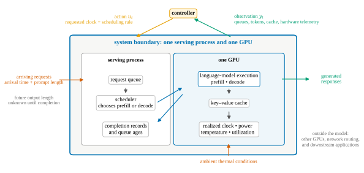
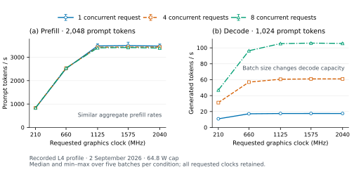
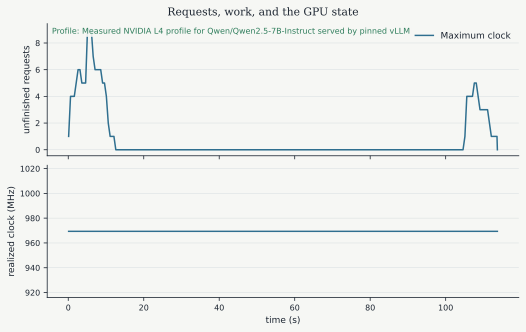
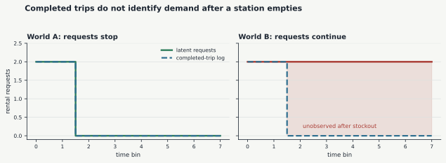
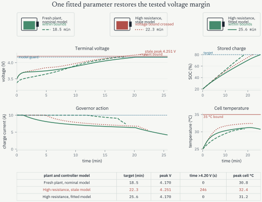

> **Cours de Pierre-Luc Bacon — 05.** [Page publiée](https://pierrelucbacon.com/rlbook/model-interfaces) · [Source numérotée](../05-model-interfaces.md)
> Extraction HTML → Markdown, effectuée le 2026-10-11. Les formules LaTeX, figures statiques, solutions et liens sont conservés ; les animations nécessitent le site original.

<a id="skip-to-frontmatter"></a>

# Model Interfaces and Learned Components

<a id="skip-to-article"></a>

Stochastic dynamics and observation models specify the law of the next state and the information returned to the controller. Which of those mathematical objects can an algorithm actually evaluate, differentiate, resample, or learn from recorded data?

Two models may generate the same nominal trajectory while exposing different operations to an algorithm. Access to equations, derivatives, resets, and new interactions determines what can be computed. The interface therefore matters independently of the model’s physical fidelity: knowing that a transition exists is different from being able to differentiate it, resample it, or query it under a new action.

| available interface | operations it supports directly | methods developed later |
| --- | --- | --- |
| equations and derivatives | evaluate local dynamics, linearize, differentiate constraints | direct transcription, LQR, gradient-based MPC |
| one-step transition function | reset and advance from chosen state-action pairs | shooting, simulation-based MPC, model-based dynamic programming |
| generative simulator | sample trajectories without inspecting internal equations | Monte Carlo estimation, derivative-free search, policy learning |
| logged transitions | fit or evaluate models on the recorded distribution | system identification, fitted value and Q methods, offline evaluation |
| interactive environment and objective | collect new transitions under chosen actions | online reinforcement learning |

The rows are not mutually exclusive. A simulator may be differentiable, an explicit model may contain unknown parameters, and logged data can be used to fit a new one-step model. The table records the information supplied to the algorithm, not the origin or fidelity of the model.

A program is a model when its execution defines state transitions. MuJoCo, for example, combines rigid-body equations, contact detection, constraint forces, sensors, and rendering behind a reset-and-step interface. A user can query that interface without possessing a practical expression for its complete local transition function. A discrete-event simulator also defines a transition model, although its clock advances from one asynchronous event to the next.

Calling a method **model-free** specifies which transition information its updates can use. In this book, a model-free update receives sampled experience rather than direct access to the transition function, transition probabilities, or their derivatives. An online method may choose an action and observe the resulting transition. An offline method is restricted to the transitions in its log. Neither can directly request the exact outcome distribution for an untried action at the same state. Both still require a declared observation, action set, reward, sampling process, and assumptions connecting the available samples to deployment.

<a id="inference-serving-as-a-controlled-system"></a>

### Inference Serving as a Controlled System

Inference serving contains several modeling choices within one boundary. It combines conserved work and cache balances with profiled performance maps, has both request-level and aggregate states, and can be accessed through equations, simulation, logged traces, or a live process. The control objective is to schedule work and choose hardware settings while respecting latency, memory, power, and thermal limits.

An inference server receives prompts at irregular times and generates one response for each request. A decoder-only language model processes a request in two phases. The **prefill** phase processes the prompt in parallel and creates the first output token. The **decode** phase generates the remaining tokens one iteration at a time. Long prefills can delay the short decode iterations of requests already in progress. Iteration-level scheduling and chunked prefill are production approaches to controlling this interaction [Yu _et al._ (2022)](https://www.usenix.org/conference/osdi22/presentation/yu)[Agrawal _et al._ (2024)](https://www.usenix.org/conference/osdi24/presentation/agrawal). The teaching simulator below uses a reduced interleaving rule rather than reproducing either serving system.

<a id="boundary-state-and-action"></a>

#### Boundary, State, and Action

The system boundary surrounds one GPU and its serving process. The language model and inference engine lie inside the boundary. Request arrivals and ambient thermal conditions enter from outside it.

<a id="fig-inference-serving-boundary"></a>

<a id="eSz6pUUyDv"></a>


[Figure 1:](#fig-inference-serving-boundary "Link to this figure")The boundary contains the request queue, scheduler, language-model execution, key-value cache, and GPU hardware state. The controller observes queue and cache state, completed work, power, temperature, and realized clock; it chooses a requested clock and scheduling rule. Arrivals are disturbances, and a request’s eventual output length remains hidden until that request completes. Other GPUs, network routing, and downstream applications remain outside this model.

This fixed serving boundary is available through four of the interfaces above. Token, cache, and thermal balances provide equations. The profile-based event simulator can be reset and run under chosen clock and scheduling actions. Logged traces and profile records contain only the states and actions that were recorded, so they cannot directly answer counterfactual questions outside that coverage. A live Qwen/vLLM process accepts new requests and chosen clock settings, producing new transition samples. Several interfaces may coexist; their available operations differ even though the serving process does not.

The full request-level simulator state records each request’s phase, age, remaining prompt work, generated tokens, eventual output length, and cache allocation. The eventual output length is part of the simulator’s hidden state but is not revealed to the controller. At a one-second control interval, the reduced control model uses the aggregate state

<a id="lPr7pmDM3Q"></a>

$$
x_t=(p_t,d_t,m_t,T_t,f_t),
$$

[(1)](#lPr7pmDM3Q "Link to this Equation")

where $p_t$ is queued prefill work and $d_t$ is unfinished decode work. The quantity $m_t$ is key-value-cache occupancy; this cache stores intermediate attention representations so that previously processed tokens need not be recomputed at each decode step. The remaining variables are GPU temperature $T_t$ and realized graphics clock $f_t$, the hardware frequency that determines how quickly GPU work can proceed. This vector is a state of the reduced model, but it is not a Markov description of every request-level trajectory. The control

<a id="yvPtwXJ7qh"></a>

$$
u_t=(f_t^{\mathrm{req}},\sigma_t)
$$

[(2)](#yvPtwXJ7qh "Link to this Equation")

combines a requested clock with a scheduling rule $\sigma_t$. The scheduler decides which phase receives each service step and how much prefill work may be processed before returning to active decodes. The clock request changes the rate and energy cost of that work. Hardware may realize a lower clock under a power or thermal limit, so $f_t^{\mathrm{req}}$ and $f_t$ are distinct variables [NVIDIA Corporation (2026)](https://docs.nvidia.com/deploy/nvidia-smi/index.html).

Request arrivals form the disturbance. An arrival supplies its time and prompt length, but its eventual output length remains unknown to the controller until the end-of-sequence token arrives. The observation contains queue ages, completed prompt and output tokens, cache use, power, temperature, and realized clock. This information pattern prevents a controller from scheduling with the future length recorded in an evaluation trace.

<a id="conservation-and-calibrated-maps"></a>

#### Conservation and Calibrated Maps

The aggregate balances expose structure that does not have to be learned. If $A_t^p$ prompt tokens arrive, $C_t^p$ prompt tokens are processed, $N_t^p$ requests finish prefill, and $C_t^d$ decode tokens are produced, then

<a id="LmNBKKpL8j"></a>

$$
\begin{aligned}
p_{t+1} &= p_t+A_t^p-C_t^p,\\
d_{t+1} &= d_t+W_t^d(N_t^p)-C_t^d.
\end{aligned}
$$

[(3)](#LmNBKKpL8j "Link to this Equation")

The term $W_t^d(N_t^p)$ denotes the still-unknown output work associated with newly admitted decode requests. The request-level simulator makes this work available only as tokens complete. It tracks continuous prompt and generated-token occupancy, including partial prefills, together with a fixed per-request reserve. That occupancy is released when a request completes. This aggregate accounting preserves the modeled cache balance, but it does not reproduce a serving engine’s block allocator. An aggregate thermal balance has the form

<a id="tcmtcEeYtL"></a>

$$
T_{t+1}=T_t+\frac{\Delta t}{C_\theta}
\left(P(x_t,u_t)-\frac{T_t-T_{\mathrm{amb}}}{R_\theta}\right).
$$

[(4)](#tcmtcEeYtL "Link to this Equation")

Here $T_{\mathrm{amb}}$ is ambient temperature, $C_\theta$ is effective thermal capacitance, and $R_\theta$ is thermal resistance to the surroundings. The power map $P(x_t,u_t)$ adds heat, while $(T_t-T_{\mathrm{amb}})/R_\theta$ removes heat when the GPU is warmer than its environment.

Token and cache conservation determine the form of the transition. Measurements are still needed for the service-rate map, the power map $P$, and the thermal parameters. The profiling protocol targets Qwen2.5-7B-Instruct served by vLLM on an NVIDIA L4 [Qwen Team (2025)](https://arxiv.org/abs/2412.15115)[Kwon _et al._ (2023)](https://doi.org/10.1145/3600006.3613165). Its intended hardware profile spans five requested clock levels, several prompt lengths, and three concurrency levels, meaning three different numbers of requests served at the same time. The book build reads a committed profile and never starts a model server. Its manifest states whether the maps come from completed L4 measurements or a pre-measurement engineering surrogate, and every rendered result displays that provenance.

<a id="batch-size-changes-the-service-map"></a>

#### Batch Size Changes the Service Map

The recorded 64.8 W L4 profile shows why a service map must retain concurrency. At a requested 2,040 MHz with a 1,024-token prompt, aggregate decode throughput rises from 17.5 generated tokens per second for one request to 105.6 for eight concurrent requests. Aggregate prefill throughput changes much less across these batch sizes. Pooling the measurements into one rate per clock loses this difference and can give a controller the wrong prediction of queue drainage.

<a id="fig-inference-batch-calibration"></a>

<a id="AGaWENfIui"></a>


[Figure 2:](#fig-inference-batch-calibration "Link to this figure")Batch size changes decode capacity in the recorded 2 September 2026 L4 profile at a 64.8 W cap. Each point is the median of five concurrent batches; whiskers show their minimum and maximum. Prompt length is fixed within each panel. All five requested clocks are retained, including the throughput plateau above 1,125 MHz.

The plateau also motivates a fixed moderate-clock baseline. A feedback controller can lower energy relative to the maximum clock without improving on a well-chosen constant clock. The live experiment therefore selects a constant clock on development requests before comparing it with the governor and MPC on fresh requests. The current live experiment uses a 40 W cap and requires fresh service and idle power measurements at that cap. The 64.8 W curves remain historical evidence; the replay below retains the original reduced teaching model.

The live controller distinguishes requests awaiting their first output from requests already streaming. It estimates remaining output work from development request lengths and the tokens received so far, then fits its transition model on mixed-serving measurements. These observations preserve useful differences in the workload without exposing unfinished requests’ final lengths or assuming that the resulting state is fully Markov.

[Download the phase, context, and concurrency calibration table (CSV)](../Assets/Website/e882e10ad3-batch_calibration-3e069fe028408abf56c3ab3125112d45.csv)

A separate measured study now compares fixed clocks, GPU-managed graphics clocks, and a causal demand/phase heuristic under the configured 40 W setting. Across four held-out Azure request blocks, each repeated twice, fixed 660 MHz used 10.31% less telemetry-derived GPU energy than GPU-managed clocks; the adaptive heuristic used a further 0.77% less than fixed 660 MHz. All paired relative latency checks passed, but the candidate failed development qualification and all three methods missed the absolute time-to-first-token target on the shorter code block. These are exploratory observations, not established latency-qualified adaptive savings. The heuristic is separate from the governor and MPC, whose calibration remains incomplete. The [measured study](https://pierrelucbacon.com/rlbook/build/gpu-adaptive-study-0b2980d8bfa15c6e98aea05982359544.html) includes the five-clock screen, request-shape probes, observed clocks, and retained failures.

[Read the completed study and paired results (PDF)](../Assets/Website/460706c542-article-92c02a4d51251cc17113676ccb4c56f3.pdf)

<a id="workload-and-scheduling-rule"></a>

#### Workload and Scheduling Rule

The conservation equations specify how work moves through the server, but an experiment also needs a reproducible arrival process and a declared scheduler. The following settings define the recorded simulation. The revised live experiment instead measures mixed-serving capacity and freezes its latency targets from development requests before confirmation.

The simulated workload is a five-minute excerpt from the Azure 2023 code-generation trace, which records request times and input and output token counts [Microsoft Azure (2023)](https://github.com/Azure/AzurePublicDataset/blob/master/AzureLLMInferenceDataset2023.md)[Patel _et al._ (2024)](https://www.microsoft.com/en-us/research/publication/splitwise-efficient-generative-llm-inference-using-phase-splitting/). Arrival times are dilated once to place maximum-clock utilization near 80 percent. This time dilation preserves request sizes and ordering while spreading arrivals over a longer interval. If $\rho_{\max}$ is the isolated service time of all requests at the highest profiled clock divided by the original window length, the dilation and normalized arrivals are

<a id="HqjXsoBAOk"></a>

$$
\kappa=\max\!\left(1,\frac{\rho_{\max}}{0.8}\right),
\qquad
t_i'=\kappa(t_i-t_0).
$$

[(5)](#HqjXsoBAOk "Link to this Equation")

The factor $\kappa$ is at least one, so it can leave the trace unchanged or slow its arrivals; it never compresses them into a shorter interval.

All simulated controllers receive the same immutable requests after this transformation. The simulated time-to-first-token limit is twice the median baseline value for a 1,024-token prompt at concurrency one and the highest clock. The time-per-output-token limit is 1.5 times the corresponding median. These are reference levels for a controlled comparison, not service-level objectives claimed for production systems.

| quantity | recorded simulation setting |
| --- | --- |
| model | Qwen2.5-7B-Instruct, revision `acbd96531cda22292a3ceaa67e984955d3965282` [Qwen Team (2025)](https://huggingface.co/Qwen/Qwen2.5-7B-Instruct/tree/acbd96531cda22292a3ceaa67e984955d3965282) |
| inference engine | vLLM OpenAI server, version 0.28.0 [vLLM Project (2026)](https://docs.vllm.ai/en/v0.28.0/deployment/docker/) |
| target accelerator | one NVIDIA L4 |
| clock profile | five requested graphics clocks; realized clock, power, utilization, and temperature retained |
| request trace | first five minutes for evaluation; first 20 requests for the animation |
| controller sampling | one second |
| service simulation | 0.1-second steps; decode priority or one prefill chunk first; unused prefill capacity may return to decode |
| output length | hidden from the controller until completion |

Within each one-second clock-control period, the scheduler gives each 0.1-second simulator step to decode or begins it with one prefill chunk. If that chunk finishes before the step’s service budget is exhausted, the remaining capacity returns to decode. When both phases have work, active decode receives alternating-step priority and strict priority under high cache pressure. The **512-token interleaved chunked-prefill** rule specifies the teaching model’s action channel; it does not reproduce vLLM’s mixed-batch scheduler or Sarathi-Serve.

<a id="recorded-replay-and-scope"></a>

#### Recorded Replay and Scope

The first 20 requests form the recorded replay below. They move through arrival, interleaved 512-token prefill chunks, autoregressive decode, and completion. The plots report only the trajectory prefix reached by the playhead, and output length is hidden from the controller until each request completes. A provenance badge distinguishes a verified measured profile from a pre-measurement engineering surrogate.

<a id="AAkLhOiMz1"></a>

```python
from pathlib import Path
import sys

from IPython.display import HTML, display

code_dir = Path.cwd() / "code"
if str(code_dir) not in sys.path:
    sys.path.insert(0, str(code_dir))

from inference_replay import render_serving_replay

display(HTML(render_serving_replay(
    Path("artifacts/inference_serving/textbook_results.json"),
    view="modeling",
)))
```

Loading...

<a id="fig-inference-serving-model-fallback"></a>

<a id="HyPECzEadT"></a>


[Figure 3:](#fig-inference-serving-model-fallback "Link to this figure")Static summary of unfinished requests and realized clock from the same request-level simulation. The online book provides playback, stepping, scrubbing, phase detail, and controller selection.

Conservation checks account for every request, processed token, and cache allocation. At the end of the committed replay, all 20 requests have completed, the prefill and decode queues are empty, and all modeled cache occupancy has been released. This establishes closure of the modeled flows. It does not show that the aggregate variables are Markov for the request-level plant, nor that the service-rate, power, or thermal maps are accurate. A provisional profile permits tests of the simulation and control software but does not supply empirical latency or energy evidence. In either case, the model does not cover every inference engine or GPU. Network transfer, host-side tokenization, multi-GPU communication, model-quality effects, and failures outside the serving process remain outside the boundary.

Inspect the request-level transition

inference\_serving.py

```
1
2
3
4
5
6
7
8
9
10
11
12
13
14
15
16
17
18
19
20
21
22
23
24
25
26
27
28
29
30
31
32
33
34
35
36
37
38
39
40
41
42
43
44
45
46
47
48
49
50
51
52
53
54
55
56
57
58
59
60
61
62
63
64
65
66
67
68
69
70
71
72
73
74
75
76
77
78
79
80
81
82
83
84
85
86
87
88
89
90
91
92
93
94
95
96
97
98
99
100
101
102
103
104
105
106
107
108
109
110
111
112
113
114
115
116
117
118
119
120
121
122
123
124
125
126
127
128
129
130
131
132
133
134
135
136
137
138
139
140
141
142
143
144
145
146
147
148
149
150
151
152
153
154
155
156
157
158
159
160
161
162
163
164
165
166
167
168
169
170
171
172
173
174
175
176
177
178
179
180
181
182
183
184
185
186
187
188
189
190
191
192
193
194
195
196
197
198
199
200
201
202
203
204
205
206
207
208
209
210
211
212
213
214
215
216
217
218
219
220
221
222
223
224
225
226
227
228
229
230
231
232
233
234
235
236
237
238
239
240
241
242
243
244
245
246
247
248
249
250
251
252
253
254
255
256
257
258
259
260
261
262
263
264
265
266
267
268
269
```

[Download the complete inference-serving model](https://pierrelucbacon.com/rlbook/build/inference_serving-a97ceb70b51a0e213a87632e9bcd954e.py)

<a id="censoring-in-completed-trip-logs"></a>

### Censoring in Completed-Trip Logs

The inference example can generate new trajectories from a simulator or live process. The BIXI archive supplies a more restrictive interface: a fixed log of completed trips. The distinction matters because a completed-event log records what the system served, not every request that users attempted. A completed rental proves that a bicycle was available, but an empty station leaves no trip record for a customer who could not depart. A completed return similarly proves that a dock was available without counting customers who found the station full.

<a id="fig-bixi-completed-trip-censoring"></a>

<a id="th49DS65Kg"></a>


[Figure 4:](#fig-bixi-completed-trip-censoring "Link to this figure")Two worlds can produce the same completed-trip log. In the second world, additional customers attempt to rent while the station is empty. The log cannot identify those censored attempts.

The public station-status feed can report current inventories while it is running, but it does not provide an action channel for relocating bicycles. Historical completed trips omit unsuccessful demand, past station inventories, and operator movements. A fitted arrival model can be useful, but evaluating a new relocation policy from these logs requires assumptions about the missing attempts and about how operations generated the observed data. The executable BIXI example keeps those assumptions visible by declaring an attempted-demand model and recording every rejected event.

Inspect the logged-data counterexample

bixi\_control.py

```
1
2
3
4
5
6
7
8
9
10
11
12
13
14
15
16
17
18
19
20
21
22
23
24
25
26
27
28
29
30
31
32
33
34
35
36
37
38
39
40
41
42
43
44
45
46
47
48
49
50
51
52
53
54
55
56
57
58
59
60
61
62
63
64
65
66
67
```
<a id="language-generation-as-a-sequential-system"></a>

### Language Generation as a Sequential System

The distinction between a transition model and a policy can also be obscured when one software object appears to generate an entire trajectory. Autoregressive language generation separates the two. For a fixed prompt $p$, let

<a id="w9HgpLvIFY"></a>

$$
s_t=(p,y_1,\ldots,y_{t-1}),
\qquad
a_t=y_t.
$$

[(6)](#w9HgpLvIFY "Link to this Equation")

The base transition appends the selected token,

<a id="aGkqjcazPK"></a>

$$
s_{t+1}=\operatorname{concat}(s_t,a_t).
$$

[(7)](#aGkqjcazPK "Link to this Equation")

This transition is deterministic once the token is chosen; uncertainty comes from the token policy $\pi(a_t\mid s_t)$. A language model therefore supplies a policy, while the prefix update supplies the transition. A reward or preference model is an additional object rather than an inherent property of text generation.

The simplified boundary changes when the model calls tools, receives new user messages, or interacts with an external application. Tool outputs and user responses then become observations generated by an environment outside the prefix concatenation rule. Context truncation also requires the retained context or memory state to be specified explicitly.

The interface determines which data and counterfactual queries are available. The remaining modeling decision is which transition structure should be fixed and which components should be estimated from those data.

<a id="known-structure-and-learned-components"></a>

## Known Structure and Learned Components

When data expose a mismatch, which model components should be recalibrated and which conservation laws, geometry, and constraints should remain explicit?

Uncertainty in one component does not require replacing the entire model. One can retain the known transition and learn only the discrepancy between its prediction and the observed next state:

<a id="z8LF7j3nGI"></a>

$$
x_{t+1}=f_{\mathrm{known}}(x_t,u_t)
+r_\theta(x_t,u_t,\eta_t)+\xi_t.
$$

[(8)](#z8LF7j3nGI "Link to this Equation")

The correction $r_\theta$ is called a **learned residual** because it accounts for what remains after the known model has made its prediction. The context vector $\eta_t$ may contain weather, payload information, or other measured conditions. This residual has a narrower task than a complete black-box transition.

| system | retained structure | plausible learned component | model-audit experiment |
| --- | --- | --- | --- |
| swing | internal actuation and unilateral tension | rider, damping, and contact-loss parameters | measure the first slack event |
| bicycle corridor | inventory and truck conservation, dock and truck capacities | attempted-demand distribution and travel times | introduce a declared demand shock |
| camera gimbal | rigid-body dynamics, torque limit, and sensor geometry | gyro-bias evolution or disturbance model | separate mechanical rotation from base translation |
| inference service | request, token, and cache conservation | service-rate, power, and thermal residuals | hold out prompt lengths, clocks, and concurrency levels |
| battery cell | charge balance, equivalent circuit, and thermal conservation | resistance change | apply a diagnostic current pulse, then repeat the charge |

<a id="fast-charging-when-resistance-drifts"></a>

### Fast Charging When Resistance Drifts

The battery case separates a known model structure from one changed parameter. Charge balance, circuit topology, and thermal conservation remain fixed, while a short current pulse estimates a resistance scale that affects safe charging. This separation makes it possible to ask whether a targeted calibration can correct a specific prediction error without relearning the entire transition.

Charge balance determines how current changes the state of charge. With the book’s charge-positive sign convention,

<a id="SJtRCspqFX"></a>

$$
\dot z=\frac{I}{3600Q},
$$

[(9)](#SJtRCspqFX "Link to this Equation")

where $z$ is the state of charge, $I$ is charging current in amperes, and $Q$ is cell capacity in ampere-hours. A 5 Ah cell charged at 10 A would move from 20 to 80 percent in

<a id="SJim91Sink"></a>

$$
\frac{0.6(5\ \mathrm{Ah})}{10\ \mathrm A}
=0.3\ \mathrm h
=18\ \mathrm{min},
$$

[(10)](#SJim91Sink "Link to this Equation")

if this were the only relevant equation. Terminal voltage and temperature can restrict the current before that charge target is reached.

Terminal voltage cannot be predicted from charge balance alone because current also produces an immediate resistive rise and a slower polarization response. The reference process represents those two responses with PyBaMM’s documented [one-RC Thévenin model](https://docs.pybamm.org/en/v26.6.2.0/source/api/models/equivalent_circuit/thevenin.html) [Sulzer _et al._ (2021)](https://doi.org/10.5334/jors.309)[Barletta _et al._ (2022)](https://doi.org/10.3390/en15176207). It also uses two lumped thermal states, treating the cell and its fixture as objects with one uniform temperature each. Its state contains $x=(z,v_p,T_c,T_j)$: state of charge, polarization voltage, cell temperature, and jig temperature. The jig is the surrounding fixture with which the cell exchanges heat. The electrical model uses an open-circuit voltage $U_{\mathrm{oc}}(z)$, the cell voltage when no current flows, a series resistance $R_0$, and an $R_1$\--$C_1$ branch containing one resistor and one capacitor. Its voltage $v_p$ changes on the time scale $R_1C_1$, so it represents slower polarization behavior. With $V$ denoting terminal voltage, the charge-positive equations are

<a id="J4JVSqlPSO"></a>

$$
\dot v_p=-\frac{v_p}{R_1C_1}+\frac{I}{C_1},
\qquad
V=U_{\mathrm{oc}}(z)+v_p+IR_0.
$$

[(11)](#J4JVSqlPSO "Link to this Equation")

PyBaMM treats positive current as discharge, so the implementation changes the sign of the positive charging current used in these equations.

The calibration begins with a controlled experiment rather than a full charge. The cell rests at $I=0$ for 20 seconds, receives a commanded 5 A charge current for 10 seconds, and then rests for another 40 seconds. Samples are recorded every 0.5 seconds. Switching the current on produces an immediate voltage jump through $R_0$, followed by the slower voltage response $v_p$ of the RC branch. Switching it off exposes the decay of that slower response. The pulse is therefore a deliberately chosen input that makes the resistive part of the model visible in the voltage trace.

The committed diagnostic record contains the commanded current, simulated state of charge, and terminal voltage. Independent Gaussian sensor noise with a standard deviation of 1 mV and seed 11 is added to the voltage. This fit does not use temperature measurements. Cell and jig temperatures are monitored in the subsequent full-charge runs, while their model parameters remain fixed.

The nominal circuit uses $R_0=15$ m$\Omega$, $R_1=10$ m$\Omega$, and $C_1=2400$ F. The calibration allows only the following one-parameter change:

<a id="ZZKt9ZT5iZ"></a>

$$
R_0(\alpha)=\alpha R_0,
\qquad
R_1(\alpha)=\alpha R_1,
\qquad
C_1(\alpha)=\frac{C_1}{\alpha}.
$$

[(12)](#ZZKt9ZT5iZ "Link to this Equation")

The dimensionless multiplier $\alpha$ measures resistance relative to the nominal circuit. Thus $\alpha=1$ is the nominal cell, and $\alpha=1.8$ makes both resistances 80 percent larger. The inverse change in $C_1$ keeps the RC time constant $R_1C_1$ at 24 seconds. It is a controlled way to isolate the amplitude of the resistive response, not a claim that all aging changes these three components in this proportion.

Under this restriction, the pulse voltage is linear in $\alpha$. Let $\bar v_{p,k}$ denote the polarization voltage predicted at sample $k$ by the nominal RC branch, driven by the known current $I_k$. Define the measured voltage above open circuit and the nominal model’s prediction for that excess voltage as

<a id="n2YjqEn61Z"></a>

$$
y_k=V_k^{\mathrm{meas}}-U_{\mathrm{oc}}(z_k),
\qquad
\phi_k=I_kR_0+\bar v_{p,k}.
$$

[(13)](#n2YjqEn61Z "Link to this Equation")

Thus $y_k$ is the excess voltage observed at sample $k$, while $\phi_k$ is the excess voltage predicted when the resistance scale is one.

Because the scaled branch has the same time constant and starts from rest, $v_{p,k}=\alpha\bar v_{p,k}$. With $\epsilon_k$ denoting voltage-measurement noise, the measured samples therefore satisfy

<a id="s5OIihsbvI"></a>

$$
y_k=\alpha\phi_k+\epsilon_k.
$$

[(14)](#s5OIihsbvI "Link to this Equation")

The estimate chooses the value of $\alpha$ that makes the sum of squared voltage prediction errors as small as possible, while restricting the value to a plausible interval:

<a id="pF3wnynKWk"></a>

$$
\hat\alpha
=\underset{0.7\leq a\leq2.5}{\arg\min}
\sum_{k:\,|\phi_k|>10^{-8}\,\mathrm V}
\left(y_k-a\phi_k\right)^2.
$$

[(15)](#pF3wnynKWk "Link to this Equation")

Before the pulse, both $I_k$ and $\bar v_{p,k}$ are zero, so those resting samples contain no information about $\alpha$. The current step makes $\phi_k$ nonzero, and the relaxation after the step supplies additional samples. This experiment can identify the common multiplier because it is the only unknown in the fit: the ratio $R_0/R_1$ and the time constant are fixed. It cannot separately estimate $R_0$, $R_1$, and $C_1$.

The fitted value enters the charging rule as the controller’s resistance estimate $\hat\alpha$. A **current governor** is a local safety rule that maps the present estimated state to an allowable current request. At each one-second control update, the governor receives the simulated values of $z$, $v_p$, and $T_c$ and requests the largest current inside three limits. Let $[q]_+=\max(q,0)$ and let $h_{cj}=0.55$ W/K denote the modeled cell-to-jig heat-transfer coefficient. The rule is

<a id="ewg7jW8Zps"></a>

$$
I=\min\left\{
10,
\left[\frac{4.17-U_{\mathrm{oc}}(z)-v_p}{\hat\alpha R_0}\right]_+,
\sqrt{\left[
\frac{h_{cj}(34.5-T_c)}{\hat\alpha(R_0+R_1)}
\right]_+}
\right\}.
$$

[(16)](#ewg7jW8Zps "Link to this Equation")

The first entry is the 10 A hardware limit. The second prevents the model’s instantaneous terminal-voltage prediction from exceeding its 4.17 V guard. The third starts from the remaining temperature margin, $34.5-T_c$. Multiplying that margin by $h_{cj}$ gives a simple allowance for resistive heating, modeled here as $I^2\hat\alpha(R_0+R_1)$. Solving this inequality for $I$ gives the square-root ceiling in the rule. This ceiling is conservative; it does not forecast the future temperature trajectory. The simulated plant itself is checked against the bounds of 4.20 V and 35 degrees Celsius. A larger fitted resistance lowers both the voltage-based and temperature-based current ceilings.

This governor is a fixed local rule, not an optimization over a future current sequence. Constrained fast charging also motivates richer predictive-control methods [Gonzalez-Saenz & Becerra (2024)](https://doi.org/10.3390/en17061470).

The three matched runs ask whether the governor reaches the charge target while respecting its bounds on the reference plant, whether the stale model preserves the voltage margin after resistance changes, and whether updating one parameter restores that margin.

| run | plant scale $\alpha$ | governor scale $\hat\alpha$ |
| --- | --- | --- |
| fresh, nominal | 1.0 | 1.0 |
| high resistance, stale | 1.8 | 1.0 |
| high resistance, calibrated | 1.8 | fitted from the pulse |

The recorded battery audit compares the three matched runs through charge, terminal voltage, cell temperature, and requested current. Each trace displays only the prefix reached by the playhead. Event controls seek to the first current taper, the first plant-bound violation, and the 80 percent target when those events exist.

<a id="m52E0ntpOR"></a>

```python
from pathlib import Path
import sys

from IPython.display import HTML, display

code_dir = Path.cwd() / "code"
if str(code_dir) not in sys.path:
    sys.path.insert(0, str(code_dir))

from battery_replay import render_battery_replay

display(HTML(render_battery_replay(
    Path("artifacts/battery/textbook_results.json"),
    replay_id="battery-fast-charging-replay",
    fallback_id="fig-battery-fast-charging-fallback",
)))
```

Loading...

<a id="fig-battery-fast-charging-fallback"></a>

<a id="wgKCzfdDXj"></a>


[Figure 5:](#fig-battery-fast-charging-fallback "Link to this figure")The stale model loses its voltage margin after resistance changes. Updating one fitted resistance scale restores the tested margin at the cost of a longer charge. The online book adds synchronized playback and event seeking.

The pulse-response fit gives alpha = 1.8005. Within the declared one-parameter model, this means that R0 and R1 are estimated to be 1.8005 times their nominal values. The fitted voltage trace has an RMSE of 0.94 mV. The fresh plant reaches the target in 18.52 minutes. The stale model reaches the charge target in 22.26 minutes, but its voltage exceeds 4.20 V for 245.5 seconds and peaks at 4.251 V. The fitted model takes 25.64 minutes and remains inside both plant bounds.

Time above the voltage bound uses linear interpolation at the threshold crossings. The 35 degree C plant bound is never reached, but the conservative 34.5 degree C local thermal-headroom envelope does limit requested current. These are results for a declared teaching cell and a controlled high-resistance counterfactual, not charging guidance for a product.

Within this declared simulation, the comparison supports a narrow conclusion: when the plant differs from the controller model by exactly the common resistance scale above, the pulse estimates that scale well enough for the same governor to remain inside the tested voltage and temperature bounds. The fit changes the predicted voltage drop and resistive heat for a candidate current; it does not replace charge conservation, the circuit topology, or the thermal states.

The comparison does not establish a safe charging rule for a physical product. Every run gives the governor the exact simulated state, so it does not test state estimation. One fitted scale also cannot represent capacity fade, lithium plating, an incorrect open-circuit-voltage curve, sensor bias, spatial temperature gradients, or other electrochemical degradation mechanisms.

[Model Predictive Control](12-receding-horizon-control.md) will optimize an entire future input sequence under state and input constraints. The governor here evaluates a fixed, local current rule so that the consequence of changing one model parameter remains visible.

Inspect the local governor and one-parameter fit

battery\_control.py

```
1
2
3
4
5
6
7
8
9
10
11
12
13
14
15
16
17
18
19
20
21
22
23
24
25
26
27
28
29
30
31
32
33
34
35
36
37
38
39
40
41
42
43
44
45
46
47
48
49
50
51
52
53
54
55
56
```

battery\_control.py

```
1
2
3
4
5
6
7
8
9
10
11
12
13
14
15
16
17
18
19
20
21
22
23
24
25
26
27
28
29
30
31
32
33
34
35
36
37
38
39
40
41
42
43
```

[Download the complete battery model audit](https://pierrelucbacon.com/rlbook/build/battery_control-42af00ad99845247b1fc434d793795c5.py)

[Download the recorded replay renderer](https://pierrelucbacon.com/rlbook/build/battery_replay-3719b4db7c1a07b0a3481d7c7c6075f5.py)

Generated simulator or controller code may execute while representing the wrong action, omitting a physical mode, or leaving a safety requirement outside the objective and constraints. Execution tests software behavior. Claims about the target system require inspection of the model and evidence from interventions that expose the disputed assumption.

A residual cannot repair a missing action channel or a missing physical mode if the training data never contains evidence of it. The SwingRL comparison exposed the failure by changing the suspension model while holding the controller fixed. Comparable interventions are needed to decide which structure should remain and which component should be learned.

<a id="exercises"></a>

## Exercises

<a id="ex-dynamics-cache-balance"></a>

[Exercise 1](#ex-dynamics-cache-balance "Link to this Exercise") (Aggregate cache state)

For the inference service, write an aggregate cache balance that distinguishes occupancy added while prompt and output tokens are processed, reserve added when a request enters decode, and occupancy released at request completion. Give one reason why the aggregate total may be insufficient for prediction.

Solution to [Exercise 1](#ex-dynamics-cache-balance)

One balance consistent with the teaching abstraction is

<a id="Yilxrm7PjY"></a>

$$
m_{t+1}=m_t+C_t^p+C_t^d+rN_t^p
-\sum_{j\in\mathcal C_t}L_{j,t},
$$

[(17)](#Yilxrm7PjY "Link to this Equation")

where $C_t^p$ and $C_t^d$ are processed prompt and decode tokens, $rN_t^p$ is the fixed reserve for requests entering decode, $\mathcal C_t$ is the set that completes, and $L_{j,t}$ is all occupancy released by completed request $j$. Equal totals can hide different per-request remaining output lengths, so future completion and cache-release times can differ.

<a id="ex-dynamics-interface-capabilities"></a>

[Exercise 2](#ex-dynamics-interface-capabilities "Link to this Exercise") (Capabilities of three model interfaces)

For a differentiable ODE solver, a reset-and-step robotics simulator, and a fixed table of logged transitions, list the operations each exposes. Name one method from the book that each interface directly supports.

Solution to [Exercise 2](#ex-dynamics-interface-capabilities)

The differentiable ODE solver supports chosen-input rollouts and derivatives of those rollouts, which can support shooting or gradient-based MPC. The reset-and-step simulator supports counterfactual sampled rollouts from chosen states and actions, which can support simulation-based MPC, Monte Carlo evaluation, or policy learning. Logged transitions support fitting and evaluation on their recorded distribution, including system identification or fitted Q iteration, but do not by themselves answer arbitrary counterfactual queries.

<a id="ex-dynamics-language-transition"></a>

[Exercise 3](#ex-dynamics-language-transition "Link to this Exercise") (Text generation: transition or policy?)

For autoregressive language generation, distinguish the environment transition from the token policy. How does the model change when a tool call returns information from an external database?

Solution to [Exercise 3](#ex-dynamics-language-transition)

For a closed text prefix, the transition is deterministic concatenation, $s_{t+1}=\operatorname{concat}(s_t,a_t)$, while the language model supplies the token distribution $\pi(a_t\mid s_t)$. A tool call crosses that boundary. The returned value is an external observation, and the state must retain whatever tool result or interaction history is needed to predict subsequent transitions.

<a id="ex-dynamics-bixi-censoring"></a>

[Exercise 4](#ex-dynamics-bixi-censoring "Link to this Exercise") (Censoring at an empty station)

Starting from the completed-trip counterexample, add one rental attempt while the station is empty. Why does latent demand change while the completed-trip log remains unchanged?

Solution to [Exercise 4](#ex-dynamics-bixi-censoring)

The additional customer cannot depart because no bicycle is available. The attempt therefore raises demand by one but generates no completed rental record. Both worlds produce the same observed trip log even though their attempted-demand histories differ.

<a id="ex-dynamics-inference-dilation"></a>

[Exercise 5](#ex-dynamics-inference-dilation "Link to this Exercise") (Offered-load sensitivity)

Use `data/inference_serving/azure_code_evaluation.csv` and `normalize_offered_load` from `code/inference_serving.py`. Recompute the offered-load dilation after omitting the ten requests with the longest prompts. Which model quantities change, and which conservation equations remain unchanged?

Solution to [Exercise 5](#ex-dynamics-inference-dilation)

The ten removed prompts each contain 7,436 tokens. For the committed profile, the dilation changes from

<a id="Pjfs4knhL9"></a>

$$
3.5538284803\quad\text{to}\quad3.4524186516.
$$

[(18)](#Pjfs4knhL9 "Link to this Equation")

The isolated-service total, normalized arrival times, and exogenous request sequence change. The algebraic form of the request, token, cache, and thermal balances does not.

<a id="ex-dynamics-battery-calibration"></a>

[Exercise 6](#ex-dynamics-battery-calibration "Link to this Exercise") (Battery calibration)

Ignoring voltage and temperature, derive the ideal time needed to move a $5\ \mathrm{Ah}$ cell from 20 to 80 percent state of charge at $10\ \mathrm A$. Then use the Thévenin output equation to explain why a governor with a stale resistance estimate can violate the voltage bound even though charge conservation is correct. Which structure should remain fixed, and which quantity can be estimated from the known current pulse and measured voltage?

Solution to [Exercise 6](#ex-dynamics-battery-calibration)

The required charge is $0.6(5\ \mathrm{Ah})=3\ \mathrm{Ah}$, so

<a id="IczJOcdORE"></a>

$$
\Delta t=\frac{3\ \mathrm{Ah}}{10\ \mathrm A}
=0.3\ \mathrm h=18\ \mathrm{min}.
$$

[(19)](#IczJOcdORE "Link to this Equation")

Because $V=U_{\mathrm{oc}}+v_p+IR_0$, underestimated resistance makes the governor underpredict terminal voltage and request too much current. Charge conservation, the circuit topology, and the thermal equations remain fixed. During the known 5 A pulse, the immediate voltage jump and slower relaxation make the resistive response visible. Fitting that response estimates the one allowed unknown, $\alpha$, where $R_0$ and $R_1$ are $\alpha$ times their nominal values and $C_1$ is divided by $\alpha$. The experiment updates this single controller parameter; it does not relearn the balance equations or separately identify all three circuit elements.

<a id="summary-and-outlook"></a>

## Summary and Outlook

Equations, reset-and-step simulators, logged transitions, and interactive environments expose different operations even when they describe the same nominal evolution. Known balances and constraints can remain explicit while data estimate uncertain parameters, residual dynamics, values, or policies. The battery example makes the division concrete: the circuit and thermal balances remain fixed while one resistance factor is recalibrated.

A model interface can now generate or constrain candidate trajectories. Which admissible action sequence performs best from a given initial condition? [The finite-horizon optimal-control problem](06-discrete-time-optimal-control.md) is the first answer, and it remains open loop until later measurements are allowed to change the decision.

<a id="computational-sources"></a>

## Computational Sources

The SwingRL dependency is pinned to commit [`d579663`](https://github.com/pierrelux/swing-rl/commit/d579663fc81c044729f4d3ab60bf63bcdbd27b9a). The three modeling chapters execute domain code and read committed experiment artifacts:

-   [SwingRL controller and model audit](https://pierrelucbacon.com/rlbook/build/swing_control-71b2d30e643ba40b27f7237a540015bd.py)
    
-   [BIXI inventory model and controllers](https://pierrelucbacon.com/rlbook/build/bixi_control-c5fc44d4361eba917395bf1d64ee2b16.py)
    
-   [BIXI recorded replay renderer](https://pierrelucbacon.com/rlbook/build/bixi_replay-e923b65be79d676945decce8e73bda83.py)
    
-   [Camera-gimbal plant, estimators, and controller](https://pierrelucbacon.com/rlbook/build/gimbal_control-fa8228dcab354ac53e8247e502818ebf.py)
    
-   [Camera-gimbal recorded replay renderer](https://pierrelucbacon.com/rlbook/build/gimbal_replay-2c643ed2db645692aca4e7c3bfa0c581.py)
    
-   [Battery model audit and parameter fit](https://pierrelucbacon.com/rlbook/build/battery_control-42af00ad99845247b1fc434d793795c5.py)
    
-   [Battery recorded replay renderer](https://pierrelucbacon.com/rlbook/build/battery_replay-3719b4db7c1a07b0a3481d7c7c6075f5.py)
    
-   [Battery diagnostic pulse](../Assets/Website/ea067f1326-diagnostic_pulse-226054abb1960e73dafc94f9472e0597.csv)
    
-   [Battery recorded trajectories](https://pierrelucbacon.com/rlbook/build/trajectories-6ee3ee48d39e2087cd7643675813d193.npz) and [browser replay data](../Assets/Website/6a8c04ae56-textbook_results-58b2e6e731d804132ef1bbdc1e5d5029.json)
    
-   [Battery artifact manifest](../Assets/Website/b03487b571-manifest-221e59e77988c50944d1418773dc9a9d.json)
    
-   [Conceptual-figure generator](https://pierrelucbacon.com/rlbook/build/modeling_interfaces-37474f8995c615767b4411831ab0e36f.py)
    
-   [Sampling-and-integration SVG](../Assets/Website/d2eacf12b6-sampling-and-integra-d442468b357267f89def2053c2b8f63a.svg)
    
-   [Open-loop and feedback SVG](../Assets/Website/7e36c1ed0b-open-loop-vs-feedbac-9ab83bb9f992dbbc9e4765b57bdc07a2.svg)
    
-   [Swing-coordinate SVG](../Assets/Website/590cc9bf60-swing-reduced-coordi-c9914f636583e2a0c7a3246eb6fccc3c.svg)
    
-   [Inference-serving boundary SVG](../Assets/Website/00e0a1430b-inference-serving-bo-8a67a6a85379fa2222bc62b552cc9ab2.svg)
    
-   [Inference-serving model](https://pierrelucbacon.com/rlbook/build/inference_serving-a97ceb70b51a0e213a87632e9bcd954e.py)
    
-   [Inference replay renderer](https://pierrelucbacon.com/rlbook/build/inference_replay-3bb4e9ae85a9d2b39725c1c4e2954185.py)
    

The animation controls are embedded in the static site and require no live Python kernel.

<a id="references"></a>

References[¶](#references "Link to References")

<a id="cite-yu2022orca"></a>
2.  Yu, G.-I., Jeong, J. S., Kim, G.-W., Kim, S., & Chun, B.-G. (2022). Orca: A Distributed Serving System for Transformer-Based Generative Models. _16th USENIX Symposium on Operating Systems Design and Implementation (OSDI 22)_, 521–538. [https://www.usenix.org/conference/osdi22/presentation/yu](https://www.usenix.org/conference/osdi22/presentation/yu)
<a id="cite-agrawal2024sarathi"></a>
4.  Agrawal, A., Kedia, N., Panwar, A., Mohan, J., Kwatra, N., Gulavani, B. S., Tumanov, A., & Ramjee, R. (2024). Taming Throughput-Latency Tradeoff in LLM Inference with Sarathi-Serve. _18th USENIX Symposium on Operating Systems Design and Implementation (OSDI 24)_, 117–134. [https://www.usenix.org/conference/osdi24/presentation/agrawal](https://www.usenix.org/conference/osdi24/presentation/agrawal)
<a id="cite-nvidiaSmi2026"></a>
6.  NVIDIA Corporation. (2026). _NVIDIA System Management Interface: nvidia-smi_. [https://docs.nvidia.com/deploy/nvidia-smi/index.html](https://docs.nvidia.com/deploy/nvidia-smi/index.html)
<a id="cite-qwen25report"></a>
8.  Qwen Team. (2025). Qwen2.5 Technical Report. _arXiv Preprint arXiv:2412.15115_. [https://arxiv.org/abs/2412.15115](https://arxiv.org/abs/2412.15115)
<a id="cite-kwon2023vllm"></a>
10.  Kwon, W., Li, Z., Zhuang, S., Sheng, Y., Zheng, L., Yu, C. H., Gonzalez, J. E., Zhang, H., & Stoica, I. (2023). Efficient Memory Management for Large Language Model Serving with PagedAttention. _Proceedings of the 29th Symposium on Operating Systems Principles_, 611–626. [10.1145/3600006.3613165](https://doi.org/10.1145/3600006.3613165)
<a id="cite-azureLLMTrace2023"></a>
12.  Microsoft Azure. (2023). _Azure LLM Inference Dataset 2023_. Azure Public Dataset. [https://github.com/Azure/AzurePublicDataset/blob/master/AzureLLMInferenceDataset2023.md](https://github.com/Azure/AzurePublicDataset/blob/master/AzureLLMInferenceDataset2023.md)
<a id="cite-patel2024splitwise"></a>
14.  Patel, P., Choukse, E., Zhang, C., Shah, A., Goiri, Í., Maleki, S., & Bianchini, R. (2024). Splitwise: Efficient Generative LLM Inference Using Phase Splitting. _Proceedings of the 51st Annual International Symposium on Computer Architecture (ISCA)_. [https://www.microsoft.com/en-us/research/publication/splitwise-efficient-generative-llm-inference-using-phase-splitting/](https://www.microsoft.com/en-us/research/publication/splitwise-efficient-generative-llm-inference-using-phase-splitting/)
<a id="cite-qwen25modelcard"></a>
16.  Qwen Team. (2025). _Qwen2.5-7B-Instruct, revision acbd96531cda22292a3ceaa67e984955d3965282_. Hugging Face model repository. [https://huggingface.co/Qwen/Qwen2.5-7B-Instruct/tree/acbd96531cda22292a3ceaa67e984955d3965282](https://huggingface.co/Qwen/Qwen2.5-7B-Instruct/tree/acbd96531cda22292a3ceaa67e984955d3965282)
<a id="cite-vllmDocker028"></a>
18.  vLLM Project. (2026). _Using Docker with vLLM, version 0.28.0_. [https://docs.vllm.ai/en/v0.28.0/deployment/docker/](https://docs.vllm.ai/en/v0.28.0/deployment/docker/)
<a id="cite-sulzer2021pybamm"></a>
20.  Sulzer, V., Marquis, S. G., Timms, R., Robinson, M., & Chapman, S. J. (2021). Python Battery Mathematical Modelling (PyBaMM). _Journal of Open Research Software_, _9_(1), 14. [10.5334/jors.309](https://doi.org/10.5334/jors.309)
<a id="cite-barletta2022thevenin"></a>
22.  Barletta, G., Di Prima, P., & Papurello, D. (2022). Thévenin’s Battery Model Parameter Estimation Based on Simulink. _Energies_, _15_(17), 6207. [10.3390/en15176207](https://doi.org/10.3390/en15176207)
<a id="cite-gonzalezSaenz2024fastCharging"></a>
24.  Gonzalez-Saenz, J., & Becerra, V. (2024). Determining Fast Battery Charging Profiles Using an Equivalent Circuit Model and a Direct Optimal Control Approach. _Energies_, _17_(6), 1470. [10.3390/en17061470](https://doi.org/10.3390/en17061470)

[

Modeling Sequential Decisions

Stochastic Dynamics and Partial Observation


](04-stochastic-dynamics-observation.md)[

Open-Loop Optimal Control

Finite-Horizon Optimal Control Problems


](06-discrete-time-optimal-control.md)
