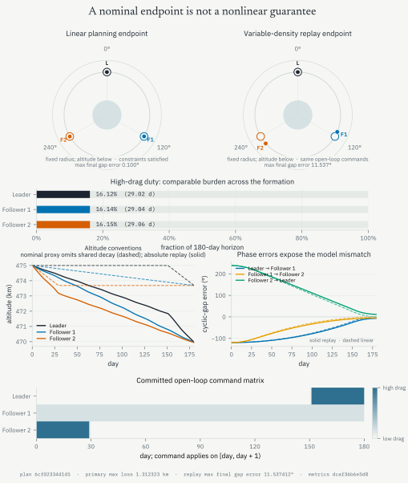
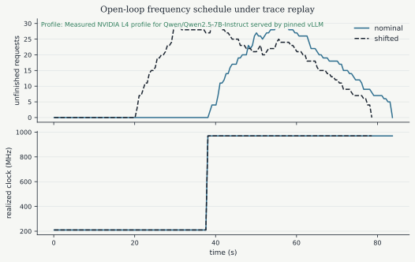

> **Cours de Pierre-Luc Bacon — 06.** [Page publiée](https://pierrelucbacon.com/rlbook/discrete-time-optimal-control) · [Source numérotée](../06-discrete-time-optimal-control.md)
> Extraction HTML → Markdown, effectuée le 2026-10-11. Les formules LaTeX, figures statiques, solutions et liens sont conservés ; les animations nécessitent le site original.

<a id="skip-to-frontmatter"></a>

# Finite-Horizon Optimal Control Problems

<a id="skip-to-article"></a>

The models introduced in the previous chapter predict how actions change a system’s state. Trajectory optimization adds an objective and constraints, then selects the actions that produce a desirable state sequence. For a fixed discrete horizon, the states and controls form a finite vector, so the planning problem can be written as a nonlinear program.

Which finite-dimensional optimization problem selects the best admissible trajectory from one known initial condition?

A **trajectory** is the time-indexed sequence of states $(\mathbf{x}_1,\ldots,\mathbf{x}_T)$ and controls $(\mathbf{u}_1,\ldots,\mathbf{u}_{T-1})$. This chapter first computes the complete control sequence from a known initial state. The sequence is **open loop**: once execution begins, the action at time $t$ does not change in response to the measured state.

The three-satellite example below makes both the value and the limitation of open-loop planning visible. A linear model produces a sparse, feasible plan, but the same immutable plan misses its target when replayed through a nonlinear model. Later chapters will replace the fixed sequence by feedback through receding-horizon control and policies.

Learning Goals

After studying this chapter, you should be able to:

1.  Formulate a discrete-time optimal control problem (DOCP) in Bolza, Lagrange, and Mayer forms, and convert between them.
    
2.  State the KKT conditions for a constrained NLP and explain the role of constraint qualifications.
    
3.  Derive the discrete-time Pontryagin principle from the Lagrangian of a DOCP.
    
4.  Implement single shooting and multiple shooting methods for trajectory optimization.
    
5.  Explain the trade-offs between simultaneous (direct transcription) and sequential (shooting) methods.
    
6.  Compute gradients of the objective with respect to controls using the adjoint (costate) recursion.
    
7.  Audit an immutable open-loop plan under a specified model mismatch.
    

Prerequisites

This chapter uses gradients, Jacobians, the chain rule, matrix-vector products, and linear systems. [Nonlinear Programming](31-appendix-nlp.md) reviews the nonlinear-programming objects used in the KKT derivation. The state and transition models come from [Controlled Systems: Boundaries, States, and Actions](03-modeling-controlled-systems.md).

<a id="a-motivating-example-phasing-three-satellites-with-differential-drag"></a>

## A Motivating Example: Phasing Three Satellites with Differential Drag

What does an open-loop plan gain from a transparent finite-horizon model, and which part of its guarantee disappears when the replay model changes?

Three small satellites are released into nearly the same circular orbit, but the mission calls for them to occupy slots separated by $120^\circ$. They have no propulsion. Each satellite can instead rotate between low- and high-drag attitudes. High drag lowers its orbit slightly; the lower satellite then moves faster and accumulates phase relative to the others. The control authority is weak, slow, and irreversible because every maneuver spends altitude.

Differential drag has been used to phase propulsionless satellite constellations in orbit [Foster _et al._, 2018](https://doi.org/10.2514/1.A33927). Linear programs provide a useful planning model for this control mechanism [Sin _et al._, 2018](https://doi.org/10.23919/ACC.2018.8431408). The example below is a teaching-scale reconstruction inspired by that literature. It is not a reconstruction of a particular flight campaign.

We plan over $N=180$ daily intervals. All three satellites begin at a circular altitude of 475 km, with phase offsets

<a id="bSPCO2yx9I"></a>

$$
\varphi_{0}
=
\begin{bmatrix}-0.5&0&0.5\end{bmatrix}^{\mathsf T}\text{ degrees}
$$

[(1)](#bSPCO2yx9I "Link to this Equation")

and zero relative angular rates. The action

<a id="XqzrqVyg95"></a>

$$
0\leq u_{i,k}\leq1
$$

[(2)](#XqzrqVyg95 "Link to this Equation")

is the fraction of day $k$ that satellite $i$ spends in its high-drag attitude. For the nominal daily model, its state is

<a id="WyGTVpyZCv"></a>

$$
x_{i,k}
=
\begin{bmatrix}
\varphi_{i,k}\\
\omega_{i,k}\\
\ell_{i,k}
\end{bmatrix},
$$

[(3)](#WyGTVpyZCv "Link to this Equation")

where $\varphi$ is phase in degrees, $\omega$ is relative angular rate in degrees per day, and $\ell$ is extra altitude loss in kilometres relative to remaining in the low-drag attitude.

<a id="from-drag-physics-to-a-daily-linear-model"></a>

### From drag physics to a daily linear model

Use SI units in the derivation. With $h_0=475\text{ km}$, set

<a id="A0SJ3qPzt0"></a>

$$
a_0=(R_\mathrm{E}+h_0)\frac{10^3\text{ m}}{1\text{ km}}
=6{,}853{,}137\text{ m},
\qquad
n_0=\sqrt{\mu/a_0^3}.
$$

[(4)](#A0SJ3qPzt0 "Link to this Equation")

At the reference density $\rho_0$, changing the ballistic coefficient from $B_\mathrm{low}$ to $B_\mathrm{high}$ changes the area-to-mass factor by

<a id="FVqxhA8bmi"></a>

$$
\Delta\sigma
=\frac{1}{B_\mathrm{high}}-\frac{1}{B_\mathrm{low}}.
$$

[(5)](#FVqxhA8bmi "Link to this Equation")

Linearizing the semimajor-axis and mean-motion changes over one day gives

<a id="WSplYgGZVV"></a>

$$
\begin{aligned}
d
&=\rho_0\Delta\sigma\sqrt{\mu a_0}\,\Delta t
\left(\frac{1\ {\rm km}}{10^3\ {\rm m}}\right),\\
\alpha
&=\frac{3n_0}{2a_0}
\rho_0\Delta\sigma\sqrt{\mu a_0}\,\Delta t^2
\left(\frac{180^\circ}{\pi\ {\rm rad}}\right),
\end{aligned}
$$

[(6)](#WSplYgGZVV "Link to this Equation")

where $\Delta t=86400$ s. For

<a id="ZFSaJk6pLy"></a>

$$
\begin{gathered}
\rho_0=3\times10^{-13}\ {\rm kg/m^3},\qquad
B_\mathrm{low}=60\ {\rm kg/m^2},\qquad
B_\mathrm{high}=20\ {\rm kg/m^2},\\
R_\mathrm{E}=6378.137\ {\rm km},\qquad
\mu=3.986004418\times10^{14}\ {\rm m^3/s^2},
\end{gathered}
$$

[(7)](#ZFSaJk6pLy "Link to this Equation")

the coefficients are

<a id="lgSUltcnAU"></a>

$$
\alpha=0.0544503\ {\rm deg/day^2},
\qquad
d=0.0451572\ {\rm km/day}.
$$

[(8)](#lgSUltcnAU "Link to this Equation")

The daily dynamics are therefore

<a id="eIICosUom6"></a>

$$
x_{i,k+1}
=
\underbrace{
\begin{bmatrix}
1&1&0\\
0&1&0\\
0&0&1
\end{bmatrix}}_{A}
x_{i,k}
+
\underbrace{
\begin{bmatrix}
\alpha/2\\
\alpha\\
d
\end{bmatrix}}_{B}
u_{i,k}.
$$

[(9)](#eIICosUom6 "Link to this Equation")

The phase receives half of the new daily rate during the interval, the rate accumulates the drag-induced acceleration, and the extra altitude loss accumulates monotonically.

<a id="a-finite-open-loop-plan"></a>

### A finite open-loop plan

Define the cyclic difference matrix

<a id="KwCfyw34eE"></a>

$$
G=
\begin{bmatrix}
-1&1&0\\
0&-1&1\\
1&0&-1
\end{bmatrix}.
$$

[(10)](#KwCfyw34eE "Link to this Equation")

The terminal target is

<a id="dlFVH7aCCz"></a>

$$
G\varphi_N
\approx
\begin{bmatrix}120\\120\\-240\end{bmatrix}
\text{ degrees},
\qquad
G\omega_N\approx0,
$$

[(11)](#dlFVH7aCCz "Link to this Equation")

with tolerances of 0.1 degree and 0.002 degree per day. These are unwrapped directed differences. Because the rows of $G$ sum to zero, the third target is $-240^\circ$, which represents the same circular separation as $+120^\circ$ modulo $360^\circ$ while preserving a consistent unwrapped coordinate system.

The primary linear program minimizes the worst final extra altitude loss:

<a id="JmXCAjb6hH"></a>

$$
\begin{aligned}
\underset{x,u,z}{\operatorname{minimize}}\quad&z\\
\text{subject to}\quad&
x_{i,k+1}=Ax_{i,k}+Bu_{i,k},\\
&\ell_{i,N}\leq z,\qquad 0\leq u_{i,k}\leq1,\\
&\left\lVert G\varphi_N-
\begin{bmatrix}120&120&-240\end{bmatrix}^{\mathsf T}
\right\rVert_\infty\leq0.1,\\
&\lVert G\omega_N\rVert_\infty\leq0.002.
\end{aligned}
$$

[(12)](#JmXCAjb6hH "Link to this Equation")

A second linear program keeps $z$ at its primary optimum, up to numerical tolerance, and minimizes

<a id="ewJ9xcAXhm"></a>

$$
\sum_{i=1}^{3}\sum_{k=0}^{N-2}
\left|u_{i,k+1}-u_{i,k}\right|.
$$

[(13)](#ewJ9xcAXhm "Link to this Equation")

This lexicographic step selects a low-variation member of the primary optimal set without changing the worst-loss objective beyond numerical tolerance.

<a id="nominal-and-nonlinear-replay"></a>

### Nominal and nonlinear replay

The linear plan is first rolled out through the model used by the optimizer. The exact same $u_{i,k}$ is then replayed, without reoptimization, through the nonlinear orbital model

<a id="Pi4sQ0zNvR"></a>

$$
\dot a_i
=-\rho(a_i,t)\,\sigma(u_i)\sqrt{\mu a_i},
\qquad
\dot\theta_i
=\sqrt{\frac{\mu}{a_i^3}},
$$

[(14)](#Pi4sQ0zNvR "Link to this Equation")

where

<a id="XfZogxNcx2"></a>

$$
\begin{aligned}
\sigma(u)
&=\frac{1-u}{B_\mathrm{low}}+\frac{u}{B_\mathrm{high}},\\
\rho(a,t)
&=\rho_0
\left[
0.90+0.15\sin\left(\frac{2\pi t}{26\text{ days}}+\frac{\pi}{6}\right)
\right]
\exp\left(\frac{h_0-h_i}{60\text{ km}}\right),
\qquad
h_i=\frac{a_i-R_\mathrm{E}}{10^3}\text{ km}.
\end{aligned}
$$

[(15)](#XfZogxNcx2 "Link to this Equation")

Here $a_i$ and $R_\mathrm{E}$ are in metres inside the orbital equations, so $h_i$ is the corresponding altitude in kilometres. In the display, the nominal altitude trace is the planning-model proxy $475-\ell_i$ km and therefore omits the common low-drag decay; the nonlinear trace reports absolute orbital altitude.

The nonlinear trajectory is integrated by hourly RK4 and checked against a 30-minute replay. This variable-density model is a deterministic teaching stress test, not a flight-dynamics reconstruction. The complete command sequence is known from day zero; the state traces below are revealed only up to the playhead.

<a id="P7GSyvu9S1"></a>

<a id="fig-cubesat-differential-drag"></a>

<a id="fig-cubesat-differential-drag-code"></a>

```python
from pathlib import Path
import sys

from IPython.display import HTML, display

code_dir = Path.cwd() / "code"
if str(code_dir) not in sys.path:
    sys.path.insert(0, str(code_dir))

from cubesat_replay import render_cubesat_replay

display(HTML(render_cubesat_replay(
    Path("artifacts/cubesat/textbook_results.json"),
    replay_id="cubesat-differential-drag-replay",
    fallback_id="fig-cubesat-differential-drag-fallback",
)))
```

[Figure 1:](#fig-cubesat-differential-drag "Link to this figure")A single open-loop differential-drag plan is evaluated by two plant models. The nominal linear rollout reaches the cyclic slot and relative-rate tolerances. The nonlinear variable-density replay uses the unchanged plan and exposes the accumulated phase miss. The orbit diagrams use a fixed radius; altitude differences are reported numerically rather than exaggerated geometrically.

<a id="fig-cubesat-differential-drag-outputs"></a>

Loading...

<a id="fig-cubesat-differential-drag-fallback"></a>

<a id="McMUstEUjJ"></a>


[Figure 2:](#fig-cubesat-differential-drag-fallback "Link to this figure")Static audit of the immutable differential-drag plan. The online book adds synchronized playback and scrubbing while keeping the full planned command heatmap visible from the start.

The lexicographic solve limits the largest nominal extra altitude loss to 1.312323 km, then reduces total variation from 33.701181 to 2.000000 without changing that primary answer beyond the declared lock tolerance.

At day 180, the linear planning model reaches a maximum cyclic-gap error of $0.100000^\circ$ and a maximum cyclic relative rate of $0.002000^\circ/\mathrm{day}$. Replaying the identical command matrix through the variable-density model raises those values to $11.537412^\circ$ and $0.031144^\circ/\mathrm{day}$. The optimization result is therefore a statement about the planning model, not a guarantee for the replay model.

| spacecraft | high-drag equivalent (day) | duty | nominal final loss (km) | nonlinear final loss (km) | nonlinear altitude (km) |
| --- | --- | --- | --- | --- | --- |
| Leader | 29.024453 | 16.125% | 1.310664 | 1.262074 | 469.966466 |
| Follower 1 | 29.044961 | 16.136% | 1.311590 | 1.269299 | 469.959242 |
| Follower 2 | 29.061184 | 16.145% | 1.312323 | 1.287855 | 469.940685 |

| directed cyclic gap | target (degrees) | nominal final (degrees) | nominal error (degrees) | nonlinear final (degrees) | nonlinear error (degrees) |
| --- | --- | --- | --- | --- | --- |
| Leader to Follower 1 | 120.000 | 119.900000 | \-0.100000 | 113.231784 | \-6.768216 |
| Follower 1 to Follower 2 | 120.000 | 120.000000 | \-0.000000 | 115.230804 | \-4.769196 |
| Follower 2 to Leader | \-240.000 | \-239.900000 | 0.100000 | \-228.462588 | 11.537412 |

The hourly RK4 replay agrees with a 30-minute reference to within $3.101e-09^\circ$ in phase, $6.333e-11^\circ/\mathrm{day}$ in relative rate, and 3.183e-11 km in altitude. Its sampled density spans 2.264e-13 to 3.403e-13 kg/m³.

All 15 deterministic acceptance checks pass. This is a transparent stress test of one open-loop teaching model, not a flight-operations prescription.

[Download the open-loop plan (CSV)](../Assets/Website/692b743c72-open_loop_plan-63d27294d07480cd724dcc861674a5b5.csv)

[Download the audit metrics (CSV)](../Assets/Website/fffc58d678-metrics-52526989adf113cc41db588c9d2fd193.csv)

The nominal rollout establishes feasibility for the optimization model. The nonlinear replay tests the same plan under the declared model change, and the terminal phase constraints fail. [Closing the loop by replanning](12-receding-horizon-control.md#closing-the-loop-by-replanning) will replace the immutable schedule by controls that can change when new state measurements arrive.

The example already contains the ingredients of a **discrete-time optimal control problem** (DOCP): a state $x_{i,k}$, a bounded control $u_{i,k}$, a transition map, terminal constraints, and an objective accumulated over a finite horizon. We now formalize that structure.

<a id="discrete-time-optimal-control-problems-docps"></a>

## Discrete-Time Optimal Control Problems (DOCPs)

Which variables, costs, dynamics, and constraints place the satellite planner inside a reusable finite-horizon control template?

Consider a system described by a **state** $\mathbf{x}_t \in \mathbb{R}^n$, summarizing everything needed to predict its evolution. At each stage $t$, we can influence the system through a **control input** $\mathbf{u}_t \in \mathbb{R}^m$. The dynamics specify how the state evolves:

<a id="OTwjPR4dIP"></a>

$$
\mathbf{x}_{t+1} = \mathbf{f}_t(\mathbf{x}_t, \mathbf{u}_t),
$$

[(16)](#OTwjPR4dIP "Link to this Equation")

where $\mathbf{f}_t$ may be nonlinear or time-varying. We assume the initial state $\mathbf{x}_1$ is known.

The goal is to pick a sequence of controls $\mathbf{u}_1,\dots,\mathbf{u}_{T-1}$ that makes the trajectory desirable. But desirable in what sense? That depends on an **objective function**, which often includes two components:

<a id="KaabskmPe3"></a>

$$
\text{(i) stage cost: } c_t(\mathbf{x}_t,\mathbf{u}_t), \qquad \text{(ii) terminal cost: } c_T(\mathbf{x}_T).
$$

[(17)](#KaabskmPe3 "Link to this Equation")

The stage cost reflects ongoing penalties such as energy, delay, or risk. The terminal cost measures the value (or cost) of ending in a particular state. Together, these give a discrete-time Bolza problem with path constraints and bounds:

<a id="STPr0yKUJe"></a>

$$
\begin{aligned}
    \text{minimize} \quad & c_T(\mathbf{x}_T) + \sum_{t=1}^{T-1} c_t(\mathbf{x}_t,\mathbf{u}_t) \\
    \text{subject to} \quad & \mathbf{x}_{t+1} = \mathbf{f}_t(\mathbf{x}_t,\mathbf{u}_t) \\
                            & \mathbf{g}_t(\mathbf{x}_t,\mathbf{u}_t) \leq \mathbf{0} \\
                            & \mathbf{x}_{\text{min}} \leq \mathbf{x}_t \leq \mathbf{x}_{\text{max}} \\
                            & \mathbf{u}_{\text{min}} \leq \mathbf{u}_t \leq \mathbf{u}_{\text{max}} \\
    \text{given} \quad & \mathbf{x}_1 = \mathbf{x}_0 \enspace .
\end{aligned}
$$

[(18)](#STPr0yKUJe "Link to this Equation")

In the satellite example, $\mathbf{x}_t$ stacks the three phase, relative-rate, and altitude-loss states; $\mathbf{u}_t$ stacks the three daily drag fractions; and $\mathbf{f}_t$ applies the block-diagonal copies of the daily map. The terminal inequalities impose the cyclic slot and rate tolerances, while the epigraph variable $z$ represents the worst altitude loss. This mapping also shows why state values can appear explicitly as decision variables even when a deterministic rollout could reconstruct them from the controls.

Written this way, it may seem obvious that the decision variables are the controls $\mathbf{u}_t$. After all, in most intuitive descriptions of control, we think of choosing inputs to influence the system. But notice that in the program above, the entire state trajectory also appears as a set of variables, linked to the controls by the dynamics constraints. This is intentional: it reflects one way of writing the problem that makes the constraints explicit.

Why introduce $\mathbf{x}_t$ as decision variables if they can be simulated forward from the controls? Many readers hesitate here, and the question is natural: _If the model is deterministic and $\mathbf{x}_1$ is known, why not pick $\mathbf{u}_{1:T-1}$ and compute $\mathbf{x}_{2:T}$ on the fly?_ That instinct leads to **single shooting**, a method we will return to shortly.

Already in this formulation, though, **the structure of the problem matters**. Ignoring it can make our life much harder. The reason is twofold:

-   **Dimensionality grows with the horizon.** For a horizon of length $T$, the program has roughly $(T-1)(m+n)$ decision variables.
    
-   **Temporal coupling.** Each control affects all future states and costs. The feasible set is not a simple box but a narrow manifold defined by the dynamics.
    

Together, these features explain why specialized methods exist and why the way we write the problem influences the algorithms we can use. Whether we keep states explicit or eliminate them through forward simulation determines the problem size, its conditioning, and the trade-offs between robustness and computational effort.

<a id="existence-of-solutions-and-optimality-conditions"></a>

## Existence of Solutions and Optimality Conditions

Writing the problem as a nonlinear program does not ensure that a minimizer exists or that a candidate is locally optimal. Which conditions supply those two claims?

Now that we have the optimization problem written down, we can ask: does it always have a solution? And if so, how do we recognize one? These questions lead us to feasibility and optimality conditions.

<a id="existence-of-solutions"></a>

### Existence of Solutions

Notice first that nothing in the problem statement required the dynamics

<a id="hBapKLe5JZ"></a>

$$
\mathbf{x}_{t+1} = \mathbf{f}_t(\mathbf{x}_t,\mathbf{u}_t)
$$

[(19)](#hBapKLe5JZ "Link to this Equation")

to be stable. In fact, many problems of interest involve unstable systems; think of balancing a pole or steering a spacecraft. What matters is that the dynamics are **well defined**: given a state–control pair, the rule $\mathbf{f}_t$ produces a valid next state.

In continuous time, one usually requires $\mathbf{f}$ to be continuous (often Lipschitz continuous) in $\mathbf{x}$ so that the ODE has a unique solution on the horizon of interest. In discrete time, the requirement is lighter: we only need the update map to be well posed.

Existence also hinges on **feasibility**. A candidate control sequence must generate a trajectory that respects all constraints: the dynamics, any bounds on state and control, and any terminal requirements. If no such sequence exists, the feasible set is empty and the problem has no solution. This can happen if the constraints are overly strict, or if the system is uncontrollable from the given initial condition.

<a id="optimality-conditions"></a>

### Optimality Conditions

Assume the feasible set is nonempty. Necessary conditions for a local minimum follow from the Lagrange multiplier theorem. They supply equations for candidate solutions, although satisfying them alone need not establish a minimum. For a smooth problem

<a id="yHAUdzRfTu"></a>

$$
\begin{aligned}
\min_{\mathbf{z}}\quad & F(\mathbf{z})\\
\text{s.t.}\quad & H(\mathbf{z})=\mathbf{0},\\
& G(\mathbf{z})\le \mathbf{0},
\end{aligned}
$$

[(20)](#yHAUdzRfTu "Link to this Equation")

Here $G$ stacks inequalities of the form $g_i\leq0$, and $H$ stacks equalities of the form $h_i=0$. Define the **Lagrangian**

<a id="WGJHvurOW6"></a>

$$
\mathcal{L}(\mathbf{z},\boldsymbol{\lambda},\boldsymbol{\mu})
= F(\mathbf{z})+\boldsymbol{\lambda}^{\top}H(\mathbf{z})+\boldsymbol{\mu}^{\top}G(\mathbf{z}),\qquad \boldsymbol{\mu}\ge \mathbf{0}.
$$

[(21)](#WGJHvurOW6 "Link to this Equation")

The positive sign before the inequality term follows from the convention $G(\mathbf z)\le \mathbf0$: a violation $G_i(\mathbf z)>0$ increases the Lagrangian when $\mu_i>0$. Equality multipliers remain unrestricted. For a candidate point $\mathbf z$, the **active set** is

<a id="h5ghJapXF2"></a>

$$
\mathcal{A}(\mathbf{z}) \;=\; \{\, i \;:\; G_i(\mathbf{z})=0 \,\},
$$

[(22)](#h5ghJapXF2 "Link to this Equation")

while indices with $G_i(\mathbf{z})<0$ are **inactive**. Only active inequalities can carry positive multipliers.

A **constraint qualification** is a regularity assumption under which a local minimum admits Lagrange multipliers. One sufficient choice is the **Linear Independence Constraint Qualification (LICQ)**: the equality gradients and active inequality gradients at the candidate are linearly independent. If $J_H$ and $J_{G_{\mathcal A}}$ have those gradients as rows, LICQ requires

<a id="U3fbd7lePJ"></a>

$$
\begin{bmatrix}J_H(\mathbf z^\star)\\J_{G_{\mathcal A}}(\mathbf z^\star)\end{bmatrix}
\quad\text{to have full row rank.}
$$

[(23)](#U3fbd7lePJ "Link to this Equation")

This assumption guarantees multiplier existence at a local minimum. It does not by itself make the Newton system for the optimality conditions invertible; that also depends on the objective and constraint curvature.

Under such a constraint qualification, any local minimizer $\mathbf{z}^\star$ admits multipliers $(\boldsymbol{\lambda}^\star,\boldsymbol{\mu}^\star)$ that satisfy the **Karush–Kuhn–Tucker (KKT) conditions**:

<a id="AGTJAP1K26"></a>

$$
\begin{aligned}
&\text{stationarity:} && \nabla_{\mathbf{z}}\mathcal{L}(\mathbf{z}^\star,\boldsymbol{\lambda}^\star,\boldsymbol{\mu}^\star)=\mathbf{0},\\
&\text{primal feasibility:} && H(\mathbf{z}^\star)=\mathbf{0},\quad G(\mathbf{z}^\star)\le \mathbf{0},\\
&\text{dual feasibility:} && \boldsymbol{\mu}^\star\ge \mathbf{0},\\
&\text{complementarity:} && \mu_i^\star\,G_i(\mathbf{z}^\star)=0\quad \text{for all } i.
\end{aligned}
$$

[(24)](#AGTJAP1K26 "Link to this Equation")

Complementarity requires $\mu_i^\star=0$ when $G_i(\mathbf z^\star)<0$. At a tight constraint, the multiplier may be positive or zero. Under suitable sensitivity assumptions, multipliers quantify changes in the optimal value when constraint right-hand sides change, with signs determined by the chosen perturbation convention.

In trajectory problems, $\mathbf z$ stacks states and controls, $H$ enforces the dynamics, and $G$ collects bounds and path constraints. The equality multipliers associated with dynamics become Pontryagin costates when the residual is written $\mathbf f_t-\mathbf x_{t+1}$. Writing the residual in the opposite order reverses the multiplier sign. Terminal-equality multipliers are denoted separately by $\boldsymbol\nu$ in that derivation. Since nonlinear dynamics generally make these programs nonconvex, KKT is a necessary first-order test under regularity. It does not generally imply a local minimum of the Lagrangian or a global saddle point.

If LICQ fails, a different constraint qualification may still apply. Without an applicable qualification, multipliers can fail to exist or be nonunique. Redundant dynamic or path constraints can also make numerical systems singular or poorly conditioned.

<a id="from-kkt-to-algorithms"></a>

### From KKT to algorithms

The Lagrangian gives an exact min–max representation of the constrained problem, whether or not the problem is convex:

<a id="gRBS7rb9QB"></a>

$$
p^\star=\inf_{\mathbf z}
\sup_{\boldsymbol\lambda,\,\boldsymbol\mu\ge\mathbf0}
\mathcal L(\mathbf z,\boldsymbol\lambda,\boldsymbol\mu),
\qquad
\mathcal L=F+\boldsymbol\lambda^\top H+\boldsymbol\mu^\top G.
$$

[(25)](#gRBS7rb9QB "Link to this Equation")

Here $\boldsymbol\lambda$ is unrestricted. For a feasible $\mathbf z$, the inner supremum equals $F(\mathbf z)$. If an equality is violated, its multiplier can choose a sign and magnitude that makes the Lagrangian arbitrarily large. If $G_i(\mathbf z)>0$, sending $\mu_i$ to infinity does the same. Thus the multiplier player’s response assigns $+\infty$ to every infeasible choice.

Reversing the order gives the dual value, a lower bound on the primal value:

<a id="FwbWhicENw"></a>

$$
d^\star=\sup_{\boldsymbol\lambda,\,\boldsymbol\mu\ge\mathbf0}
\inf_{\mathbf z}\mathcal L(\mathbf z,\boldsymbol\lambda,\boldsymbol\mu)
\le p^\star.
$$

[(26)](#FwbWhicENw "Link to this Equation")

The distinction is whether the multipliers can respond to each candidate or must be fixed before the candidate is chosen. A **saddle point** requires one fixed multiplier pair for which $\mathbf z^\star$ globally minimizes the Lagrangian, together with optimal multipliers against that fixed $\mathbf z^\star$. Such a pair satisfies

<a id="p21Ng26VVt"></a>

$$
\mathcal L(\mathbf z^\star,\boldsymbol\lambda,\boldsymbol\mu)
\le\mathcal L(\mathbf z^\star,\boldsymbol\lambda^\star,\boldsymbol\mu^\star)
\le\mathcal L(\mathbf z,\boldsymbol\lambda^\star,\boldsymbol\mu^\star)
$$

[(27)](#p21Ng26VVt "Link to this Equation")

for all $\mathbf z$, unrestricted $\boldsymbol\lambda$, and $\boldsymbol\mu\ge\mathbf0$. Solving the primal min–max problem alone does not guarantee this property. For example, minimizing $-z^2$ subject to $z=0$ has the unique feasible optimizer $z^\star=0$ and KKT multiplier $\lambda^\star=0$, yet $\mathcal L(z,0)=-z^2$ is maximized at zero.

When $F$ is convex, each $G_i$ is convex, and $H$ is affine, the Lagrangian is convex in $\mathbf z$. KKT stationarity then guarantees its global minimum; feasibility and complementarity give the other saddle inequality. An existing KKT point is therefore sufficient for a global saddle point. Slater’s condition, the existence of a point with $H=0$ and $G_i<0$ for every inequality, guarantees suitable multipliers at an attained finite optimizer in this convex setting. The [nonlinear-programming appendix](31-appendix-nlp.md#the-lagrangian-duality-and-optimality-conditions) derives these statements and distinguishes them from the necessary conditions used in nonconvex trajectory optimization.

<a id="primal-dual-gradient-dynamics-arrow-hurwicz"></a>

#### Primal–dual gradient dynamics (Arrow–Hurwicz)

A first-order method takes a descent step in the primal variables and an ascent step in the multipliers, projecting the inequality multipliers back onto their allowed set:

<a id="lDLkedOb1Y"></a>

$$
\begin{aligned}
\mathbf{z}^{k+1} &= \mathbf{z}^{k}-\alpha_k\big(\nabla F(\mathbf{z}^{k})+J_H(\mathbf{z}^{k})^{\top}\boldsymbol{\lambda}^{k}+J_G(\mathbf{z}^{k})^{\top}\boldsymbol{\mu}^{k}\big),\\[2mm]
\boldsymbol{\lambda}^{k+1} &= \boldsymbol{\lambda}^{k}+\beta_k\,H(\mathbf{z}^{k}),\\[1mm]
\boldsymbol{\mu}^{k+1} &= \Pi_{\ge 0}\!\big(\boldsymbol{\mu}^{k}+\beta_k\,G(\mathbf{z}^{k})\big).
\end{aligned}
$$

[(28)](#lDLkedOb1Y "Link to this Equation")

Here $\Pi_{\ge0}$ clips each negative component to zero. With the convention $G\le0$, a violated inequality increases its multiplier. These finite updates do not perform the inner supremum in the exact primal representation, and saddle-point existence alone does not guarantee their convergence. Even the convex bilinear case $\mathcal L(z,\lambda)=\lambda z$ has simultaneous updates with eigenvalues $1\pm i\sqrt{\alpha\beta}$ for fixed positive steps, whose magnitudes exceed one.

Additional curvature assumptions or algorithmic modifications are needed for convergence. Penalty and augmented-Lagrangian methods add terms that discourage violations. For example, one can use the penalized Lagrangian

<a id="ZKGUXxF9iW"></a>

$$
\mathcal{L}_\rho(\mathbf{z},\boldsymbol{\lambda},\boldsymbol{\mu})
= \mathcal{L}(\mathbf{z},\boldsymbol{\lambda},\boldsymbol{\mu})
+\tfrac{\rho}{2}\|H(\mathbf{z})\|^2
+\tfrac{\rho}{2}\|\max\{0,G(\mathbf{z})\}\|^2,
$$

[(29)](#ZKGUXxF9iW "Link to this Equation")

where $\rho>0$ weights squared equality residuals and inequality violations. These terms change the curvature away from feasibility. Their use still requires a suitable step-selection or subproblem strategy; adding them alone is not a convergence guarantee.

<a id="sec-sqp-newton"></a>

#### SQP as Newton on the KKT system (equality case)

With **only equality constraints** $H(\mathbf{z})=\mathbf{0}$, write first-order conditions

<a id="eeOOJdYSS0"></a>

$$
\nabla_{\mathbf{z}}\mathcal{L}(\mathbf{z},\boldsymbol{\lambda})=\mathbf{0},
\qquad
H(\mathbf{z})=\mathbf{0},
\quad \text{where }\mathcal{L}=F+\boldsymbol{\lambda}^{\top}H.
$$

[(30)](#eeOOJdYSS0 "Link to this Equation")

Applying Newton’s method to this system gives the linear KKT solve

<a id="KnTiU9eNoi"></a>

$$
\begin{bmatrix}
\nabla_{\mathbf{z}\mathbf{z}}^2\mathcal{L}(\mathbf{z}^k,\boldsymbol{\lambda}^k) & J_H(\mathbf{z}^k)^{\top}\\
J_H(\mathbf{z}^k) & 0
\end{bmatrix}
\begin{bmatrix}
\Delta \mathbf{z}\\ \Delta \boldsymbol{\lambda}
\end{bmatrix}
=
-
\begin{bmatrix}
\nabla_{\mathbf{z}}\mathcal{L}(\mathbf{z}^k,\boldsymbol{\lambda}^k)\\
H(\mathbf{z}^k)
\end{bmatrix}.
$$

[(31)](#KnTiU9eNoi "Link to this Equation")

The same step has an optimization interpretation. With $B_k=\nabla^2_{\mathbf z\mathbf z}\mathcal L(\mathbf z^k,\boldsymbol\lambda^k)$, **Sequential Quadratic Programming (SQP)** chooses a displacement $\Delta\mathbf z$ by solving the quadratic program

<a id="HX0W4SgAou"></a>

$$
\boxed{
\begin{aligned}
\underset{\Delta\mathbf z}{\operatorname{minimize}}\quad&
\nabla F(\mathbf z^k)^\top\Delta\mathbf z
+\frac12\Delta\mathbf z^\top B_k\Delta\mathbf z\\
\text{subject to}\quad&
H(\mathbf z^k)+J_H(\mathbf z^k)\Delta\mathbf z=\mathbf0.
\end{aligned}}
$$

[(32)](#HX0W4SgAou "Link to this Equation")

The quadratic objective retains a slope, $\nabla F(\mathbf z^k)$, and a curvature matrix, $B_k$. Its gradient changes linearly with the proposed displacement: $\nabla F(\mathbf z^k)+B_k\Delta\mathbf z$. This lets the model predict how the benefit of moving in a direction changes as we move farther. The constant $F(\mathbf z^k)$ can be omitted because it does not affect which step minimizes the model.

Linearizing a constraint means replacing its value at the trial point by its current value plus its predicted first-order change. Thus the QP asks $J_H(\mathbf z^k)\Delta\mathbf z$ to cancel the current residual $H(\mathbf z^k)$. At a feasible iterate, this becomes $J_H(\mathbf z^k)\Delta\mathbf z=\mathbf0$: the step lies in the tangent space to the constraints. These are _affine_ constraints on the step, meaning linear expressions plus constants.

Why use the Lagrangian’s Hessian in the quadratic objective? For equality constraints it is

<a id="ECjOg8fEil"></a>

$$
B_k=\nabla^2 F(\mathbf z^k)
+\sum_i\lambda_i^k\nabla^2 H_i(\mathbf z^k).
$$

[(33)](#ECjOg8fEil "Link to this Equation")

The additional terms carry information about the curvature of the constraints, weighted by their multipliers. The QP therefore uses a quadratic model designed for the constrained problem; it is generally different from the second-order Taylor expansion of $F$ alone. Its connection to Newton’s method explains this choice. If $\boldsymbol\lambda_{\mathrm{QP}}$ denotes the multiplier of the QP equality, the QP’s stationarity and feasibility conditions are

<a id="NSunbEXSaH"></a>

$$
\begin{bmatrix}
B_k & J_H(\mathbf z^k)^\top\\
J_H(\mathbf z^k) & 0
\end{bmatrix}
\begin{bmatrix}
\Delta\mathbf z\\ \boldsymbol\lambda_{\mathrm{QP}}
\end{bmatrix}
=-
\begin{bmatrix}
\nabla F(\mathbf z^k)\\ H(\mathbf z^k)
\end{bmatrix}.
$$

[(34)](#NSunbEXSaH "Link to this Equation")

Substitute $\boldsymbol\lambda_{\mathrm{QP}}=\boldsymbol\lambda^k+
\Delta\boldsymbol\lambda$ and move $J_H(\mathbf z^k)^\top\boldsymbol\lambda^k$ to the right-hand side. This gives exactly the Newton system above. The QP multiplier is thus the new multiplier estimate for a full step; its difference from the old estimate is the Newton multiplier increment.

With inequalities $G(\mathbf z)\le\mathbf0$, the QP also includes

<a id="NNg6pdaUQp"></a>

$$
G(\mathbf z^k)+J_G(\mathbf z^k)\Delta\mathbf z\le\mathbf0.
$$

[(35)](#NNg6pdaUQp "Link to this Equation")

The Hessian $B_k$ then includes $\sum_i\mu_i^k\nabla^2G_i(\mathbf z^k)$, and the QP returns inequality multipliers $\boldsymbol\mu_{\mathrm{QP}}\ge\mathbf0$ as well.

The computational benefit comes from fixing these matrices for the duration of each QP solve. The solver works with a quadratic function and flat constraint boundaries, without repeatedly differentiating the original nonlinear functions. In the equality case, one linear KKT solve gives the unique QP minimizer when $J_H$ has full row rank and $B_k$ is positive definite on nonzero directions $\mathbf v$ satisfying $J_H\mathbf v=\mathbf0$. With inequalities, an **active-set method** selects candidate tight constraints and solves equality-constrained QPs, updating the selection as needed. An **interior-point method** handles the inequalities through slacks and perturbed complementarity equations, solving related linear systems. Both approaches can exploit sparse matrix factorizations. The [NEOS guide to QP algorithms](https://neos-guide.org/guide/algorithms/qp/) develops these two approaches.

Consecutive subproblems often share their pattern of nonzero entries, so solvers can reuse the ordering used for sparse elimination and start from previous primal and dual estimates. A numerical factorization can also be reused when its coefficient matrix stays unchanged; changing the Hessian or constraint Jacobians generally requires updating or recomputing it. [OSQP](https://osqp.org/docs/) provides one implementation of factorization reuse and warm starts for convex QPs. In trajectory optimization, each dynamics constraint couples neighboring time steps, which gives the matrices a sparse block structure. With stagewise quadratic costs, linearized dynamics, and no additional inequalities, suitable QPs can be solved by a Riccati recursion as in LQR.

The exact Lagrangian Hessian need not give a convex QP away from a solution. Practical SQP methods often modify it or use a positive-definite approximation. For a least-squares objective, a Gauss–Newton approximation provides positive-semidefinite curvature; adding a positive multiple of the identity makes it positive definite. These choices give modified Newton steps. Finally, satisfying the linearized constraints does not ensure nonlinear feasibility at $\mathbf z^k+\Delta\mathbf z$. A line search or trust region checks progress using the original objective and constraints and controls how far to move before constructing the next QP.

<a id="further-sources-of-discrete-time-optimal-control-problems"></a>

## Further Sources of Discrete-Time Optimal-Control Problems

Beyond sampled physical dynamics, which computations and continuous-time models produce the same temporally coupled optimization structure?

The satellite planner begins from a deliberately discretized daily model. Other problems are discrete because decisions naturally occur at stages, while still others inherit a discrete transition from numerical integration or program execution. The next two constructions make those latter connections explicit.

<a id="docps-arising-from-the-discretization-of-continuous-time-ocps"></a>

### DOCPs Arising from the Discretization of Continuous-Time OCPs

Although many applications are natively discrete-time, it is also common to obtain a DOCP by discretizing a continuous-time formulation. Consider a system on $[0, T_c]$ given by

<a id="dT8vhPUOWO"></a>

$$
\dot{\mathbf{x}}(t) = \mathbf{f}(\mathbf{x}(t), \mathbf{u}(t),t), \qquad \mathbf{x}(0) = \mathbf{x}_0.
$$

[(36)](#dT8vhPUOWO "Link to this Equation")

Choose a step size $\Delta > 0$ and grid $t_k = k\,\Delta$. A one-step integration scheme induces a discrete map $\mathbf{F}_\Delta$ so that

<a id="ZVQLs5aRKl"></a>

$$
\mathbf{x}_{k+1} = \mathbf{F}_\Delta(\mathbf{x}_k, \mathbf{u}_k, t_k),\qquad k=0,\dots, T-1,
$$

[(37)](#ZVQLs5aRKl "Link to this Equation")

where, for example, explicit Euler gives $\mathbf{F}_\Delta(\mathbf{x},\mathbf{u},t) = \mathbf{x} + \Delta\,\mathbf{f}(\mathbf{x},\mathbf{u},t)$. The resulting discrete-time optimal control problem takes the Bolza form with these induced dynamics:

<a id="CdgZ4DKVol"></a>

$$
\begin{aligned}
\min_{\{\mathbf{x}_k,\mathbf{u}_k\}}\; & c_T(\mathbf{x}_T) + \sum_{k=0}^{T-1} c_k(\mathbf{x}_k,\mathbf{u}_k) \\
\text{s.t.}\; & \mathbf{x}_{k+1} - \mathbf{F}_\Delta(\mathbf{x}_k,\mathbf{u}_k, t_k) = 0,\quad k=0,\dots,T-1, \\
& \mathbf{x}_0 = \mathbf{x}_\mathrm{init}.
\end{aligned}
$$

[(38)](#CdgZ4DKVol "Link to this Equation")

<a id="programs-as-docps-and-differentiable-programming"></a>

### Programs as DOCPs and Differentiable Programming

It is often useful to view a computer program itself as a discrete-time dynamical system. Let the **program state** collect memory, buffers, and intermediate variables, and let the **control** represent inputs or tunable decisions at each step. A single execution step defines a transition map

<a id="xASuLSBsCp"></a>

$$
\mathbf{x}_{k+1}=\Phi_k(\mathbf{x}_k,\mathbf{u}_k),
$$

[(39)](#xASuLSBsCp "Link to this Equation")

and a scalar objective (e.g., loss, error, runtime, energy) yields a DOCP:

<a id="exEOH76K8v"></a>

$$
\min_{\{\mathbf{u}_k\}} \; c_T(\mathbf{x}_T)+\sum_{k=0}^{T-1} c_k(\mathbf{x}_k,\mathbf{u}_k)
\quad\text{s.t.}\quad \mathbf{x}_{k+1}=\Phi_k(\mathbf{x}_k,\mathbf{u}_k).
$$

[(40)](#exEOH76K8v "Link to this Equation")

In differentiable programming (e.g., JAX, PyTorch), the composed map $\Phi_{T-1}\circ\cdots\circ\Phi_0$ is differentiable, enabling reverse-mode automatic differentiation and efficient gradient-based trajectory optimization. When parts of the program are non-differentiable (discrete branches, simulators with events), DOCPs can still be solved using derivative-free or weak-gradient methods (eg. finite differences, SPSA, Nelder–Mead, CMA-ES, or evolutionary strategies) optionally combined with smoothing, relaxations, or stochastic estimators to navigate non-smooth regions.

<a id="example-offline-frequency-planning-for-inference"></a>

#### Example: Offline Frequency Planning for Inference

The inference service from the [model-interface chapter](05-model-interfaces.md#inference-serving-as-a-controlled-system) is also a program with a controllable execution rate. Its service-rate and phase-power curves come from a measured NVIDIA L4 profile. The request and queue trajectories below come from a simulator calibrated with those curves, not from running each controller on the GPU. The scheduling rule is held fixed. Each 0.1-second simulator step prioritizes decode or begins with a prefill chunk capped at 512 tokens. If that chunk finishes early, the remaining service budget may return to decode. Active decode receives alternating-step or cache-pressure priority. This reduced interleaving model is not a reproduction of the vLLM scheduler used for profiling. The control sequence specifies one normalized GPU frequency for each second of a 60-second horizon,

<a id="oEwxilsst9"></a>

$$
u_k=\frac{f_k-f_{\min}}{f_{\max}-f_{\min}}\in[0,1].
$$

[(41)](#oEwxilsst9 "Link to this Equation")

An aggregate state collects queued prefill work, active decode work, temperature, and the preceding frequency:

<a id="diRWZSs46I"></a>

$$
x_k=(p_k,d_k,T_k,f_{k-1}),
\qquad
x_{k+1}=F_k(x_k,u_k,w_k).
$$

[(42)](#diRWZSs46I "Link to this Equation")

The disturbance $w_k$ contains the arrival times and prompt lengths predicted for second $k$. Future output lengths remain hidden. The planner substitutes the trace distribution’s expected output length, while the request-level replay uses each realized length only as a disturbance. Service and power in $F_k$ interpolate the committed profile whose provenance is displayed with the result. The request-level simulator remains outside the optimizer and validates the resulting schedule after the solve.

The 60-second workload is selected before optimization by a deterministic, capacity-screened rule. The rule scans ten-second-aligned windows after load normalization, discards any window whose forecast work exceeds the horizon’s maximum-clock service capacity, and requires an occupied burst that can be moved twenty seconds earlier. Among the remaining windows, it chooses the shift-eligible burst with the largest forecast work; total window work and then earlier source time break ties. The selected source interval is $[890,950)$ seconds in the normalized trace and is rebased to start at zero. Its 48 requests require 51.936 seconds of forecast work at maximum clock, or 86.56% of the horizon’s capacity. The chosen burst occupies $[40,50)$ seconds after rebasing and contains 31 requests. The shifted replay moves those requests to $[20,30)$ seconds.

The offline problem uses the complete nominal arrival forecast. It introduces a normalized service decision $\nu_k\in[\nu_{\min},1]$ and a nonnegative backlog variable $B_{k+1}$. If $W_k$ is arriving work in seconds of highest-clock service, their fluid balance is relaxed to

<a id="ajLnBFn4t7"></a>

$$
\begin{aligned}
\underset{\nu_0,\ldots,\nu_{59},B_1,\ldots,B_{60}}
{\operatorname{minimize}}\quad
&\sum_{k=0}^{59}\left[\alpha_P\nu_k+20B_{k+1}\right]
+20B_{60}\\
\text{subject to}\quad
&B_{k+1}\geq B_k+W_k-\Delta t\,\nu_k,\qquad B_0=0,\\
&B_{k+1}\geq0,\qquad \nu_{\min}\leq\nu_k\leq1.
\end{aligned}
$$

[(43)](#ajLnBFn4t7 "Link to this Equation")

The coefficient $\alpha_P$ is the slope of a linear interpolation between the lowest- and highest-clock normalized power values. The backlog term prices waiting throughout the horizon, while the additional terminal term discourages postponing work beyond second 60. This is a linear program, solved with HiGHS. The service decisions are mapped through the profiled service curve to continuous frequencies. Execution rounds each frequency downward to the nearest profiled requested clock, so the request-level validation includes the actuator’s finite action set. The replay reports the corresponding measured median realized clock separately; a requested level and its realized clock need not coincide under the experimental power cap.

This planning model deliberately omits request identities, phase-specific queues, clock slew, and the nonlinear thermal state. The detailed replay restores those variables and reports power, temperature, latency, and memory violations. The optimizer therefore supplies an offline plan from a tractable aggregate model, while the replay audits the assumptions used to obtain it.

The experiment asks what a one-shot frequency schedule gains from a perfect nominal arrival and prompt-length forecast, and what it loses when that forecast is wrong. Future output lengths remain uncertain in both cases. The same plan is replayed twice. The nominal replay uses the forecast supplied to the optimizer. The shifted replay uses the earlier arrival times defined above. No reoptimization occurs after either replay starts.

<a id="DyCXyv0PJq"></a>

<a id="fig-inference-open-loop"></a>

<a id="fig-inference-open-loop-code"></a>

```python
from pathlib import Path
import sys

from IPython.display import HTML, display

code_dir = Path.cwd() / "code"
if str(code_dir) not in sys.path:
    sys.path.insert(0, str(code_dir))

from inference_replay import render_serving_replay

display(HTML(render_serving_replay(
    Path("artifacts/inference_serving/textbook_results.json"),
    view="open_loop",
)))
```

[Figure 3:](#fig-inference-open-loop "Link to this figure")The optimized clock schedule is computed once from the nominal 60-second request forecast. The shifted replay moves the selected work burst twenty seconds earlier while keeping the planned clocks fixed. Both request-level trajectories are simulations calibrated by measured NVIDIA L4 service-rate and phase-power curves. The playhead reveals only the executed trajectory prefix; the dashed schedule is the plan available at time zero.

<a id="fig-inference-open-loop-outputs"></a>

Loading...

<a id="fig-inference-open-loop-fallback"></a>

<a id="eRm3BjVBc0"></a>


[Figure 4:](#fig-inference-open-loop-fallback "Link to this figure")Static comparison of the nominal and shifted-burst replays. The online book adds playback and a controller selector.

The table reports request-level results for the fixed offline schedule under its nominal forecast and the shifted-burst disturbance. Both columns use the same requests, controller parameters, and measured profile calibration.

<a id="bAojVoWYzp"></a>

```python
import pandas as pd

open_loop_metrics = pd.read_csv(
    "artifacts/inference_serving/metrics_open_loop.csv"
).set_index("controller")
open_loop_metrics[
    [
        "mean_ttft_s",
        "p95_ttft_s",
        "matched_moved_burst_mean_ttft_s",
        "matched_moved_burst_p95_ttft_s",
        "energy_j",
        "peak_queued_requests_at_minimum_clock",
        "queued_requests_at_30_s",
        "power_violation_w",
        "thermal_violation_c",
    ]
].T.rename_axis("metric").round(3)
```

Loading...

[Download every open-loop metric (CSV)](../Assets/Website/fdb21c6b3d-metrics_open_loop-bc8787d3ae658e9a66680fa963ec6594.csv)

HiGHS reports an optimal solution for the stated linear program, with objective 11,205.68 in its weighted model units. Across all 48 requests, mean time to first token rises from 16.35 seconds under the nominal arrival times to 23.23 seconds after the shift. The 95th percentile rises from 28.09 to 31.28 seconds. For the 31 moved requests, the mean rises from 15.22 to 22.73 seconds. Their 95th percentile rises from 23.74 to 32.04 seconds. These changes are increases of 7.52 and 8.30 seconds, respectively.

At 30 seconds, the nominal replay has no queued request, while the shifted replay has 29. The peak queue while the clock is at its minimum also rises from zero to 29 requests. Energy falls from 3,719.7 to 3,646.8 joules despite the larger delays. Moving the burst changes which requests overlap and how long the system remains in each phase, so an energy decrease does not imply an improved service trajectory.

All requests eventually complete during the post-horizon drain. At the 60-second reporting horizon, 27 nominal requests and 22 shifted requests remain unfinished. Both simulations reach a modeled phase power of 64.852 W and exceed the configured 64.800 W power limit by 0.052 W. Neither simulation records a thermal or KV-capacity violation.

The displayed table focuses on latency, energy, queueing, and constraint violations. The downloadable CSV also reports energy per output token, time per output token, unfinished work, and the full set of recorded diagnostics. The nominal run tests the optimized trajectory under its own assumptions. The shifted run tests sensitivity to one explicit forecast error. It does not establish robustness to arbitrary arrivals, model error, or hardware throttling. Closing that gap requires new information to alter future controls, which is the role of feedback and receding-horizon optimization. The profile calibration is a hardware measurement, while the controller comparison is a simulation of the calibrated model. The reported latency, energy, and constraint outcomes are not direct measurements from replaying this trace through vLLM.

Inspect the offline frequency optimization

inference\_control.py

```
1
2
3
4
5
6
7
8
9
10
11
12
13
14
15
16
17
18
19
20
21
22
23
24
25
26
27
28
29
30
31
32
33
34
35
36
37
38
39
40
41
42
43
44
45
46
47
48
49
50
51
52
53
54
55
56
57
58
59
60
61
62
63
64
65
66
67
68
69
70
71
72
73
74
75
76
77
78
79
80
81
82
83
84
85
86
87
88
89
90
91
92
93
94
95
96
97
98
99
100
101
102
103
104
105
106
107
108
109
110
111
112
113
```

[Download the complete inference-control implementation](https://pierrelucbacon.com/rlbook/build/inference_control-4281ed415b62adfe193289f0e3dfbe27.py)

<a id="example-gradient-descent-with-momentum-as-docp"></a>

#### Example: Gradient Descent with Momentum as DOCP

To connect this lens to familiar practice, including hyperparameter optimization, treat the learning rate and momentum (or their schedules) as controls. Rather than fixing them a priori, we can optimize them as part of a trajectory optimization. The optimizer itself becomes the dynamical system whose execution we shape to minimize final loss.

Program: gradient descent with momentum on a quadratic loss. We fit $\boldsymbol{\theta}\in\mathbb{R}^p$ to data $(\mathbf{A},\mathbf{b})$ by minimizing

<a id="jj8XB88JfY"></a>

$$
\ell(\boldsymbol{\theta})=\tfrac{1}{2}\,\lVert\mathbf{A}\boldsymbol{\theta}-\mathbf{b}\rVert_2^2.
$$

[(44)](#jj8XB88JfY "Link to this Equation")

The program maintains parameters $\boldsymbol{\theta}_k$ and momentum $\mathbf{m}_k$. Each iteration does:

1.  compute gradient $\mathbf{g}_k=\nabla_{\boldsymbol{\theta}}\ell(\boldsymbol{\theta}_k)=\mathbf{A}^\top(\mathbf{A}\boldsymbol{\theta}_k-\mathbf{b})$
    
2.  update momentum $\mathbf{m}_{k+1}=\beta_k \, \mathbf{m}_k + \mathbf{g}_k$
    
3.  update parameters $\boldsymbol{\theta}_{k+1}=\boldsymbol{\theta}_k - \alpha_k \, \mathbf{m}_{k+1}$
    

State, control, and transition. Define the state $\mathbf{x}_k=\begin{bmatrix}\boldsymbol{\theta}_k\\ \mathbf{m}_k\end{bmatrix}\in\mathbb{R}^{2p}$ and the control $\mathbf{u}_k=\begin{bmatrix}\alpha_k\\ \beta_k\end{bmatrix}$. One program step is

<a id="f295jJxoPf"></a>

$$
\Phi_k(\mathbf{x}_k,\mathbf{u}_k)=
\begin{bmatrix}
\boldsymbol{\theta}_k - \alpha_k\!\left(\beta_k \, \mathbf{m}_k + \mathbf{A}^\top(\mathbf{A}\boldsymbol{\theta}_k-\mathbf{b})\right)\\[2mm]
\beta_k \, \mathbf{m}_k + \mathbf{A}^\top(\mathbf{A}\boldsymbol{\theta}_k-\mathbf{b})
\end{bmatrix}.
$$

[(45)](#f295jJxoPf "Link to this Equation")

Executing the program for $T$ iterations gives the trajectory

<a id="ZJZJmFlQwg"></a>

$$
\mathbf{x}_{k+1}=\Phi_k(\mathbf{x}_k,\mathbf{u}_k),\quad k=0,\dots,T-1,\qquad
\mathbf{x}_0=\begin{bmatrix}\boldsymbol{\theta}_0\\ \mathbf{m}_0\end{bmatrix}.
$$

[(46)](#ZJZJmFlQwg "Link to this Equation")

Objective as a DOCP. Choose terminal cost $c_T(\mathbf{x}_T)=\ell(\boldsymbol{\theta}_T)$ and (optionally) stage costs $c_k(\mathbf{x}_k,\mathbf{u}_k)=\rho_\alpha \, \alpha_k^2+\rho_\beta\,(\beta_k- \bar\beta)^2$. The program-as-control problem is

<a id="qehif8mDwW"></a>

$$
\min_{\{\alpha_k,\beta_k\}} \; \ell(\boldsymbol{\theta}_T)+\sum_{k=0}^{T-1}\big(\rho_\alpha \, \alpha_k^2+\rho_\beta\,(\beta_k-\bar\beta)^2\big)
\quad\text{s.t.}\quad \mathbf{x}_{k+1}=\Phi_k(\mathbf{x}_k,\mathbf{u}_k).
$$

[(47)](#qehif8mDwW "Link to this Equation")

Backpropagation = reverse-time costate recursion. Because $\Phi_k$ is differentiable, reverse-mode AD computes $\nabla_{\mathbf{u}_{0:T-1}} \big(c_T+\sum c_k\big)$ by propagating a costate $\boldsymbol{\lambda}_k=\partial \mathcal{J}/\partial \mathbf{x}_k$ backward:

<a id="XCBdXEUgvC"></a>

$$
\boldsymbol{\lambda}_T=\nabla_{\mathbf{x}_T} c_T,\qquad
\boldsymbol{\lambda}_k=\nabla_{\mathbf{x}_k} c_k + \left(\nabla_{\mathbf{x}_k}\Phi_k\right)^\top \boldsymbol{\lambda}_{k+1},
$$

[(48)](#XCBdXEUgvC "Link to this Equation")

where $\nabla_{\mathbf{x}_k}\Phi_k$ denotes the Jacobian of the vector-valued map $\Phi_k$ with respect to $\mathbf{x}_k$, so that $\left(\nabla_{\mathbf{x}_k}\Phi_k\right)^\top \boldsymbol{\lambda}_{k+1}$ is a vector-Jacobian product, and the gradients with respect to controls are

<a id="p311GZAFeZ"></a>

$$
\nabla_{\mathbf{u}_k}\mathcal{J}=\nabla_{\mathbf{u}_k} c_k + \left(\nabla_{\mathbf{u}_k}\Phi_k\right)^\top \boldsymbol{\lambda}_{k+1}.
$$

[(49)](#p311GZAFeZ "Link to this Equation")

Unrolling a tiny horizon ($T=3$) to see the composition:

<a id="gioVelDX33"></a>

$$
\begin{aligned}
\mathbf{x}_1&=\Phi_0(\mathbf{x}_0,\mathbf{u}_0),\\
\mathbf{x}_2&=\Phi_1(\mathbf{x}_1,\mathbf{u}_1),\\
\mathbf{x}_3&=\Phi_2(\mathbf{x}_2,\mathbf{u}_2),\qquad
\mathcal{J}=c_T(\mathbf{x}_3)+\sum_{k=0}^{2} c_k(\mathbf{x}_k,\mathbf{u}_k).
\end{aligned}
$$

[(50)](#gioVelDX33 "Link to this Equation")

What if the program branches? Suppose we insert a “skip-small-gradients” branch

<a id="nPud6IPvgT"></a>

$$
\boldsymbol{\theta}_{k+1}=\boldsymbol{\theta}_k - \alpha_k\,\mathbf{m}_{k+1}\,\mathbf{1}\{ \lVert\mathbf{g}_k\rVert>\tau\},
$$

[(51)](#nPud6IPvgT "Link to this Equation")

which is non-differentiable because of the indicator. The DOCP view still applies, but gradients are unreliable. Two practical paths: smooth the branch (e.g., replace $\mathbf{1}\{\cdot\}$ with $\sigma((\lVert\mathbf{g}_k\rVert-\tau)/\epsilon)$ for small $\epsilon$) and use autodiff; or go derivative-free on $\{\alpha_k,\beta_k,\tau\}$ (e.g., SPSA or CMA-ES) while keeping the inner dynamics exact.

<a id="variants-lagrange-and-mayer-problems"></a>

## Variants: Lagrange and Mayer Problems

How does moving cost between running and terminal terms change the representation without changing the underlying control problem?

The Bolza form is general enough to cover most situations, but two common special cases deserve mention:

-   **Lagrange problem (no terminal cost)** If the objective only accumulates stage costs:
    

<a id="MiCyA4kFDZ"></a>

$$
\min_{\mathbf{u}_{1:T-1}} \sum_{t=1}^{T-1} c_t(\mathbf{x}_t,\mathbf{u}_t).
$$

[(52)](#MiCyA4kFDZ "Link to this Equation")

Example: _Energy minimization for a delivery drone_. The concern is total battery use, regardless of the final position.

-   **Mayer problem (terminal cost only)** If the objective depends only on the final state:
    

<a id="ir0HrDUOlZ"></a>

$$
\min_{\mathbf{u}_{1:T-1}} c_T(\mathbf{x}_T).
$$

[(53)](#ir0HrDUOlZ "Link to this Equation")

Example: _Satellite orbital transfer_. The only goal is to reach a specified orbit, no matter the fuel spent along the way.

These distinctions matter when deriving optimality conditions, but conceptually they fit in the same framework: the system evolves over time, and we choose controls to shape the trajectory.

<a id="reducing-to-mayer-form-by-state-augmentation"></a>

### Reducing to Mayer Form by State Augmentation

Although Bolza, Lagrange, and Mayer problems look different, they are equivalent in expressive power. Any problem with running costs can be rewritten as a Mayer problem (one whose objective depends only on the final state) through a simple trick: **augment the state with a running sum of costs**.

The idea is straightforward. Introduce a new variable, $y_t$, that keeps track of the cumulative cost so far. At each step, we update this running sum along with the system state:

<a id="mN0O3o1vij"></a>

$$
\tilde{\mathbf{x}}_{t+1} =
\begin{pmatrix}
\mathbf{f}_t(\mathbf{x}_t,\mathbf{u}_t) \\
y_t + c_t(\mathbf{x}_t,\mathbf{u}_t)
\end{pmatrix},
$$

[(54)](#mN0O3o1vij "Link to this Equation")

where $\tilde{\mathbf{x}}_t = (\mathbf{x}_t, y_t)$. The terminal cost then becomes:

<a id="BNWZacuyZH"></a>

$$
\tilde{c}_T(\tilde{\mathbf{x}}_T) = c_T(\mathbf{x}_T) + y_T.
$$

[(55)](#BNWZacuyZH "Link to this Equation")

The overall effect is that the explicit sum $\sum_{t=1}^{T-1} c_t(\mathbf{x}_t,\mathbf{u}_t)$ disappears from the objective and is captured implicitly by the augmented state. This lets us write every optimal control problem in Mayer form.

This reduction serves two purposes. First, it often simplifies mathematical derivations, as we will see later when deriving necessary conditions. Second, it can streamline algorithmic implementation: instead of writing separate code paths for Mayer, Lagrange, and Bolza problems, we can reduce everything to one canonical form. That said, this unified approach is not always best in practice. Specialized formulations can sometimes be more efficient computationally, especially when the running cost has simple structure.

The unifying theme is that a DOCP may look like a generic NLP on paper, but its structure matters. Ignoring that structure often leads to impractical solutions, whereas formulations that expose sparsity and respect temporal coupling allow modern solvers to scale effectively. In the following sections, we will examine how these choices play out in practice through single shooting, multiple shooting, and collocation methods, and why different formulations strike different trade-offs between robustness and computational effort.

<a id="summary-and-outlook"></a>

## Summary and Outlook

A finite horizon converts a controlled dynamical model into a nonlinear program over states and actions. The differential-drag and inference examples also delimit its guarantee: feasibility and performance apply to the stated initial condition, dynamics, and disturbance forecast. Bolza, Lagrange, and Mayer forms change the bookkeeping without changing the admissible action sequences.

Under a constraint qualification, the KKT conditions are necessary at a local solution of the resulting nonlinear program, but their raw form hides the direction of time. Can the multipliers be organized into a backward recursion that matches the forward state dynamics? [Adjoints and the discrete-time Pontryagin principle](07-discrete-time-pmp.md) provide that organization.

<a id="exercises"></a>

## Exercises

<a id="ex-trajectories-kkt"></a>

[Exercise 1](#ex-trajectories-kkt "Link to this Exercise") (KKT conditions for a simple DOCP)

Consider a two-stage optimal control problem with scalar state and control:

<a id="n5WZ0yhBa6"></a>

$$
\min_{u_1, u_2} \quad x_3^2 + u_1^2 + u_2^2
$$

[(56)](#n5WZ0yhBa6 "Link to this Equation")

subject to:

<a id="BMVIGbrPKf"></a>

$$
x_2 = x_1 + u_1, \quad x_3 = x_2 + u_2, \quad x_1 = 1.
$$

[(57)](#BMVIGbrPKf "Link to this Equation")

**(a)** Write out the Lagrangian with multipliers $\lambda_2, \lambda_3$ for the dynamics constraints.

**(b)** Derive the KKT conditions (stationarity with respect to $x_2, x_3, u_1, u_2$).

**(c)** Solve the system to find the optimal controls $u_1^\star, u_2^\star$ and the optimal cost.

Solution to [Exercise 1](#ex-trajectories-kkt)

The Lagrangian is $\mathcal{L} = x_3^2 + u_1^2 + u_2^2 + \lambda_2(x_1 + u_1 - x_2) + \lambda_3(x_2 + u_2 - x_3)$.

Stationarity conditions:

-   $\partial \mathcal{L}/\partial x_2 = -\lambda_2 + \lambda_3 = 0 \Rightarrow \lambda_2 = \lambda_3$
    
-   $\partial \mathcal{L}/\partial x_3 = 2x_3 - \lambda_3 = 0 \Rightarrow \lambda_3 = 2x_3$
    
-   $\partial \mathcal{L}/\partial u_1 = 2u_1 + \lambda_2 = 0 \Rightarrow u_1 = -\lambda_2/2$
    
-   $\partial \mathcal{L}/\partial u_2 = 2u_2 + \lambda_3 = 0 \Rightarrow u_2 = -\lambda_3/2$
    

Substituting and using the dynamics: $x_3 = 1 + u_1 + u_2 = 1 - \lambda_2/2 - \lambda_3/2 = 1 - \lambda_3$. Combined with $\lambda_3 = 2x_3$, we get $x_3 = 1 - 2x_3$, so $x_3^\star = 1/3$, $\lambda_3^\star = 2/3$, $u_1^\star = u_2^\star = -1/3$. The optimal cost is $(1/3)^2 + 2(1/3)^2 = 1/3$.

* * *

<a id="ex-trajectories-mayer"></a>

[Exercise 2](#ex-trajectories-mayer "Link to this Exercise") (Lagrange to Mayer conversion)

Consider the Lagrange problem:

<a id="y6RfXSlCB4"></a>

$$
\min_{u_{1:T-1}} \sum_{t=1}^{T-1} c_t(x_t, u_t) \quad \text{s.t.} \quad x_{t+1} = f_t(x_t, u_t), \quad x_1 = x_0.
$$

[(58)](#y6RfXSlCB4 "Link to this Equation")

**(a)** Introduce an auxiliary state $y_t$ that accumulates the running cost. Write the augmented dynamics and the equivalent Mayer problem.

**(b)** What is the initial condition for $y_1$? What is the terminal cost in Mayer form?

**(c)** Verify that the two formulations have the same optimal control sequence.

Solution to [Exercise 2](#ex-trajectories-mayer)

Define the augmented state $\tilde{x}_t = (x_t, y_t)$ with dynamics:

<a id="MZY2FuZTLF"></a>

$$
\tilde{x}_{t+1} = \begin{pmatrix} f_t(x_t, u_t) \\ y_t + c_t(x_t, u_t) \end{pmatrix}.
$$

[(59)](#MZY2FuZTLF "Link to this Equation")

Initial condition: $y_1 = 0$. Terminal cost: $\tilde{c}_T(\tilde{x}_T) = y_T$.

The objective $y_T = \sum_{t=1}^{T-1} c_t(x_t, u_t)$ is identical to the Lagrange objective, so the optimal controls are the same.

* * *

<a id="ex-trajectories-licq"></a>

[Exercise 3](#ex-trajectories-licq "Link to this Exercise") (When LICQ fails)

Consider a DOCP where the state must satisfy $x_T = 0$ and also $x_T \leq 0$ at the terminal time.

**(a)** At a feasible point with $x_T = 0$, which constraints are active?

**(b)** Write the gradients of the active constraints with respect to $x_T$. Are they linearly independent?

**(c)** Explain why this violates LICQ and what consequences this might have for the KKT multipliers.

Solution to [Exercise 3](#ex-trajectories-licq)

Both constraints $h(x_T) = x_T = 0$ and $g(x_T) = x_T \leq 0$ are active when $x_T = 0$. The gradients are $\nabla h = 1$ and $\nabla g = 1$, which are parallel (linearly dependent). LICQ fails because the constraint gradients do not span independent directions. Consequence: the multipliers $\lambda$ (for equality) and $\mu \geq 0$ (for inequality) may not be unique—only the sum enters the stationarity condition, so any combination satisfying $\lambda + \mu = c$ for a fixed $c$ could work. This leads to numerical difficulties in optimization algorithms.

* * *

<a id="ex-trajectories-differential-drag"></a>

[Exercise 4](#ex-trajectories-differential-drag "Link to this Exercise") (Differential-drag derivation and model audit)

Return to the three-satellite planner. Let $\Delta\sigma=1/B_\mathrm{high}-1/B_\mathrm{low}$ and $a_0=R_\mathrm{E}+h_0$, with all quantities converted to consistent SI units before substitution.

**(a)** Starting from

<a id="TfrSYhlnBY"></a>

$$
\dot a=-\rho_0\sigma\sqrt{\mu a},
\qquad
n(a)=\sqrt{\frac{\mu}{a^3}},
$$

[(60)](#TfrSYhlnBY "Link to this Equation")

derive the extra daily altitude loss $d$ and angular acceleration $\alpha$ caused by full-time high drag after linearization at $a_0$.

**(b)** Unroll the daily model and show that

<a id="g7TiE5K4aK"></a>

$$
\omega_{i,N}=\alpha\sum_{k=0}^{N-1}u_{i,k},
\qquad
\varphi_{i,N}
=\varphi_{i,0}
+\alpha\sum_{k=0}^{N-1}
\left(N-k-\frac12\right)u_{i,k}.
$$

[(61)](#g7TiE5K4aK "Link to this Equation")

Explain why equal total high-drag exposure can produce equal terminal rates while different command timing still produces different terminal phases.

**(c)** The nominal LP residual is below 10\-10, but the nonlinear replay misses a cyclic gap by more than $10^\circ$. Identify which claim each number supports. Why would tightening the LP tolerance not repair the nonlinear miss?

**(d)** Propose a validation or feedback experiment that distinguishes integration error from model mismatch without changing the already executed part of the command.

Solution to [Exercise 4](#ex-trajectories-differential-drag)

The extra semimajor-axis rate is

<a id="M3rqwthAoB"></a>

$$
\Delta\dot a
=-\rho_0\Delta\sigma\sqrt{\mu a_0}.
$$

[(62)](#M3rqwthAoB "Link to this Equation")

Thus $d=-\Delta\dot a\,\Delta t$, with a metre-to-kilometre conversion. Since $dn/da=-3n/(2a)$,

<a id="mJYjzd8vAO"></a>

$$
\dot n
=\frac{3n_0}{2a_0}
\rho_0\Delta\sigma\sqrt{\mu a_0},
$$

[(63)](#mJYjzd8vAO "Link to this Equation")

and $\alpha=\dot n\,\Delta t^2$ after converting radians to degrees. Repeated substitution in the rate equation gives the first expression in part (b). Each input contributes half of its new rate on its own day and its full rate on every later day, which gives the phase weight $N-k-\tfrac12$.

Equal sums $\sum_k u_{i,k}$ give equal final rate changes and equal nominal extra altitude losses. Moving an equal amount of high drag earlier gives it a larger phase weight, so timing can separate the satellites without leaving a large terminal rate difference.

The small LP residual certifies that the numerical solution satisfies the linear program. The cyclic-gap miss measures predictive failure under the declared nonlinear plant. Solver tolerance cannot remove omitted density and altitude dependence. First halve the RK4 step to audit integration error. To address model mismatch during operation, observe the current orbital state and replan only the remaining command, as in receding-horizon control.

<a id="self-checks"></a>

## Self-checks

<a id="ex-trajectories-check-3"></a>

[Exercise 5](#ex-trajectories-check-3 "Link to this Exercise") (Predict the active bound)

In a minimum-time braking problem with bounded deceleration, which control bound do you expect to be active before the vehicle stops?

Solution to [Exercise 5](#ex-trajectories-check-3)

The maximum braking bound should be active almost everywhere: delaying or reducing braking cannot shorten the stopping time when the terminal position and zero velocity are fixed.

<a id="ex-trajectories-check-4"></a>

[Exercise 6](#ex-trajectories-check-4 "Link to this Exercise") (Forecast shift)

The offline inference controller receives the exact total work over 60 seconds, but the largest burst arrives twenty seconds earlier than planned. Explain why matching total work does not preserve the planned queue and temperature trajectory.

Solution to [Exercise 6](#ex-trajectories-check-4)

The state depends on when work arrives. Earlier work increases the queue and power demand before the clocks chosen for that work are scheduled, and the thermal state carries this timing difference into later seconds.

<a id="references"></a>

References[¶](#references "Link to References")

<a id="cite-Foster2018ConstellationPhasing"></a>
2.  Foster, C., Mason, J., Vittaldev, V., Leung, L., Beukelaers, V., Stepan, L., & Zimmerman, R. (2018). Constellation Phasing with Differential Drag on Planet Labs Satellites. _Journal of Spacecraft and Rockets_, _55_(2), 473–483. [10.2514/1.A33927](https://doi.org/10.2514/1.A33927)
<a id="cite-Sin2018DifferentialDrag"></a>
4.  Sin, E., Arcak, M., & Packard, A. (2018). Small Satellite Constellation Separation Using Linear Programming Based Differential Drag Commands. _2018 Annual American Control Conference (ACC)_, 4951–4956. [10.23919/ACC.2018.8431408](https://doi.org/10.23919/ACC.2018.8431408)

[

Modeling Sequential Decisions

Model Interfaces and Learned Components


](05-model-interfaces.md)[

Open-Loop Optimal Control

Adjoints and the Discrete-Time Pontryagin Principle


](07-discrete-time-pmp.md)
