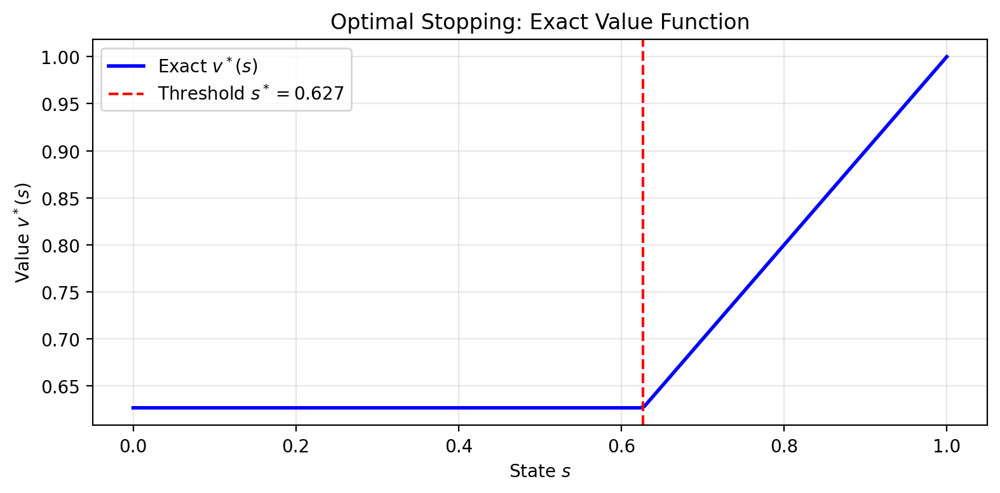
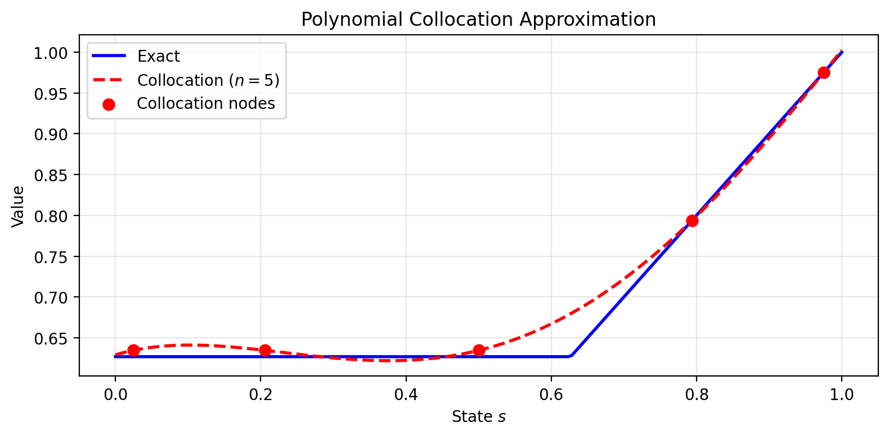

> **Cours de Pierre-Luc Bacon — 20.** [Page publiée](https://pierrelucbacon.com/rlbook/weighted-residual-methods) · [Source numérotée](../20-weighted-residual-methods.md)
> Extraction HTML → Markdown, effectuée le 2026-10-11. Les formules LaTeX, figures statiques, solutions et liens sont conservés ; les animations nécessitent le site original.

<a id="skip-to-frontmatter"></a>

# Weighted-Residual Methods

<a id="skip-to-article"></a>

Regularized and ordinary Bellman equations are both functional equations: the unknown is a function rather than a finite vector. How can such an equation be approximated by finitely many coefficients while retaining a precise condition on its residual?

The Bellman optimality equation $\mathsf{L} v = v$, whose contraction property underlies the convergence of value iteration, is a functional equation: an equation where the unknown is an entire function rather than a finite-dimensional vector. When the state space is continuous or very large, we cannot represent the value function exactly on a computer. We must instead work with finite-dimensional approximations. This motivates weighted residual methods (also called minimum residual methods), a general framework for transforming infinite-dimensional problems into tractable finite-dimensional ones [Chakraverty _et al._ (2019)](https://doi.org/10.1002/9781119423461.ch3)[Atkinson & Potra (1987)](https://doi.org/10.1137/0724087).

Learning Goals

After completing this chapter, you should be able to:

-   Explain why functional equations require finite-dimensional approximation and how weighted residual methods provide a systematic framework
    
-   Distinguish between Galerkin, collocation, and least-squares methods by their choice of test functions
    
-   Apply function iteration and Newton’s method to solve projected Bellman equations
    
-   State conditions under which projected value iteration converges (monotonicity for sup-norm, on-policy weighting for weighted $L^2$)
    
-   Derive the LSTD equations as Galerkin projection with stationary distribution weighting
    

**Prerequisites:** Bellman operator and contraction property, basic numerical quadrature, linear algebra (matrix inverses, orthogonal projection).

<a id="a-motivating-example-optimal-stopping-with-continuous-states"></a>

## A Motivating Example: Optimal Stopping with Continuous States

What fails when an exact value function lives on a continuum but only finitely many coefficients can be stored?

Before developing the general theory, consider a concrete example that illustrates the core challenge. An agent observes a state $s \in [0, 1]$ and must decide whether to **stop** (receive reward $s$ and end the episode) or **continue** (receive nothing, and the state redraws uniformly on $[0, 1]$). With discount factor $\gamma = 0.9$, the Bellman optimality equation is:

<a id="mIy9u38XTy"></a>

$$
v^*(s) = \max\left\{ s, \; \gamma \int_0^1 v^*(s') \, ds' \right\}.
$$

[(1)](#mIy9u38XTy "Link to this Equation")

The first term is the immediate payoff from stopping; the second is the discounted expected continuation value. Since the continuation value $\bar{v} = \int_0^1 v^*(s') ds'$ is a constant (it doesn’t depend on the current state $s$), the optimal policy has a **threshold structure**: stop if $s \geq s^*$ for some threshold $s^*$, continue otherwise.

At the threshold, the agent is indifferent: $s^* = \gamma \bar{v}$. Computing $\bar{v}$ by integrating $v^*$:

<a id="THikQEIHrF"></a>

$$
\bar{v} = \int_0^{s^*} \gamma \bar{v} \, ds' + \int_{s^*}^1 s' \, ds' = s^* \gamma \bar{v} + \frac{1 - (s^*)^2}{2}.
$$

[(2)](#THikQEIHrF "Link to this Equation")

Substituting $s^* = \gamma \bar{v}$ and solving gives the exact threshold and value.

<a id="cCDVvkDxee"></a>

Source

```python
#  label: fig-optimal-stopping-exact
#  caption: The exact value function for the optimal stopping problem.

%config InlineBackend.figure_format = 'retina'
import numpy as np
import matplotlib.pyplot as plt

gamma = 0.9

# Solve for exact threshold
v_bar_exact = (1 - np.sqrt(1 - gamma**2)) / gamma**2
s_star_exact = gamma * v_bar_exact

print(f"Exact solution:")
print(f"  Threshold s* = {s_star_exact:.6f}")
print(f"  Continuation value v̄ = {v_bar_exact:.6f}")

# The exact value function
def v_exact(s):
    return np.where(s >= s_star_exact, s, gamma * v_bar_exact)

# Plot the exact value function
s_grid = np.linspace(0, 1, 200)
plt.figure(figsize=(8, 4))
plt.plot(s_grid, v_exact(s_grid), 'b-', linewidth=2, label='Exact $v^*(s)$')
plt.axvline(s_star_exact, color='r', linestyle='--', label=f'Threshold $s^* = {s_star_exact:.3f}$')
plt.xlabel('State $s$')
plt.ylabel('Value $v^*(s)$')
plt.legend()
plt.title('Optimal Stopping: Exact Value Function')
plt.grid(True, alpha=0.3)
plt.tight_layout()
```

```
Exact solution:
  Threshold s* = 0.626789
  Continuation value v̄ = 0.696432
```



The exact value function is piecewise linear: constant at $\gamma \bar{v}$ below the threshold, equal to $s$ above it. Now suppose we want to approximate $v^*$ using a **polynomial basis** with $n$ terms:

<a id="Qo5Be2nZGE"></a>

$$
\hat{v}(s; \theta) = \sum_{j=0}^{n-1} \theta_j s^j = \theta_0 + \theta_1 s + \theta_2 s^2 + \cdots
$$

[(3)](#Qo5Be2nZGE "Link to this Equation")

The **residual** at state $s$ measures how far our approximation is from satisfying the Bellman equation:

<a id="ZNrqpQ0Z4e"></a>

$$
R(s; \theta) = \max\left\{ s, \; \gamma \int_0^1 \hat{v}(s'; \theta) \, ds' \right\} - \hat{v}(s; \theta).
$$

[(4)](#ZNrqpQ0Z4e "Link to this Equation")

For a perfect solution, $R(s; \theta) = 0$ for all $s \in [0, 1]$. But a polynomial cannot exactly represent the kink at $s^*$. We must choose how to make the residual “small” across the state space.

**Collocation** picks $n$ points $\{s_1, \ldots, s_n\}$ and requires the residual to vanish exactly there:

<a id="OpdXXiHhFl"></a>

$$
R(s_i; \theta) = 0, \quad i = 1, \ldots, n.
$$

[(5)](#OpdXXiHhFl "Link to this Equation")

**Galerkin** requires the residual to be orthogonal to each basis function:

<a id="FYfO9uDxjf"></a>

$$
\int_0^1 R(s; \theta) s^{j} w(s) \, ds = 0, \quad j = 0, \ldots, n-1.
$$

[(6)](#FYfO9uDxjf "Link to this Equation")

<a id="YelQCmUYUC"></a>

Source

```python
#  label: fig-collocation-comparison
#  caption: Polynomial collocation approximation with 5 Chebyshev nodes.

from scipy.integrate import quad

def chebyshev_nodes(n, a=0, b=1):
    """Chebyshev nodes on [a, b]."""
    k = np.arange(1, n + 1)
    nodes = 0.5 * (a + b) + 0.5 * (b - a) * np.cos((2*k - 1) * np.pi / (2*n))
    return np.sort(nodes)

def collocation_solve(n, gamma, max_iter=100, tol=1e-8):
    """Solve optimal stopping via polynomial collocation."""
    nodes = chebyshev_nodes(n)
    Phi = np.vander(nodes, n, increasing=True)
    
    theta = np.zeros(n)
    for iteration in range(max_iter):
        def v_approx(s):
            return sum(theta[j] * s**j for j in range(n))
        
        v_bar, _ = quad(v_approx, 0, 1)
        targets = np.maximum(nodes, gamma * v_bar)
        theta_new = np.linalg.solve(Phi, targets)
        
        if np.linalg.norm(theta_new - theta) < tol:
            return theta_new, iteration + 1
        theta = theta_new
    return theta, max_iter

# Solve with different numbers of basis functions
for n in [3, 5, 8]:
    theta, iters = collocation_solve(n, gamma)
    def v_approx(s, theta=theta, n=n):
        return sum(theta[j] * s**j for j in range(n))
    errors = [abs(v_approx(s) - v_exact(s)) for s in np.linspace(0, 1, 1000)]
    print(f"n = {n}: converged in {iters} iters, max error = {max(errors):.6f}")

# Plot comparison for n=5
n = 5
theta, _ = collocation_solve(n, gamma)
v_approx_5 = lambda s: sum(theta[j] * s**j for j in range(n))

plt.figure(figsize=(8, 4))
plt.plot(s_grid, v_exact(s_grid), 'b-', linewidth=2, label='Exact')
plt.plot(s_grid, [v_approx_5(s) for s in s_grid], 'r--', linewidth=2, label=f'Collocation ($n={n}$)')
plt.scatter(chebyshev_nodes(n), [v_approx_5(s) for s in chebyshev_nodes(n)], 
            color='red', s=50, zorder=5, label='Collocation nodes')
plt.xlabel('State $s$')
plt.ylabel('Value')
plt.legend()
plt.title('Polynomial Collocation Approximation')
plt.grid(True, alpha=0.3)
plt.tight_layout()
```

```
n = 3: converged in 49 iters, max error = 0.053991
n = 5: converged in 41 iters, max error = 0.052626
n = 8: converged in 54 iters, max error = 0.015880
```



This example illustrates the fundamental tension in weighted residual methods: with finite parameters, we cannot satisfy the Bellman equation everywhere. We must choose how to allocate our approximation capacity. The rest of this chapter develops the general theory behind these choices.

<a id="testing-whether-a-residual-vanishes"></a>

## Testing Whether a Residual Vanishes

Which scalar conditions can certify that a functional residual is zero, small, or orthogonal to selected directions?

Consider a functional equation $\mathsf{N}(f) = 0$, where $\mathsf{N}$ is an operator and the unknown $f$ is an entire function (in our case, the Bellman optimality equation $\mathsf{L} v = v$, which we can write as $\mathsf{N}(v) \equiv \mathsf{L} v - v = 0$). Suppose we have found a candidate approximate solution $\hat{f}$. To verify it satisfies $\mathsf{N}(\hat{f}) = 0$, we compute the **residual function** $R(s) = \mathsf{N}(\hat{f})(s)$. For a true solution, this residual should be the **zero function**: $R(s) = 0$ for every state $s$.

How might we test whether a function is zero? One approach: sample many input points $\{s_1, s_2, \ldots, s_m\}$, check whether $R(s_i) = 0$ at each, and summarize the results into a single scalar test by computing a weighted sum $\sum_{i=1}^m w_i R(s_i)$ with weights $w_i > 0$. If $R$ is zero everywhere, this sum is zero. If $R$ is nonzero somewhere, we can choose points and weights to make the sum nonzero. For vectors in finite dimensions, the inner product $\langle \mathbf{r}, \mathbf{y} \rangle = \sum_{i=1}^n r_i y_i$ implements exactly this idea: it tests $\mathbf{r}$ by weighting and summing. Indeed, a vector $\mathbf{r} \in \mathbb{R}^n$ equals zero if and only if $\langle \mathbf{r}, \mathbf{y} \rangle = 0$ for every vector $\mathbf{y} \in \mathbb{R}^n$. To see why, suppose $\mathbf{r} \neq \mathbf{0}$. Choosing $\mathbf{y} = \mathbf{r}$ gives $\langle \mathbf{r}, \mathbf{r} \rangle = \|\mathbf{r}\|^2 > 0$, contradicting the claim that all inner products vanish.

The same principle extends to functions. A function $R$ equals the zero function if and only if its “inner product” with every “test function” $p$ vanishes:

<a id="dyGJuTquLx"></a>

$$
R = 0 \quad \text{if and only if} \quad \langle R, p \rangle_w = \int_{\mathcal{S}} R(s) p(s) w(s) ds = 0 \quad \text{for all test functions } p,
$$

[(7)](#dyGJuTquLx "Link to this Equation")

where $w(s) > 0$ is a weight function that is part of the inner product definition. Why does this work? For the same reason as in finite dimensions: if $R$ is not the zero function, there must be some region where $R(s) \neq 0$. We can then choose a test function $p$ that is nonzero in that same region (for instance, $p(s) = R(s)$ itself), which will produce $\langle R, p \rangle_w = \int R(s) p(s) w(s) ds > 0$, witnessing that $R$ is nonzero. Conversely, if $R$ is the zero function, then $\langle R, p \rangle_w = 0$ for any test function $p$.

This ability to **distinguish between different functions using inner products** is a fundamental principle from functional analysis. Just as we can test a vector by taking inner products with other vectors, we can test a function by taking inner products with other functions.

Connection to Functional Analysis

The principle that “a function equals zero if and only if it has zero inner product with all test functions” is a consequence of the **Hahn-Banach theorem**, one of the cornerstones of functional analysis. The theorem guarantees that for any nonzero function $R$ in a suitable function space, there exists a continuous linear functional (which can be represented as an inner product with some test function $p$) that produces a nonzero value when applied to $R$. This is often phrased as “the dual space separates points.”

While you don’t need to know the Hahn-Banach theorem to use weighted residual methods, it provides the rigorous mathematical foundation ensuring that our inner product tests are theoretically sound. The constructive argument we gave above (choosing $p = R$) works in simple cases with well-behaved functions, but the Hahn-Banach theorem extends this guarantee to much more general settings.

This transforms the pointwise condition “$R(s) = 0$ for all $s$” (infinitely many conditions, one per state) into an equivalent condition about inner products. We still cannot test against _all_ possible test functions, since there are infinitely many of those too. But the inner product perspective suggests a natural computational strategy: choose a finite collection of test functions $\{p_1, \ldots, p_n\}$ and use them to construct $n$ conditions that we can actually compute.

<a id="from-variational-conditions-to-optimization"></a>

### From Variational Conditions to Optimization

Making a residual “small” is an optimization problem. We want to find $\theta$ that minimizes $\lVert R(\cdot; \theta) \rVert$ for some norm. Different methods correspond to different choices of norm:

-   Minimize the weighted $L^2$ norm $\lVert R \rVert_w^2 = \int R(s)^2 w(s) ds$
    
-   Minimize a discrete norm $\sum_j \omega_j R(s_j)^2$ at selected points
    
-   Minimize $\lVert R \rVert$ in a dual norm induced by the approximation space
    

The first-order conditions for these optimization problems take the form $\langle R, p_j \rangle_w = 0$ for appropriate “test functions” $p_j$. The variational formulation is useful for analysis, but we are simply minimizing the residual in a chosen norm.

The rest of this chapter develops the computational framework: how to parameterize the unknown function, define the residual, choose a norm, and solve the resulting finite-dimensional problem.

<a id="the-general-framework"></a>

## The General Framework

How do an approximation space, residual, test space, and solver combine into a reusable finite-dimensional method?

Consider an operator equation of the form

<a id="SwCXnzMhvG"></a>

$$
\mathsf{N}(f) = 0,
$$

[(8)](#SwCXnzMhvG "Link to this Equation")

where $\mathsf{N}: B_1 \to B_2$ is a continuous operator between complete normed vector spaces $B_1$ and $B_2$. For the Bellman equation, we have $\mathsf{N}(v) = \mathsf{L} v - v$, so that solving $\mathsf{N}(v) = 0$ is equivalent to finding the fixed point $v = \mathsf{L} v$.

Just as we transcribed infinite-dimensional continuous optimal control problems into finite-dimensional discrete optimal control problems in earlier chapters, we seek a finite-dimensional approximation to this infinite-dimensional functional equation. Recall that for continuous optimal control, we adopted control parameterization: we represented the control trajectory using a finite set of basis functions (piecewise constants, polynomials, splines) and searched over the finite-dimensional coefficient space instead of the infinite-dimensional function space. For integrals in the objective and constraints, we used numerical quadrature to approximate them with finite sums.

We follow the same strategy here. We parameterize the value function using a finite set of basis functions $\{\varphi_1, \ldots, \varphi_n\}$, commonly polynomials (Chebyshev, Legendre), though other function classes (splines, radial basis functions, neural networks) are possible, and search for coefficients $\theta = (\theta_1, \ldots, \theta_n)$ in $\mathbb{R}^n$. When integrals appear in the Bellman operator or projection conditions, we approximate them using numerical quadrature. The projection method approach consists of several conceptual steps that accomplish this transcription.

<a id="step-1-choose-a-finite-dimensional-approximation-space"></a>

### Step 1: Choose a Finite-Dimensional Approximation Space

We begin by selecting a basis $\Phi = \{\varphi_1, \varphi_2, \ldots, \varphi_n\}$ and approximating the unknown function as a linear combination:

<a id="zCVHw4yycF"></a>

$$
\hat{f}(x) = \sum_{i=1}^n \theta_i \varphi_i(x).
$$

[(9)](#zCVHw4yycF "Link to this Equation")

The choice of basis functions $\varphi_i$ is problem-dependent. Common choices include:

-   **Polynomials**: For smooth problems, we might use Chebyshev polynomials or other orthogonal polynomial families
    
-   **Splines**: For problems where we expect the solution to have regions of different smoothness
    
-   **Radial basis functions**: For high-dimensional problems where tensor product methods become intractable
    

The number of basis functions $n$ determines the flexibility of our approximation. In practice, we start with small $n$ and increase it until the approximation quality is satisfactory. The only unknowns now are the coefficients $\theta = (\theta_1, \ldots, \theta_n)$.

While the classical presentation of projection methods focuses on polynomial bases, the framework applies equally well to other function classes. Neural networks, for instance, can be viewed through this lens: a neural network $\hat{f}(x; \theta)$ with parameters $\theta$ defines a flexible function class, and many training procedures can be interpreted as projection methods with specific choices of test functions or residual norms. The distinction is that classical methods typically use predetermined basis functions with linear coefficients, while neural networks use adaptive nonlinear features. Throughout this chapter, we focus on the classical setting to develop the core concepts, but the principles extend naturally to modern function approximators.

<a id="step-2-define-the-residual-function"></a>

### Step 2: Define the Residual Function

Since we are approximating $f$ with $\hat{f}$, the operator $\mathsf{N}$ will generally not vanish exactly. Instead, we obtain a **residual function**:

<a id="twHezlpIvC"></a>

$$
R(x; \theta) = \mathsf{N}(\hat{f}(\cdot; \theta))(x).
$$

[(10)](#twHezlpIvC "Link to this Equation")

This residual measures how far our candidate solution is from satisfying the equation at each point $x$. As we discussed in the introduction, we want to make this residual small—an optimization problem whose formulation depends on how we measure “small.”

<a id="step-3-impose-conditions-on-the-residual"></a>

### Step 3: Impose Conditions on the Residual

The basis and residual reduce the functional equation to $n$ scalar conditions on $\theta$. The choice of conditions determines the method:

| **Method** | **Residual criterion** | **Conditions** ($n$ equations) |
| --- | --- | --- |
| Least squares | $\displaystyle\lVert R \rVert_w^2 = \int R(x; \theta)^2 w(x) dx$ | $\displaystyle\int R \cdot \frac{\partial R}{\partial \theta_j} \, w \, dx = 0$, $j = 1, \ldots, n$ |
| Galerkin | $\lVert R \rVert_{\mathcal{V}^*}$ (dual norm of approx. space) | $\displaystyle\int R(x; \theta) \varphi_j(x) w(x) dx = 0$, $j = 1, \ldots, n$ |
| Collocation | Exact pointwise satisfaction | $R(x_i; \theta) = 0$, $i = 1, \ldots, n$ |

Each criterion yields $n$ equations in the $n$ unknowns $\theta_1,\ldots,\theta_n$.

<a id="collocation-make-the-residual-zero-at-selected-points"></a>

#### Collocation: Make the Residual Zero at Selected Points

The simplest approach is to choose $n$ points $\{x_1, \ldots, x_n\}$ and require the residual to vanish exactly at each:

<a id="lJbE4KyRWJ"></a>

$$
R(x_i; \theta) = 0, \quad i = 1, \ldots, n.
$$

[(11)](#lJbE4KyRWJ "Link to this Equation")

This gives $n$ equations for $n$ unknowns. Collocation is computationally attractive because it avoids integration entirely—we only evaluate $R$ at discrete points. The resulting system is:

<a id="xjW9iy9zOK"></a>

$$
\mathsf{N}(\hat{f}(\cdot; \theta))(x_i) = 0, \quad i = 1, \ldots, n.
$$

[(12)](#xjW9iy9zOK "Link to this Equation")

For a linear operator, this is a linear system; for the Bellman equation, it is nonlinear due to the max.

_Verify for yourself: with $n = 2$ collocation points and $n = 2$ basis functions, the system $\boldsymbol{\Phi}\theta = t$ is a $2 \times 2$ linear system. What must be true about the collocation matrix $\boldsymbol{\Phi}$ for this system to have a unique solution?_

The choice of collocation points matters. **Orthogonal collocation** (or **spectral collocation**) places points at the zeros of the $n$\-th orthogonal polynomial in a family (Chebyshev, Legendre, etc.). For Chebyshev polynomials $T_0, T_1, \ldots, T_{n-1}$, we place collocation points at the zeros of $T_n(x)$. These points are also optimal nodes for Gauss quadrature, so:

-   We get the computational simplicity of pointwise evaluation $R(x_i) = 0$
    
-   When we need integrals (inside the Bellman operator), the collocation points double as quadrature nodes with exactness for polynomials up to degree $2n-1$
    
-   For smooth problems, spectral approximations achieve **exponential convergence**: the error decreases like $O(e^{-cn})$ as we add basis functions, compared to $O(h^{p+1})$ for piecewise polynomials
    

The Chebyshev interpolation theorem guarantees that forcing $R(x_i; \theta) = 0$ at these carefully chosen points makes $R(x; \theta)$ small everywhere, with well-conditioned systems and near-optimal interpolation error.

<a id="galerkin-make-the-residual-orthogonal-to-the-approximation-space"></a>

#### Galerkin: Make the Residual Orthogonal to the Approximation Space

The Galerkin method requires the residual to be orthogonal to each basis function:

<a id="TFd0sdajU9"></a>

$$
\int_{\mathcal{S}} R(x; \theta) \varphi_i(x) w(x) dx = 0, \quad i = 1, \ldots, n.
$$

[(13)](#TFd0sdajU9 "Link to this Equation")

To understand why this is optimal, consider the approximation space $\mathcal{V} = \text{span}\{\varphi_1, \ldots, \varphi_n\}$ as an $n$\-dimensional subspace. If the residual $R$ is orthogonal to all basis functions, then by linearity, $R$ is orthogonal to every function in $\mathcal{V}$:

<a id="e38Jsg2dOl"></a>

$$
\langle R, g \rangle_w = \left\langle R, \sum_{i=1}^n c_i \varphi_i \right\rangle_w = \sum_{i=1}^n c_i \langle R, \varphi_i \rangle_w = 0 \quad \text{for all } g \in \mathcal{V}.
$$

[(14)](#e38Jsg2dOl "Link to this Equation")

The residual has “zero overlap” with our approximation space—it is as “invisible” to our basis as possible. This is the defining property of orthogonal projection.

In what sense is Galerkin minimizing a norm? The **dual norm** of $R$ with respect to $\mathcal{V}$ measures $R$ by its largest inner product with functions in $\mathcal{V}$:

<a id="rNZ5rHYDU7"></a>

$$
\lVert R \rVert_{\mathcal{V}^*} = \sup_{\substack{g \in \mathcal{V} \\ \lVert g \rVert_w = 1}} \lvert \langle R, g \rangle_w \rvert.
$$

[(15)](#rNZ5rHYDU7 "Link to this Equation")

The Galerkin conditions $\langle R, \varphi_j \rangle_w = 0$ for all $j$ imply $\langle R, g \rangle_w = 0$ for all $g \in \mathcal{V}$, so $\lVert R \rVert_{\mathcal{V}^*} = 0$. Galerkin makes the residual “invisible” when measured against the approximation space—it minimizes the dual norm to zero.

A finite-dimensional analogy: to approximate a vector $\mathbf{v} \in \mathbb{R}^3$ using only the $xy$\-plane, the best approximation is $\hat{\mathbf{v}} = (v_1, v_2, 0)$. The error $\mathbf{r} = \mathbf{v} - \hat{\mathbf{v}} = (0, 0, v_3)$ points purely in the $z$\-direction, orthogonal to the plane. The Galerkin condition generalizes this: the residual is orthogonal to the approximation space.

Galerkin requires integration to compute the conditions, making it more expensive per iteration than collocation. However, when using orthogonal polynomial bases with matching weight functions, the integrals simplify and the resulting systems are well-conditioned.

<a id="least-squares-minimize-the-l-2-norm-of-the-residual"></a>

#### Least Squares: Minimize the $L^2$ Norm of the Residual

The most direct approach is to minimize the weighted $L^2$ norm of the residual:

<a id="RKxysnHZuK"></a>

$$
\min_\theta \int_{\mathcal{S}} R(x; \theta)^2 w(x) dx.
$$

[(16)](#RKxysnHZuK "Link to this Equation")

The first-order conditions are:

<a id="vULYB1Qi0b"></a>

$$
\int_{\mathcal{S}} R(x; \theta) \frac{\partial R(x; \theta)}{\partial \theta_j} w(x) dx = 0, \quad j = 1, \ldots, n.
$$

[(17)](#vULYB1Qi0b "Link to this Equation")

This directly minimizes how far our approximation is from satisfying the equation. For the Bellman equation $R = \mathsf{L}\hat{v} - \hat{v}$, this is **Bellman residual minimization**: we minimize $\lVert \mathsf{L}\hat{v} - \hat{v} \rVert_w^2$.

The gradient $\frac{\partial R}{\partial \theta_j}$ involves differentiating the operator $\mathsf{N}$. For the Bellman operator with its max, this requires the Envelope Theorem (discussed in Step 4). The need to differentiate through the operator distinguishes least squares from Galerkin and collocation.

<a id="fitted-q-iteration-project-then-iterate"></a>

#### Fitted Q-Iteration: Project, Then Iterate

For iterative methods, there is a computationally simpler alternative to minimizing the residual directly. **Fitted Q-Iteration (FQI)** uses a two-step iteration:

1.  Apply the Bellman operator to get a target: $f_k = \mathsf{L} \hat{v}_k$
    
2.  Project the target back onto the approximation space: $\hat{v}_{k+1} = \arg\min_\theta \lVert \hat{v}(\cdot; \theta) - f_k \rVert_w^2$
    

The projection step solves $\min_\theta \lVert \hat{v} - f_k \rVert_w^2$, whose first-order conditions are $\langle \hat{v} - f_k, \varphi_j \rangle_w = 0$. This is a standard least-squares fit of the basis to the target values. Combining these steps gives:

<a id="B4pyiWPpJT"></a>

$$
\hat{v}_{k+1} = \Pi_w \, \mathsf{L} \hat{v}_k,
$$

[(18)](#B4pyiWPpJT "Link to this Equation")

where $\Pi_w$ denotes orthogonal projection onto $\text{span}\{\varphi_j\}$ with respect to the weighted inner product.

FQI does **not** minimize the Bellman residual $\lVert \mathsf{L}\hat{v} - \hat{v} \rVert^2$ directly. It projects, then iterates. FQI’s projection step uses only the gradient of $\hat{v}$ with respect to $\theta$ (the “semi-gradient”), while Bellman residual minimization requires differentiating through $\mathsf{L}$ (the “full gradient”). We return to this distinction when discussing temporal difference learning.

<a id="step-4-solve-the-finite-dimensional-problem"></a>

### Step 4: Solve the Finite-Dimensional Problem

The conditions from Step 3 give us a finite-dimensional problem to solve:

-   **Collocation**: $n$ equations $R(x_i; \theta) = 0$
    
-   **Galerkin**: $n$ equations $\int R(x; \theta) \varphi_i(x) w(x) dx = 0$
    
-   **Least squares**: minimize $\int R(x; \theta)^2 w(x) dx$
    

In each case, we have $n$ equations (or first-order conditions) in $n$ unknowns $\theta_1, \ldots, \theta_n$. For the Bellman equation, these systems are nonlinear due to the max operator.

<a id="computational-cost-and-conditioning"></a>

#### Computational Cost and Conditioning

The **computational cost per iteration** varies significantly across methods:

-   **Collocation**: Cheapest to evaluate since $P_i(\theta) = R(x_i; \theta)$ requires only pointwise evaluation (no integration). The Jacobian is also cheap: $J_{ij} = \frac{\partial R(x_i; \theta)}{\partial \theta_j}$.
    
-   **Galerkin and moments**: More expensive due to integration. Computing $P_i(\theta) = \int R(x; \theta) p_i(x) w(x) dx$ requires numerical quadrature. Each Jacobian entry requires integrating $\frac{\partial R}{\partial \theta_j} p_i w$.
    
-   **Least squares**: Most expensive when done via the objective function, which requires integrating $R^2 w$. However, the first-order conditions reduce it to a system like Galerkin, with test functions $p_i = \partial R / \partial \theta_i$.
    

For methods requiring integration, the choice of quadrature rule should match the basis. Gaussian quadrature with nodes at orthogonal polynomial zeros is efficient. When combined with collocation at those same points, the quadrature is exact for polynomials up to a certain degree. This coordination between quadrature and collocation makes **orthogonal collocation** effective.

The **conditioning** of the system depends on the choice of test functions. The Jacobian matrix has entries:

<a id="L72SC3Oeax"></a>

$$
J_{ij} = \frac{\partial P_i}{\partial \theta_j} = \left\langle \frac{\partial R(\cdot; \theta)}{\partial \theta_j}, p_i \right\rangle_w.
$$

[(19)](#L72SC3Oeax "Link to this Equation")

When test functions are orthogonal (or nearly so), the Jacobian tends to be well-conditioned. This is why orthogonal polynomial bases are preferred in Galerkin methods: they produce Jacobians with controlled condition numbers. Poorly chosen basis functions or collocation points can lead to nearly singular Jacobians, causing numerical instability. Orthogonal bases and carefully chosen collocation points (like Chebyshev nodes) help maintain good conditioning.

<a id="two-main-solution-approaches"></a>

#### Two Main Solution Approaches

We have two fundamentally different ways to solve the projection equations: **function iteration** (exploiting fixed-point structure) and **Newton’s method** (exploiting smoothness). The choice depends on whether the original operator equation has contraction properties and how well those properties are preserved by the finite-dimensional approximation.

<a id="method-1-function-iteration-successive-approximation"></a>

##### Method 1: Function Iteration (Successive Approximation)

When the operator equation has the form $f = \mathsf{T} f$ where $\mathsf{T}$ is a contraction, the most natural approach is to iterate the operator directly:

<a id="izF5Cixlc3"></a>

$$
\hat{f}^{(k+1)} = \mathsf{T} \hat{f}^{(k)}.
$$

[(20)](#izF5Cixlc3 "Link to this Equation")

The infinite-dimensional iteration becomes a finite-dimensional iteration in coefficient space once we choose our weighted residual method. Given a current approximation $\hat{f}^{(k)}(x; \theta^{(k)})$, how do we find the coefficients $\theta^{(k+1)}$ for the next iterate $\hat{f}^{(k+1)}$?

Different weighted residual methods answer this differently. For **collocation**, we proceed in two steps:

1.  **Evaluate the operator**: At each collocation point $x_i$, compute what the next iterate should be: $t_i^{(k)} = (\mathsf{T} \hat{f}^{(k)})(x_i)$. These $n$ target values tell us what $\hat{f}^{(k+1)}$ should equal at the collocation points.
    
2.  **Find matching coefficients**: Determine $\theta^{(k+1)}$ so that $\hat{f}^{(k+1)}(x_i; \theta^{(k+1)}) = t_i^{(k)}$ for all $i$. This is a linear system: $\sum_j \theta_j^{(k+1)} \varphi_j(x_i) = t_i^{(k)}$.
    

In matrix form: $\boldsymbol{\Phi} \theta^{(k+1)} = t^{(k)}$, where $\boldsymbol{\Phi}$ is the collocation matrix with entries $\Phi_{ij} = \varphi_j(x_i)$. Solving this system gives $\theta^{(k+1)} = \boldsymbol{\Phi}^{-1} t^{(k)}$.

For **Galerkin**, the projection condition $\langle \hat{f}^{(k+1)} - \mathsf{T} \hat{f}^{(k+1)}, \varphi_i \rangle_w = 0$ directly gives a system for $\theta^{(k+1)}$. When $\mathsf{T}$ is linear in its argument (as in many integral equations), this is a linear system. When $\mathsf{T}$ is nonlinear (as in the Bellman equation), we must solve a nonlinear system at each iteration, though each solution still only involves $n$ unknowns rather than an infinite-dimensional function.

When $\mathsf{T}$ is a contraction in the infinite-dimensional space with constant $\gamma < 1$, iterating it pulls any starting function toward the unique fixed point. The hope is that the finite-dimensional operator, evaluating $\mathsf{T}$ and projecting back onto the span of the basis functions, inherits this contraction property. When it does, function iteration converges globally from any initial guess, with each iteration reducing the error by a factor of roughly $\gamma$. This is computationally attractive: we only evaluate the operator and solve a linear system (for collocation) or a relatively simple system (for other methods).

However, the finite-dimensional approximation doesn’t always preserve contraction. High-order polynomial bases, in particular, can create oscillations between basis functions that amplify rather than contract errors. Even when contraction is preserved, convergence can be painfully slow when $\gamma$ is close to 1, the “weak contraction” regime common in economic problems with patient agents ($\gamma \approx 0.95$ or higher). Finally, not all operator equations naturally present themselves as contractions; some require reformulation (like $f = f - \alpha \mathsf{N}(f)$), and finding a good $\alpha$ can be problem-specific.

<a id="method-2-newtons-method"></a>

##### Method 2: Newton’s Method

Alternatively, we can treat the projection equations as a rootfinding problem $G(\theta) = 0$ where $G_i(\theta) = P_i(\theta)$ for test function methods, or solve the first-order conditions for least squares. **Newton’s method** uses the update:

<a id="Nrpa9YfhS4"></a>

$$
\theta^{(k+1)} = \theta^{(k)} - J_G(\theta^{(k)})^{-1} G(\theta^{(k)}),
$$

[(21)](#Nrpa9YfhS4 "Link to this Equation")

where $J_G(\theta)$ is the Jacobian of $G$ at $\theta$.

To apply this update, we must compute the Jacobian entries $J_{ij} = \frac{\partial G_i}{\partial \theta_j}$. For collocation, $G_i(\theta) = \hat{f}(x_i; \theta) - (\mathsf{T} \hat{f}(\cdot; \theta))(x_i)$, so:

<a id="GKD3MwiCtq"></a>

$$
\frac{\partial G_i}{\partial \theta_j} = \frac{\partial \hat{f}(x_i; \theta)}{\partial \theta_j} - \frac{\partial (\mathsf{T} \hat{f}(\cdot; \theta))(x_i)}{\partial \theta_j}.
$$

[(22)](#GKD3MwiCtq "Link to this Equation")

The first term is straightforward (it’s just $\varphi_j(x_i)$ for a linear approximation). The second term requires differentiating the operator $\mathsf{T}$ with respect to the parameters.

When $\mathsf{T}$ involves optimization (as in the Bellman operator $\mathsf{L} v = \max_a \{r(s,a) + \gamma \mathbb{E}[v(s')]\}$), computing this derivative appears problematic because the max operator is not differentiable. However, the **Envelope Theorem** resolves this difficulty.

_Before reading the box below, try differentiating $v(\theta) = \max_x f(x, \theta)$ using the chain rule. What term involving $\partial x^*/\partial \theta$ appears? Why might this term vanish at an optimum?_

The Envelope Theorem

**Setup:** Consider a smooth objective function $f(\mathbf{x}, \boldsymbol{\theta})$ and define the optimal value:

<a id="SlNWEn37rN"></a>

$$
v(\boldsymbol{\theta}) = \max_{\mathbf{x}} f(\mathbf{x}, \boldsymbol{\theta}).
$$

[(23)](#SlNWEn37rN "Link to this Equation")

Let $\mathbf{x}^*(\boldsymbol{\theta})$ denote the maximizer, satisfying the first-order condition $\nabla_{\mathbf{x}} f(\mathbf{x}^*(\boldsymbol{\theta}), \boldsymbol{\theta}) = \mathbf{0}$.

**The Result:** To find how the optimal value changes with $\boldsymbol{\theta}$, we can compute:

<a id="Vxjm285cF0"></a>

$$
\nabla_{\boldsymbol{\theta}} v(\boldsymbol{\theta}) = \nabla_{\boldsymbol{\theta}} f(\mathbf{x}^*(\boldsymbol{\theta}), \boldsymbol{\theta}).
$$

[(24)](#Vxjm285cF0 "Link to this Equation")

That is, differentiate the objective with respect to $\boldsymbol{\theta}$ while treating the maximizer $\mathbf{x}^*$ as constant. We don’t need to compute $\frac{\partial \mathbf{x}^*}{\partial \boldsymbol{\theta}}$ because at the optimum, small changes in $\mathbf{x}$ don’t affect the value (first-order condition), so the direct effect dominates.

**Why it works:** By the chain rule, $\nabla_{\boldsymbol{\theta}} v = \nabla_{\boldsymbol{\theta}} f + \underbrace{(\nabla_{\mathbf{x}} f)^{\top}}_{\mathbf{0} \text{ at optimum}} \frac{\partial \mathbf{x}^*}{\partial \boldsymbol{\theta}}$.

**Application to Bellman equations:** For $[\mathsf{L} v](s) = \max_a \{r(s,a) + \gamma \mathbb{E}[v(s')]\}$, the derivative with respect to parameters in $v$ can be computed by treating the optimal action as constant. For example, if $v(s; \theta) = \sum_j \theta_j \varphi_j(s)$:

<a id="nIat0hpR5t"></a>

$$
\frac{\partial [\mathsf{L} v](s)}{\partial \theta_j} = \gamma \mathbb{E}[\varphi_j(s') \mid s, a^*(s; \theta)],
$$

[(25)](#nIat0hpR5t "Link to this Equation")

where $a^*(s; \theta)$ is the optimal action given parameters $\theta$.

**Important assumptions:** The objective $f$ is smooth, the maximizer is unique and in the interior (or constraints are smooth with stable active sets), and the first-order condition holds.

With the Envelope Theorem providing a tractable way to compute Jacobians for problems involving optimization, Newton’s method becomes practical for weighted residual methods applied to Bellman equations and similar problems. The method offers **quadratic convergence** near the solution. Once in the neighborhood of the true fixed point, Newton’s method typically converges in just a few iterations. Unlike function iteration, it doesn’t rely on the finite-dimensional approximation preserving any contraction property, making it applicable to a broader range of problems, particularly those with high-order polynomial bases or large discount factors where function iteration struggles.

However, Newton’s method demands more from both the algorithm and the user. Each iteration requires computing and solving a full Jacobian system, making the per-iteration cost significantly higher than function iteration. The method is also sensitive to initialization: started far from the solution, Newton’s method may diverge or converge to spurious fixed points that the finite-dimensional problem introduces but the original infinite-dimensional problem lacks. When applying the Envelope Theorem, implementation becomes more complex. We must track the optimal action at each evaluation point and compute the Jacobian entries using the formula above (expected basis function values at next states under optimal actions), though the economic interpretation (tracking how value propagates through optimal decisions) often makes the computation conceptually clearer than explicit derivative calculations would be.

<a id="comparison-and-practical-recommendations"></a>

##### Comparison and Practical Recommendations

| **Method** | **Convergence** | **Per-iteration cost** | **Initial guess sensitivity** |
| --- | --- | --- | --- |
| **Function iteration** | Linear (when contraction holds) | Low | Robust |
| **Newton’s method** | Quadratic (near solution) | Moderate (Jacobian + solve) | Requires good initial guess |

Which method to use? When the problem has strong contraction (small $\gamma$, well-conditioned bases, shape-preserving approximations like linear interpolation or splines), function iteration is simple and robust. For weak contraction (large $\gamma$, high-order polynomials), a hybrid approach works well: run function iteration for several iterations to enter the basin of attraction, then switch to Newton’s method for rapid final convergence. When the finite-dimensional approximation destroys contraction entirely (common with non-monotone bases), Newton’s method may be necessary from the start, though careful initialization (from a coarser approximation or perturbation methods) is required.

Quasi-Newton methods like BFGS or Broyden offer a middle ground. They approximate the Jacobian using function evaluations only, avoiding explicit derivative computations while maintaining superlinear convergence. This can be useful when computing the exact Jacobian via the Envelope Theorem is expensive or when the approximation quality is acceptable.

<a id="step-5-verify-the-solution"></a>

### Step 5: Verify the Solution

Once we have computed a candidate solution $\hat{f}$, we must verify its quality. Projection methods optimize $\hat{f}$ with respect to specific criteria (specific test functions or collocation points), but we should check that the residual is small everywhere, including directions or points we did not optimize over.

Typical diagnostic checks include:

-   Computing $\|R(\cdot; \theta)\|$ using a more accurate quadrature rule than was used in the optimization
    
-   Evaluating $R(x; \theta)$ at many points not used in the fitting process
    
-   If using Galerkin with the first $n$ basis functions, checking orthogonality against higher-order basis functions
    

In summary, we have established a template: parameterize the unknown function using basis functions, define a residual measuring how far from a solution we are, and impose conditions via inner products with test functions. Different test functions yield different methods: Galerkin uses the basis itself, collocation uses delta functions at chosen points, and least squares uses residual gradients. We now apply this framework to the Bellman equation.

<a id="summary-and-outlook"></a>

## Summary and Outlook

Weighted-residual methods replace an unknown function by finitely many basis coefficients and determine them by testing the residual. Collocation tests at selected points, Galerkin methods test against basis functions, and least squares minimizes an aggregate residual. Each choice specifies what it means for an approximate function to satisfy the original equation.

The framework is independent of the equation being solved. What additional stability questions arise when the residual is a Bellman residual and the underlying operator is a contraction? [Approximate Bellman equations](21-approximate-bellman-equations.md) connect the projection to value and Q iteration.

<a id="self-checks"></a>

## Self-checks

<a id="ex-projection-check-1"></a>

[Exercise 1](#ex-projection-check-1 "Link to this Exercise") (Orthogonality condition)

In a Galerkin method with basis functions $\phi_i$, against which functions is the Bellman residual required to be orthogonal?

Solution to [Exercise 1](#ex-projection-check-1)

Against the same basis functions: $\langle \phi_i,\mathsf{L} v-v\rangle=0$ for every $i$.

<a id="ex-projection-check-2"></a>

[Exercise 2](#ex-projection-check-2 "Link to this Exercise") (Collocation versus least squares)

What is the main distinction between collocation and least-squares residual fitting?

Solution to [Exercise 2](#ex-projection-check-2)

Collocation forces the residual to vanish at selected points. Least squares minimizes an aggregate squared residual over a sampling or weighting distribution.

<a id="references"></a>

References[¶](#references "Link to References")

<a id="cite-Chakraverty2019"></a>
2.  Chakraverty, S., Mahato, N. R., Karunakar, P., & Rao, T. D. (2019). Weighted Residual Methods. In _Advanced Numerical and Semi-Analytical Methods for Differential Equations_ (pp. 25–44). John Wiley & Sons, Inc. [10.1002/9781119423461.ch3](https://doi.org/10.1002/9781119423461.ch3)
<a id="cite-AtkinsonPotra1987"></a>
4.  Atkinson, K. E., & Potra, F. A. (1987). Projection and Iterated Projection Methods for Nonlinear Integral Equations. _SIAM Journal on Numerical Analysis_, _24_(6), 1352–1373. [10.1137/0724087](https://doi.org/10.1137/0724087)

[

Dynamic Programming

Smooth and Regularized Dynamic Programming


](19-regularized-dp.md)[

Approximate Value Methods

Approximate Bellman Equations


](21-approximate-bellman-equations.md)
