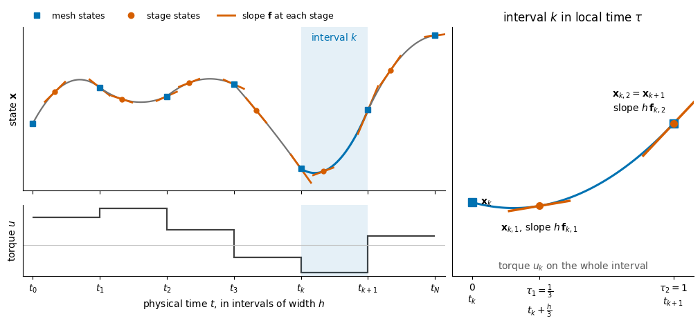
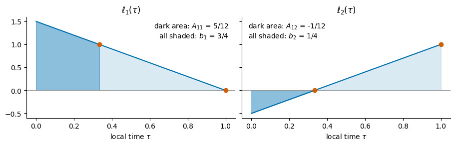
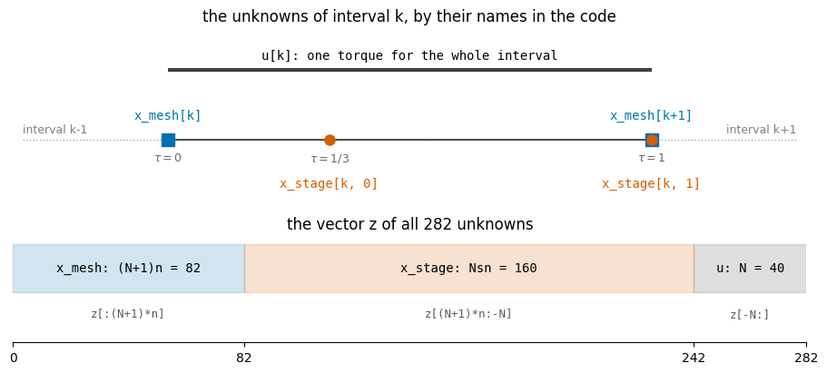
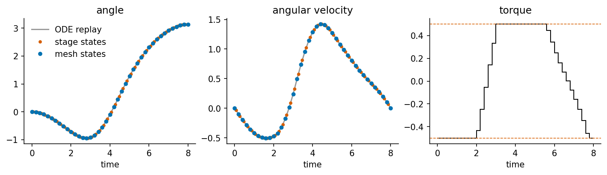

> **Cours de Pierre-Luc Bacon — 28.** [Page publiée](https://pierrelucbacon.com/rlbook/collocation-from-nodes) · [Source numérotée](../28-collocation-from-nodes.md)
> Extraction HTML → Markdown, effectuée le 2026-10-11. Les formules LaTeX, figures statiques, solutions et liens sont conservés ; les animations nécessitent le site original.

<a id="skip-to-frontmatter"></a>

# Direct Collocation for a Pendulum Swing-Up

<a id="skip-to-article"></a>

<a id="direct-collocation-for-a-pendulum-swing-up-0"></a>

<a id="l7VwGql1gE"></a>
[](https://colab.research.google.com/github/pierrelux/rlbook/blob/main/lab/notebooks/08_collocation_from_nodes.ipynb)

This demo applies the direct-collocation recipe of the chapter [Continuous-Time Transcription and Collocation](10-continuous-time-collocation.md) to a small nonlinear control problem. The chapter develops the recipe for general dynamics and general choices of nodes. Here every step is carried out once with concrete numbers and then written as a few lines of Python, so that each symbol of the recipe can be matched with a quantity in the code. The text explains why each step is needed as well as what it computes.

The demo runs in about half a minute with NumPy, SciPy, and Matplotlib and needs no other files. Run the cells in order.

<a id="the-problem-0"></a>

<a id="the-problem"></a>

## The Problem

A pendulum hangs at rest below its pivot, where a motor applies a torque $u(t)$. At time $T=8$ the pendulum must stand upright and at rest, and the motor should use as little torque as possible. Let $\theta$ be the angle measured from the hanging position and $\omega$ the angular velocity. Time is measured in units of $\sqrt{\ell/g}$ and torque in units of $mg\ell$, where $m$ is the mass, $\ell$ the length, and $g$ the gravitational acceleration. In these units the state $\mathbf x=(\theta,\omega)$ evolves according to

<a id="vgdjQr8dwR"></a>

$$
\dot\theta=\omega,\qquad \dot\omega=-\sin\theta+u.
$$

[(1)](#vgdjQr8dwR "Link to this Equation")

The term $-\sin\theta$ is gravity, which pulls the pendulum back toward the hanging position. Its largest magnitude is 1, reached when the pendulum is horizontal. The motor is weak: its torque is limited to $|u(t)|\le u_{\max}=0.5$, half of that largest gravity torque. It cannot lift the pendulum directly, and it must swing it back and forth to build up energy, which takes time. Writing the dynamics as $\dot{\mathbf x}=\mathbf f(\mathbf x,u)$, the optimal control problem is

<a id="gAXWS2BZST"></a>

$$
\min_{\mathbf x(\cdot),u(\cdot)} \int_0^T u(t)^2 dt
\quad\text{subject to}\quad
\dot{\mathbf x}=\mathbf f(\mathbf x,u),\quad
|u(t)|\le u_{\max},\quad
\mathbf x(0)=(0,0),\quad
\mathbf x(T)=(\pi,0).
$$

[(2)](#gAXWS2BZST "Link to this Equation")

Because of $\sin\theta$, the dynamics are nonlinear, and neither the optimal torque nor the resulting motion has a closed-form expression.

<a id="from-functions-to-numbers-0"></a>

<a id="from-functions-to-numbers"></a>

## From Functions to Numbers

SciPy’s `minimize`, like every nonlinear programming solver, works with a finite vector $\mathbf z$ of unknowns. It needs a function $F(\mathbf z)$ that returns the objective and a function $H(\mathbf z)$ that returns constraint residuals, which must be zero at a solution. The problem above provides neither. Its unknowns are the functions $\theta(t)$, $\omega(t)$, and $u(t)$, its constraint is a condition on a derivative at every instant, and its objective is an integral. Transcription replaces these objects by finitely many numbers and algebraic equations.

Direct collocation makes three replacements:

1.  The horizon is divided into $N$ intervals, and on each interval the state is described by a polynomial. A polynomial of low degree is determined by a few numbers, and its derivative and integral can be computed exactly from those numbers.
    
2.  The differential equation is required only at a few chosen times per interval, the **collocation nodes**, where the slope of the polynomial must equal the slope given by $\mathbf f$.
    
3.  The cost integral is replaced by a weighted sum of cost rates at the same nodes.
    

After these replacements, every condition is an equation between numbers, which the optimizer can evaluate for any candidate $\mathbf z$.

Many short intervals are used instead of one polynomial over $[0,T]$. This keeps the degree of each polynomial low, lets the accuracy improve by adding intervals, and makes each equation involve only the numbers of one interval.

The sections below follow the steps of the chapter’s [integration-form algorithm](10-continuous-time-collocation.md#alg-collocation-from-nodes). Step 1 computes fixed numbers that describe the polynomials. Steps 2 to 4 define $\mathbf z$, $F$, and $H$. Step 5 solves the problem and checks the answer against an accurate simulation. A final section builds the same problem from derivatives instead of integrals.

The first cell defines the model. The rest of the demo uses the dynamics only through calls `f(x, u)` and the cost only through calls `c(x, u)`, so another model would change only this cell.

<a id="from-functions-to-numbers-1"></a>

<a id="from-functions-to-numbers-1-code"></a>

```python
import numpy as np
import matplotlib.pyplot as plt
from fractions import Fraction
from numpy.polynomial import Polynomial
from scipy.integrate import solve_ivp
from scipy.optimize import minimize

plt.rcParams.update({"axes.spines.top": False, "axes.spines.right": False})


def f(x, u):
    # Pendulum dynamics: x = (angle, angular velocity), u = torque.
    theta, omega = x
    return np.array([omega, -np.sin(theta) + u])


def c(x, u):
    # Running cost rate.
    return u**2


T = 8.0                            # horizon
u_max = 0.5                        # torque limit
x_start = np.array([0.0, 0.0])     # hanging, at rest
x_goal = np.array([np.pi, 0.0])    # upright, at rest
```

<a id="from-functions-to-numbers-1-outputs"></a>

<a id="step-1-compute-the-rule-once-0"></a>

<a id="step-1-compute-the-rule-once"></a>

## Step 1: Compute the Rule Once

Divide $[0,T]$ into $N$ intervals of width $h=T/N$, so that interval $k$ runs from $t_k=kh$ to $t_{k+1}=t_k+h$. Inside interval $k$, measure time by the **local time** $\tau=(t-t_k)/h$, which runs from 0 at the left end to 1 at the right end. Every interval then looks the same in local time, so the numbers computed in this step on $[0,1]$ serve every interval, whatever its position and width.

Three symbols for local time appear below, and they play different roles. The letter $\tau$ stands for any point of the interval. The **collocation nodes** $\tau_1$ and $\tau_2$ are two fixed values of $\tau$, chosen once and used in every interval. This demo uses $\tau_1=\tfrac{1}{3}$ and $\tau_2=1$, called the two-stage Radau nodes. The letter $\sigma$ is the variable of integration in the integrals below, which run from 0 to some value of $\tau$. The sketch below shows what the method builds. The state trajectory consists of one polynomial piece per interval. Consecutive pieces meet at the mesh states, although their slopes may differ there. Inside each interval, the stage states sit at the nodes, where the slope of the piece must equal the slope given by $\mathbf f$. The torque is constant on each interval. The right panel shows interval $k$ in local time, with the quantities that Step 2 turns into unknowns. The trajectory in the sketch is made up for illustration; the pendulum’s trajectory appears in Step 5.

<a id="step-1-compute-the-rule-once-1"></a>

Source

<a id="step-1-compute-the-rule-once-1-code"></a>

```python
# @title Sketch a collocation trajectory and one interval in local time
def wiggle(t):                            # a made-up smooth trajectory, for the sketch only
    return 0.6 * np.sin(1.1 * t) + 0.35 * np.sin(2.4 * t + 0.8) + 0.15 * t

k, nodes = 4, np.array([1/3, 1.0])       # highlighted interval, collocation nodes
support = np.array([0, *nodes])
pieces = [Polynomial.fit(m + support, wiggle(m + support), 2) for m in range(6)]  # one per interval
torque = [0.9, 1.2, 0.5, -0.4, -0.9, 0.3]
step = np.array([-0.15, 0.15])

fig = plt.figure(figsize=(10, 4.6), constrained_layout=True)
layout = fig.add_gridspec(2, 2, width_ratios=[1.75, 1], height_ratios=[2.3, 1])
state, control = fig.add_subplot(layout[0, 0]), fig.add_subplot(layout[1, 0])
zoom = fig.add_subplot(layout[:, 1])

# The whole horizon: one quadratic piece per interval, joined at the mesh states.
for m, piece in enumerate(pieces):
    t = np.linspace(m, m + 1, 60)
    state.plot(t, piece(t), color="#0072B2" if m == k else "0.45", linewidth=2.2 if m == k else 1.6)
    for node in m + nodes:
        state.plot(node + step, piece(node) + piece.deriv()(node) * step, color="#D55E00", linewidth=2)
    state.plot(m + nodes[0], piece(m + nodes[0]), "o", color="#D55E00", markersize=5, zorder=3)
state.plot(range(7), [pieces[min(m, 5)](m) for m in range(7)], "s", color="#0072B2", markersize=6,
           zorder=3)
state.axvspan(k, k + 1, color="#0072B2", alpha=0.1, linewidth=0)
state.text(k + 0.5, 0.97, r"interval $k$", transform=state.get_xaxis_transform(), ha="center",
           va="top", color="#0072B2")
state.set(xlim=(-0.15, 6.15), xticks=range(7), xticklabels=[], yticks=[], ylabel=r"state $\mathbf{x}$")
state.plot([], [], "s", color="#0072B2", label="mesh states")
state.plot([], [], "o", color="#D55E00", label="stage states")
state.plot([], [], color="#D55E00", linewidth=2, label=r"slope $\mathbf{f}$ at each stage")
state.legend(loc="lower left", bbox_to_anchor=(0, 1), ncol=3, frameon=False, fontsize=9,
             borderaxespad=0.2)

# The torque: one constant value per interval.
control.stairs(torque, range(7), baseline=None, color="0.25", linewidth=1.6)
control.axvspan(k, k + 1, color="#0072B2", alpha=0.1, linewidth=0)
control.axhline(0, color="0.75", linewidth=0.8)
control.set(xlim=(-0.15, 6.15), xticks=range(7), yticks=[], ylabel=r"torque $u$",
            xticklabels=[r"$t_0$", r"$t_1$", r"$t_2$", r"$t_3$", r"$t_k$", r"$t_{k+1}$", r"$t_N$"],
            xlabel=r"physical time $t$, in intervals of width $h$")

# Interval k in local time: the same piece, with the unknowns attached to it.
local = Polynomial(pieces[k](k + Polynomial([0, 1])).coef)
tau_grid = np.linspace(0, 1, 100)
zoom.plot(tau_grid, local(tau_grid), color="#0072B2", linewidth=2.2)
for node in nodes:
    zoom.plot(node + step, local(node) + local.deriv()(node) * step, color="#D55E00", linewidth=2.5)
zoom.plot([0, 1], local([0, 1]), "s", color="#0072B2", markersize=8, zorder=3)
zoom.plot(nodes, local(nodes), "o", color="#D55E00", markersize=7, zorder=3)
zoom.annotate(r"$\mathbf{x}_k$", (0, local(0)), xytext=(9, 0), textcoords="offset points",
              va="center")
zoom.annotate(r"$\mathbf{x}_{k,1}$, slope $h\,\mathbf{f}_{k,1}$", (1/3, local(1/3)),
              xytext=(0, -16), textcoords="offset points", ha="center", va="top")
zoom.annotate(r"$\mathbf{x}_{k,2}=\mathbf{x}_{k+1}$" "\n" r"slope $h\,\mathbf{f}_{k,2}$",
              (1, local(1)), xytext=(-8, 10), textcoords="offset points", ha="right", va="bottom")
zoom.text(0.5, 0.03, r"torque $u_k$ on the whole interval", transform=zoom.transAxes, ha="center",
          color="0.35")
low, high = zoom.get_ylim()
zoom.set(xlim=(-0.1, 1.1), ylim=(low - 0.45 * (high - low), high + 0.45 * (high - low)), yticks=[],
         xticks=[0, 1/3, 1], title=r"interval $k$ in local time $\tau$",
         xticklabels=["0\n" r"$t_k$", r"$\tau_1=\frac{1}{3}$" "\n" r"$t_k+\frac{h}{3}$",
                      r"$\tau_2=1$" "\n" r"$t_{k+1}$"])
plt.show()
```

<a id="step-1-compute-the-rule-once-1-outputs"></a>



<a id="step-1-compute-the-rule-once-2"></a>

The differential equation gives the slope of the state through a known function, $\dot{\mathbf x}=\mathbf f(\mathbf x,u)$. By the fundamental theorem of calculus, the state at local time $\tau$ in interval $k$ equals the state at the left end plus the integral of the slope:

<a id="ycpTR8ChiY"></a>

$$
\mathbf x(t_k+h\tau)
=\mathbf x_k+\int_{t_k}^{t_k+h\tau}\mathbf f(\mathbf x(t),u_k)dt
=\mathbf x_k+h\int_0^{\tau}\mathbf f(\mathbf x(t_k+h\sigma),u_k)d\sigma .
$$

[(3)](#ycpTR8ChiY "Link to this Equation")

The second form substitutes $t=t_k+h\sigma$, so that $dt=h d\sigma$. This is where the factor $h$ comes from: it converts a stretch of local time into physical time.

The function $\mathbf f$ is known, but the integrand also depends on the trajectory $\mathbf x(t)$, which is what we are trying to find, so this integral cannot be evaluated as it stands. Collocation evaluates the integrand only at the nodes and replaces it by the polynomial that takes those values. Write $\mathbf f_{k,j}=\mathbf f(\mathbf x_{k,j},u_k)$ for its value at node $j$, where $\mathbf x_{k,j}$ is the state at that node. Each value is computed from the known function $\mathbf f$. What is not known in advance is the state $\mathbf x_{k,j}$ at which to evaluate it, and Step 2 makes those states unknowns of the optimization. For now, treat $\mathbf f_{k,1}$ and $\mathbf f_{k,2}$ as given numbers.

The number of nodes is a choice of the method. Exactly one polynomial of degree at most $s-1$ passes through $s$ values at $s$ distinct nodes, so more nodes give a more flexible interpolant and usually a more accurate rule. This demo uses $s=2$ nodes, the smallest number whose interpolant can vary inside the interval, so the interpolating polynomial is the line

<a id="FDlMoBayCu"></a>

$$
\mathbf f_{k,1}\ell_1(\sigma)+\mathbf f_{k,2}\ell_2(\sigma).
$$

[(4)](#FDlMoBayCu "Link to this Equation")

Each **Lagrange basis function** $\ell_j$ equals one at its own node $\tau_j$ and zero at the other nodes. In general it is the product

<a id="upmWuy9cgI"></a>

$$
\ell_j(\sigma)=\prod_{m\neq j}\frac{\sigma-\tau_m}{\tau_j-\tau_m}.
$$

[(5)](#upmWuy9cgI "Link to this Equation")

Each factor is zero at one of the other nodes and equals one at $\tau_j$. The denominators are numbers, so $\ell_j$ is a product of $s-1$ linear factors in $\sigma$, which is a polynomial of degree $s-1$. With two nodes each product has a single factor: $\ell_1(\sigma)=(\sigma-\tau_2)/(\tau_1-\tau_2)$ and $\ell_2(\sigma)=(\sigma-\tau_1)/(\tau_2-\tau_1)$. The experiments at the end try other numbers of nodes. Unlike the true integrand, a polynomial can be integrated exactly, which is the purpose of the replacement. Substituting the interpolant into the integral gives

<a id="trxfIEVk0l"></a>

$$
\mathbf x(t_k+h\tau)
\approx\mathbf x_k+h\int_0^{\tau}\sum_{j=1}^{2}\mathbf f_{k,j}\ell_j(\sigma)d\sigma
=\mathbf x_k+h\sum_{j=1}^{2}\mathbf f_{k,j}\int_0^{\tau}\ell_j(\sigma)d\sigma .
$$

[(6)](#trxfIEVk0l "Link to this Equation")

The last equality uses the linearity of the integral. The integral of a sum is the sum of the integrals, and each $\mathbf f_{k,j}$ is a constant that does not depend on $\sigma$, so it moves outside its integral. After this exchange, the slopes only multiply integrals of the basis functions, and those integrals depend on the nodes alone. Evaluating them with $\tau$ equal to each node and to the right end gives the **rule** of the method:

<a id="ABaEExYG6m"></a>

$$
A_{ij}=\int_0^{\tau_i}\ell_j(\sigma)d\sigma,
\qquad
b_j=\int_0^1\ell_j(\sigma)d\sigma.
$$

[(7)](#ABaEExYG6m "Link to this Equation")

The entry $A_{ij}$ is the share of slope $j$ in the state change from the left end to node $i$, per unit of interval width. The weight $b_j$ is the share of slope $j$ in the change over the whole interval.

These integrals can be computed exactly, because each $\ell_j$ is a polynomial. The product formula above is one way to write it. Multiplying out its linear factors writes the same polynomial as a sum of powers, $\ell_j(\sigma)=a_0+a_1\sigma+\cdots+a_d\sigma^d$, and for the nodes of this demo this is done by hand below. In that form, the linearity used above applies again: the integral of a sum is the sum of the integrals of its terms, and each coefficient $a_m$ moves outside its integral. Each remaining integral is a power of $\sigma$, which the power rule integrates:

<a id="LlSAaCJbaM"></a>

$$
\int_0^{\tau}\ell_j(\sigma)d\sigma
=\sum_{m=0}^{d}a_m\int_0^{\tau}\sigma^m d\sigma
=\sum_{m=0}^{d}a_m\frac{\tau^{m+1}}{m+1}.
$$

[(8)](#LlSAaCJbaM "Link to this Equation")

The antiderivative $L_j(\tau)=\int_0^{\tau}\ell_j(\sigma)d\sigma$ is therefore again a polynomial, of one degree higher. The entries $A_{ij}=L_j(\tau_i)$ and $b_j=L_j(1)$ are evaluations of $L_j$, and no numerical approximation of an integral is involved. In code, NumPy’s `Polynomial` stores a polynomial as its coefficients $(a_0,a_1,\ldots,a_d)$ in increasing powers, and its `.integ()` method applies the power rule to them, which gives the coefficients $(0,a_0,\tfrac{a_1}{2},\ldots,\tfrac{a_d}{d+1})$. The leading 0 is the integration constant, chosen so that $L_j(0)=0$.

By hand, for $\tau_1=\tfrac{1}{3}$ and $\tau_2=1$, multiplying out the single factor of each product gives the basis functions in powers of $\tau$:

<a id="tWoCs9OdE4"></a>

$$
\ell_1(\tau)=\frac{\tau-1}{\tfrac{1}{3}-1}=\frac{3}{2}-\frac{3}{2}\tau,
\qquad
\ell_2(\tau)=\frac{\tau-\tfrac{1}{3}}{1-\tfrac{1}{3}}=-\frac{1}{2}+\frac{3}{2}\tau.
$$

[(9)](#tWoCs9OdE4 "Link to this Equation")

The power rule turns a constant $a$ into $a\tau$ and a term $a\tau$ into $\tfrac{a}{2}\tau^2$, so the antiderivatives are

<a id="bttY8rwost"></a>

$$
L_1(\tau)=\frac{3}{2}\tau-\frac{3}{4}\tau^2,
\qquad
L_2(\tau)=-\frac{1}{2}\tau+\frac{3}{4}\tau^2.
$$

[(10)](#bttY8rwost "Link to this Equation")

Differentiating them returns $\ell_1$ and $\ell_2$, which checks the calculation, and both vanish at $\tau=0$. Each entry of the rule is now one evaluation:

<a id="FVjXJikmKw"></a>

$$
\begin{aligned}
A_{11}&=L_1(\tfrac{1}{3})=\tfrac{1}{2}-\tfrac{1}{12}=\tfrac{5}{12},&
A_{12}&=L_2(\tfrac{1}{3})=-\tfrac{1}{6}+\tfrac{1}{12}=-\tfrac{1}{12},\cr
A_{21}&=L_1(1)=\tfrac{3}{2}-\tfrac{3}{4}=\tfrac{3}{4},&
A_{22}&=L_2(1)=-\tfrac{1}{2}+\tfrac{3}{4}=\tfrac{1}{4}.
\end{aligned}
$$

[(11)](#FVjXJikmKw "Link to this Equation")

The weights $b_j=L_j(1)$ repeat the second row, because $\tau_2=1$ is the right end of the interval:

<a id="Tvzlmfj81n"></a>

$$
A=\begin{bmatrix}
\tfrac{5}{12}&-\tfrac{1}{12}\cr
\tfrac{3}{4}&\tfrac{1}{4}
\end{bmatrix},
\qquad
b=\begin{bmatrix}\tfrac{3}{4}\cr \tfrac{1}{4}\end{bmatrix}.
$$

[(12)](#Tvzlmfj81n "Link to this Equation")

The code performs the same operations for any distinct nodes: it multiplies the linear factors of each $\ell_j$, integrates with `.integ()`, and evaluates. It also prints the coefficient lists, which match the expressions above.

<a id="step-1-compute-the-rule-once-3"></a>

<a id="step-1-compute-the-rule-once-3-code"></a>

```python
tau = np.array([1/3, 1.0])         # collocation nodes


def lagrange_basis(nodes):
    # ell_j(sigma) = product over m != j of (sigma - tau_m) / (tau_j - tau_m)
    sigma = Polynomial([0.0, 1.0])                  # the polynomial 0 + 1*sigma
    basis = []
    for j, tau_j in enumerate(nodes):
        ell = Polynomial([1.0])                     # start from the constant 1
        for m, tau_m in enumerate(nodes):
            if m != j:
                ell = ell * (sigma - tau_m) / (tau_j - tau_m)
        basis.append(ell)
    return basis


# A[i, j] is the integral of ell_j from 0 to tau_i, and b[j] its integral from 0 to 1.
L = [ell.integ() for ell in lagrange_basis(tau)]     # antiderivatives with L_j(0) = 0
A = np.array([[L_j(tau_i) for L_j in L] for tau_i in tau])
b = np.array([L_j(1.0) for L_j in L])


def frac(value):
    # Round a number to a nearby fraction, to compare with the hand calculation.
    return str(Fraction(value).limit_denominator(1000))


def show(name, array):
    print(name, "=", str(np.vectorize(frac)(array).tolist()).replace("'", ""))


for j, (ell, L_j) in enumerate(zip(lagrange_basis(tau), L), start=1):
    show(f"coefficients of ell_{j}", ell.coef)
    show(f"coefficients of L_{j}", L_j.coef)
show("A", A)
show("b", b)
show("row sums of A", A.sum(axis=1))
show("sum of b", b.sum())
```

<a id="step-1-compute-the-rule-once-3-outputs"></a>

```
coefficients of ell_1 = [3/2, -3/2]
coefficients of L_1 = [0, 3/2, -3/4]
coefficients of ell_2 = [-1/2, 3/2]
coefficients of L_2 = [0, -1/2, 3/4]
A = [[5/12, -1/12], [3/4, 1/4]]
b = [3/4, 1/4]
row sums of A = [1/3, 1]
sum of b = 1
```

<a id="step-1-compute-the-rule-once-4"></a>

In `lagrange_basis`, `Polynomial([0.0, 1.0])` is the polynomial whose coefficients are 0 and 1 in increasing powers, that is, $0+1\sigma$, or $\sigma$ itself. Arithmetic on `Polynomial` objects returns new polynomials, so `sigma - tau_m` is the polynomial $\sigma-\tau_m$, stored as the coefficients `[-tau_m, 1.0]`. The loop starts from the constant polynomial 1 and multiplies in one factor $(\sigma-\tau_m)/(\tau_j-\tau_m)$ for every other node, which is the product formula for $\ell_j$ written as code. The printed coefficient lists read in increasing powers of $\tau$. For example, `[3/2, -3/2]` is $\ell_1(\tau)=\tfrac{3}{2}-\tfrac{3}{2}\tau$, and `.integ()` turns it into `[0, 3/2, -3/4]`, which is $L_1(\tau)=\tfrac{3}{2}\tau-\tfrac{3}{4}\tau^2$. Calling `L_j(tau_i)` evaluates that polynomial at $\tau_i$, which gives the integral from 0 to $\tau_i$. The printed arrays agree with the hand calculation.

> **Question.** The printed row sums of $A$ equal the nodes, and the weights $b$ sum to one. Why must this hold for any choice of nodes? Hint: consider a motion whose slope is the same at every node.

Answer

If every slope equals the same value $\mathbf f$, the interpolated slope is that constant, and the state changes by $h\tau_i\mathbf f$ between the left end and node $i$, and by $h\mathbf f$ over the whole interval. The rule gives these changes as $h\sum_jA_{ij}\mathbf f$ and $h\sum_jb_j\mathbf f$, so each row of $A$ must sum to $\tau_i$ and the weights $b$ must sum to one. A rule that failed this check would not reproduce motion at constant velocity.

The figure below draws each basis function and shows the entries of the rule as signed areas under it.

<a id="step-1-compute-the-rule-once-5"></a>

Source

<a id="step-1-compute-the-rule-once-5-code"></a>

```python
# @title Plot each basis function and the areas that form A and b
fig, axes = plt.subplots(1, len(tau), figsize=(4.5 * len(tau), 2.8), squeeze=False,
                         sharey=True, constrained_layout=True)
grid = np.linspace(0, 1, 200)
for j, (ax, ell) in enumerate(zip(axes[0], lagrange_basis(tau))):
    to_node, to_end = np.linspace(0, tau[0], 50), np.linspace(tau[0], 1, 100)
    ax.axhline(0, color="0.6", linewidth=0.8)
    ax.fill_between(to_node, ell(to_node), color="#0072B2", alpha=0.45)
    ax.fill_between(to_end, ell(to_end), color="#0072B2", alpha=0.15)
    ax.plot(grid, ell(grid), color="#0072B2")
    ax.plot(tau, ell(tau), "o", color="#D55E00")
    ax.set(xlabel=r"local time $\tau$", title=rf"$\ell_{{{j + 1}}}(\tau)$")
    label = (rf"dark area: $A_{{1{j + 1}}}$ = {frac(A[0, j])}" "\n"
             rf"all shaded: $b_{{{j + 1}}}$ = {frac(b[j])}")
    left = ell(0) < ell(1)          # write the label on the side where the curve is low
    ax.text(0.03 if left else 0.97, 0.95, label, transform=ax.transAxes,
            ha="left" if left else "right", va="top")
plt.show()
```

<a id="step-1-compute-the-rule-once-5-outputs"></a>



<a id="step-1-compute-the-rule-once-6"></a>

The orange dots mark the nodes, where each basis function equals one or zero. The entry $A_{12}=-\tfrac{1}{12}$ is negative because $\ell_2$ is negative between 0 and $\tfrac{1}{3}$, and a negative weight is not an error. The interpolated slope is a line through $\mathbf f_{k,1}$ at $\tau=\tfrac{1}{3}$ and $\mathbf f_{k,2}$ at $\tau=1$. Increasing $\mathbf f_{k,2}$ while $\mathbf f_{k,1}$ stays fixed tilts this line upward to the right of $\tau=\tfrac{1}{3}$ and downward to its left, so the state gains less before the first node.

Any distinct nodes produce a valid rule, but the choice affects accuracy. The Radau nodes make the weights $b$ integrate every polynomial of degree up to two exactly. For example, $\tfrac{3}{4}(\tfrac{1}{3})^2+\tfrac{1}{4}(1)^2=\tfrac{1}{3}$, which equals $\int_0^1\tau^2d\tau$. Two nodes at the ends of the interval, which give the trapezoidal rule, integrate only polynomials of degree up to one exactly. The experiments at the end compare several node choices on the pendulum.

The arrays $A$ and $b$ are computed once, before any optimization, and stay fixed while the optimizer searches.

<a id="step-2-allocate-the-variables-0"></a>

<a id="step-2-allocate-the-variables"></a>

## Step 2: Allocate the Variables

The rule needs the slopes at the nodes, $\mathbf f_{k,j}=\mathbf f(\mathbf x_{k,j},u_k)$, and those depend on the states at the nodes, which are unknown before the problem is solved. Direct collocation does not compute these states by simulation. It makes them unknowns of the optimization and adds equations, in Step 3, that make them consistent. On interval $k$ the unknowns are a mesh state, the stage states, and a torque. The diagram after the next code cell shows them with their names in the code and their places in the vector $\mathbf z$.

The **mesh state** $\mathbf x_k$ is the state at the left end $t_k$. The preceding interval ends at the same time and uses the same variable, and this sharing keeps the trajectory continuous. The **stage states** $\mathbf x_{k,1}$ and $\mathbf x_{k,2}$ are the states at the two nodes. The torque $u_k$ is held constant over the interval, a choice called a **zero-order hold** and the simplest control representation. In the chapter’s notation, the control matrix $B$ is then a column of ones. A linear or quadratic torque would add numbers per interval without changing the construction of the state.

All states and torques are unknowns at the same time, and no simulation runs inside the optimizer. This is why direct collocation is called a simultaneous method. In single shooting, by contrast, the optimizer chooses only the torques, and a time integrator computes the states.

Python counts from zero, so the stage state $\mathbf x_{k,j}$ is stored in `x_stage[k, j-1]`. The solver needs all unknowns in one flat vector $\mathbf z$, and the function `unpack` cuts that vector into the three arrays.

<a id="step-2-allocate-the-variables-1"></a>

<a id="step-2-allocate-the-variables-1-code"></a>

```python
N = 40                              # intervals
h = T / N                           # interval width
s = len(tau)                        # stages per interval
n = len(x_start)                    # state dimension
n_z = (N + 1) * n + N * s * n + N   # number of unknowns


def unpack(z):
    x_mesh = z[:(N + 1) * n].reshape(N + 1, n)      # x_mesh[k] is the mesh state x_k
    x_stage = z[(N + 1) * n:-N].reshape(N, s, n)    # x_stage[k, j] is a stage state
    u = z[-N:]                                      # u[k] is the torque on interval k
    return x_mesh, x_stage, u


print("number of unknowns:", n_z)
```

<a id="step-2-allocate-the-variables-1-outputs"></a>

```
number of unknowns: 282
```

<a id="step-2-allocate-the-variables-2"></a>

Source

<a id="step-2-allocate-the-variables-2-code"></a>

```python
# @title Draw the unknowns of one interval and their places in z
fig, (interval, vector) = plt.subplots(2, 1, figsize=(9, 4.0), height_ratios=[1.7, 1],
                                       constrained_layout=True)
mono = dict(family="monospace", fontsize=10)

# One interval in local time, with the unknowns that belong to it.
interval.plot([-0.3, 1.3], [0, 0], color="0.65", linewidth=1, linestyle=":")
interval.plot([0, 1], [0, 0], color="0.3", linewidth=1.5)
interval.plot([0, 1], [0, 0], "s", color="#0072B2", markersize=10, zorder=3)
interval.plot(tau, np.zeros(s), "o", color="#D55E00", markersize=8, zorder=4)
interval.text(0, 0.3, "x_mesh[k]", ha="center", color="#0072B2", **mono)
interval.text(1, 0.3, "x_mesh[k+1]", ha="center", color="#0072B2", **mono)
for j, node in enumerate(tau):
    interval.text(node, -0.55, f"x_stage[k, {j}]", ha="center", va="top", color="#D55E00", **mono)
for point in sorted({0.0, *tau, 1.0}):
    interval.text(point, -0.18, rf"$\tau={frac(point)}$", ha="center", va="top", color="0.4",
                  fontsize=9)
interval.plot([0, 1], [1.0, 1.0], color="0.25", linewidth=3, solid_capstyle="butt")
interval.text(0.5, 1.12, "u[k]: one torque for the whole interval", ha="center", va="bottom",
              **mono)
interval.text(-0.3, 0.1, "interval k-1", color="0.5", fontsize=9)
interval.text(1.3, 0.1, "interval k+1", color="0.5", fontsize=9, ha="right")
interval.set(xlim=(-0.32, 1.32), ylim=(-1.0, 1.6), xticks=[], yticks=[],
             title="the unknowns of interval k, by their names in the code")
interval.axis("off")

# The vector z: the three arrays laid end to end, as unpack reads them.
sizes = [(N + 1) * n, N * s * n, N]
labels = [f"x_mesh: (N+1)n = {sizes[0]}", f"x_stage: Nsn = {sizes[1]}", f"u: N = {sizes[2]}"]
slices = ["z[:(N+1)*n]", "z[(N+1)*n:-N]", "z[-N:]"]
start = 0
for size, label, piece, color in zip(sizes, labels, slices, ["#0072B2", "#D55E00", "0.3"]):
    vector.barh(0, size, left=start, height=0.9, color=color, alpha=0.18, edgecolor=color)
    vector.text(start + size / 2, 0, label, ha="center", va="center", **mono)
    vector.text(start + size / 2, -0.75, piece, ha="center", va="top", color="0.35",
                family="monospace", fontsize=9)
    start += size
vector.set(xlim=(0, n_z), ylim=(-1.4, 0.6), yticks=[], xticks=np.cumsum([0, *sizes]),
           title=f"the vector z of all {n_z} unknowns")
vector.spines[["left"]].set_visible(False)
plt.show()
```

<a id="step-2-allocate-the-variables-2-outputs"></a>



<a id="step-2-allocate-the-variables-3"></a>

> **For the exam.** Count the unknowns of a collocation transcription from the number of intervals $N$, the number of nodes $s$, the state dimension $n$, and the control representation. Here the count is $(N+1)n+Nsn+N$, which is $41\cdot2+40\cdot2\cdot2+40=282$: the mesh states, the stage states, and one torque per interval. Step 3 counts the equations in the same way.

<a id="step-3-assemble-each-interval-0"></a>

<a id="step-3-assemble-each-interval"></a>

## Step 3: Assemble Each Interval

The slopes $\mathbf f_{k,j}=\mathbf f(\mathbf x_{k,j},u_k)$ are now computed from the unknowns, so they change whenever the optimizer changes $\mathbf z$. The rule $A$, $b$ does not change. On each interval, the unknowns must satisfy the chapter’s **stage equations** and **endpoint equation**:

<a id="boep35miDm"></a>

$$
\mathbf x_{k,i}=\mathbf x_k+h\sum_{j=1}^{s}A_{ij}\mathbf f_{k,j},
\qquad
\mathbf x_{k+1}=\mathbf x_k+h\sum_{j=1}^{s}b_j\mathbf f_{k,j}.
$$

[(13)](#boep35miDm "Link to this Equation")

> **Question.** Stop here before reading on. Where do these two equations come from? Derive them from the results of Step 1.

Answer

Step 1 showed that integrating the interpolated slopes from the left end gives the state inside the interval:

<a id="MHIJmCmO2Z"></a>

$$
\mathbf x(t_k+h\tau)\approx\mathbf x_k
+h\sum_{j=1}^{s}\mathbf f_{k,j}\int_0^{\tau}\ell_j(\sigma)d\sigma .
$$

[(14)](#MHIJmCmO2Z "Link to this Equation")

Setting $\tau=\tau_i$ turns each integral into $A_{ij}$, and the right side becomes the value of the polynomial at node $i$. Requiring that value to equal the stored stage state $\mathbf x_{k,i}$ gives the stage equation. Setting $\tau=1$ turns each integral into $b_j$, and the right side becomes the value at the right end. Requiring that value to equal the next mesh state $\mathbf x_{k+1}$ gives the endpoint equation.

The stage equation for node $i$ requires the stored stage state $\mathbf x_{k,i}$ to lie on the polynomial built from the slopes. It is needed because the slopes were evaluated at the stored stage states. If those states could differ from the polynomial’s values, the slopes would describe some other trajectory. When the stage equation holds, the polynomial has the value $\mathbf x_{k,i}$ at node $i$, and its slope there is $\mathbf f_{k,i}$ by construction of the interpolant. The polynomial therefore satisfies the differential equation at node $i$. This is where the name comes from: to collocate is to place together, from the Latin _com-_ (together) and _locare_ (to place). A collocation method places the approximation and the differential equation together at the chosen nodes, where they must agree exactly. Between the nodes, nothing forces them to agree.

The endpoint equation requires the next mesh state to equal the value of the polynomial at the right end of the interval. The difference between its two sides is called the **defect**. Because $\mathbf x_{k+1}$ is also the starting state of interval $k+1$, a zero defect joins consecutive pieces into one continuous trajectory.

With the numbers from Step 1, the three equations read

<a id="HfoUgEprQr"></a>

$$
\begin{aligned}
\mathbf x_{k,1}&=\mathbf x_k
+h\left(\tfrac{5}{12}\mathbf f_{k,1}-\tfrac{1}{12}\mathbf f_{k,2}\right),\cr
\mathbf x_{k,2}&=\mathbf x_k
+h\left(\tfrac{3}{4}\mathbf f_{k,1}+\tfrac{1}{4}\mathbf f_{k,2}\right),\cr
\mathbf x_{k+1}&=\mathbf x_k
+h\left(\tfrac{3}{4}\mathbf f_{k,1}+\tfrac{1}{4}\mathbf f_{k,2}\right).
\end{aligned}
$$

[(15)](#HfoUgEprQr "Link to this Equation")

The first two use the rows of $A$ and the third uses $b$. The second and third equations have the same right side because $\tau_2=1$. The second row of $A$ integrates each basis function from 0 to $\tau_2=1$, which is the same integral that defines $b$, so $A_{2j}=b_j$: both rows are $(\tfrac{3}{4},\tfrac{1}{4})$. Two quantities equal to the same expression are equal to each other, so the equations imply $\mathbf x_{k,2}=\mathbf x_{k+1}$. This matches the picture: node 2 sits at the right end of the interval, so the state there is the next mesh state. The code keeps both variables and both equations anyway, so that it stays valid for nodes that do not include the right end.

The objective is built the same way. The cost accumulated since time 0 behaves like an extra state whose slope is the cost rate $c(\mathbf x,u)$, and the same rule integrates it. Its stage equations would use the rows of $A$ and give the cost accumulated up to each node. The objective needs only the total over each interval, which is the value at the right end, so only the weights $b$ appear. Interval $k$ adds $h(\tfrac{3}{4}c_{k,1}+\tfrac{1}{4}c_{k,2})$ to the objective, where $c_{k,j}=c(\mathbf x_{k,j},u_k)$. Here $c=u_k^2$ is constant on the interval and the weights sum to one, so this sum equals $hu_k^2$, the exact integral of the squared torque over the interval. The boundary conditions $\mathbf x_0=(0,0)$ and $\mathbf x_N=(\pi,0)$ and the torque limits $-u_{\max}\le u_k\le u_{\max}$ complete the finite problem. Because the torque is constant on each interval, bounding each $u_k$ bounds the torque at every instant, not only at the nodes.

<a id="step-3-assemble-each-interval-1"></a>

<a id="step-3-assemble-each-interval-1-code"></a>

```python
def objective(z):                                                       # F(z)
    x_mesh, x_stage, u = unpack(z)
    return sum(h * b[j] * c(x_stage[k, j], u[k]) for k in range(N) for j in range(s))


def equalities(z):                                                      # H(z) = 0
    x_mesh, x_stage, u = unpack(z)
    residuals = [x_mesh[0] - x_start, x_mesh[N] - x_goal]               # boundary conditions
    for k in range(N):
        slopes = np.array([f(x_stage[k, j], u[k]) for j in range(s)])   # f at every stage
        residuals.append(x_stage[k] - x_mesh[k] - h * A @ slopes)       # stage equations
        residuals.append(x_mesh[k + 1] - x_mesh[k] - h * b @ slopes)    # endpoint equation
    return np.concatenate([r.ravel() for r in residuals])


print("number of equations:", equalities(np.zeros(n_z)).size)
```

<a id="step-3-assemble-each-interval-1-outputs"></a>

```
number of equations: 244
```

<a id="step-3-assemble-each-interval-2"></a>

In `equalities`, the array `slopes` has one row per stage and one column per state component. The product `A @ slopes` computes all the sums $\sum_jA_{ij}\mathbf f_{k,j}$ at once, one row per node $i$, and `b @ slopes` computes the endpoint sum. Each residual is written as left side minus right side, so a solution makes it zero. The last line flattens the residuals into the single vector $H(\mathbf z)$ that the solver expects.

The count of equations explains what the optimizer is free to choose. The 240 stage and endpoint equations match the 240 states other than $\mathbf x_0$, so for a given initial state and given torques they determine the whole trajectory, as a simulation would. The torque is a zero-order hold with one value on each of the 40 intervals, so the optimizer chooses 40 torques. The four boundary equations fix $\mathbf x_0$ and impose two terminal conditions, which remove two of those choices and leave $40-2=38$ degrees of freedom. The torque limits are inequalities, not equations: they do not change this count, but they rule out part of that family. Among the torque sequences that bring the pendulum to the goal within the limits, the objective selects the one with the least effort.

The table collects the correspondence between the chapter’s symbols and the code.

| Chapter | Code | Meaning |
| --- | --- | --- |
| $\tau_j$ | `tau[j-1]` | collocation node $j$, in local time |
| $\ell_j$, $L_j$ | `lagrange_basis(tau)[j-1]`, `L[j-1]` | basis function and its antiderivative |
| $A_{ij}$, $b_j$ | `A[i-1, j-1]`, `b[j-1]` | the rule: weights of the slopes |
| $h$ | `h` | interval width |
| $\mathbf x_k$ | `x_mesh[k]` | state at the mesh time $t_k$ |
| $\mathbf x_{k,j}$ | `x_stage[k, j-1]` | state at node $j$ of interval $k$ |
| $u_k$ | `u[k]` | torque on interval $k$ |
| $\mathbf f_{k,j}$ | `slopes[j-1]` | ODE slope at node $j$ of interval $k$ |
| $\mathbf z$ | `z` | all unknowns in one vector |
| $F(\mathbf z)$, $H(\mathbf z)$ | `objective(z)`, `equalities(z)` | objective and equality residuals |

<a id="step-4-connect-the-controls-0"></a>

<a id="step-4-connect-the-controls"></a>

## Step 4: Connect the Controls

The state must be continuous, because it is obtained by integrating its rate of change, but the control need not be. A motor command can jump from one value to the next, as it does here between intervals, so no equation links $u_k$ to $u_{k+1}$. State continuity needs no extra equation either, because consecutive intervals share the mesh state $\mathbf x_{k+1}$. A smooth torque could be obtained by making it linear on each interval and sharing its endpoint values between intervals.

<a id="step-5-solve-and-check-0"></a>

<a id="step-5-solve-and-check"></a>

## Step 5: Solve and Check

The solver needs a starting point. The initial guess moves the states along a straight line from the start to the goal and sets the torque to zero. This is not a motion of the pendulum: without torque the pendulum would stay hanging. The largest residual at the guess, printed below, measures how far the guess is from satisfying the equations. A simultaneous method can start from such an infeasible guess, which only has to describe roughly where the motion should go. Such a guess is often easier to provide than a good torque sequence.

SciPy’s SLSQP method then improves $\mathbf z$ step by step. At each iteration it approximates $F$ by a quadratic function and $H$ by a linear one, solves that approximation for a step, and repeats. Intermediate iterates need not satisfy $H(\mathbf z)=\mathbf 0$; at convergence the residuals are zero up to the solver’s tolerance. SLSQP estimates the derivatives of `objective` and `equalities` by finite differences, which is adequate for 282 unknowns. Larger problems supply exact derivatives, for example by automatic differentiation, and use solvers that exploit the sparsity of the equations.

The torque limits reach the solver as bounds. SLSQP accepts one (lower, upper) pair per entry of $\mathbf z$, with `None` for no bound: the states are free, and each of the last $N$ entries, the torques, must lie in $[-u_{\max},u_{\max}]$. The option `ftol=1e-10` asks for a tighter tolerance than SLSQP’s default, so that the two formulations compared at the end of the demo agree closely.

<a id="step-5-solve-and-check-1"></a>

<a id="step-5-solve-and-check-1-code"></a>

```python
t = np.linspace(0, T, N + 1)                   # mesh times
t_stage = t[:-1, None] + h * tau               # stage times, shape (N, s)
z0 = np.concatenate([
    np.outer(t, x_goal / T).ravel(),           # mesh states on a straight line
    np.outer(t_stage, x_goal / T).ravel(),     # stage states on the same line
    np.zeros(N),                               # zero torque
])
bounds = [(None, None)] * (len(z0) - N) + [(-u_max, u_max)] * N   # limits on the torques
print(f"largest residual at the initial guess = {abs(equalities(z0)).max():.2f}")

solution = minimize(objective, z0, method="SLSQP", bounds=bounds, options={"ftol": 1e-10},
                    constraints={"type": "eq", "fun": equalities})
x_mesh, x_stage, u = unpack(solution.x)
print(solution.message)
print(f"cost = {solution.fun:.4f}")
print(f"largest torque used = {abs(u).max():.2f}")
print(f"largest residual = {abs(equalities(solution.x)).max():.1e}")
```

<a id="step-5-solve-and-check-1-outputs"></a>

```
largest residual at the initial guess = 0.20
```

```
Optimization terminated successfully
cost = 1.4429
largest torque used = 0.50
largest residual = 1.5e-12
```

<a id="step-5-solve-and-check-2"></a>

> **For the exam.** A small residual does not mean that the trajectory is accurate. Explain why, and say how to check accuracy.

The residual measures one thing: how far the stored numbers are from satisfying the collocation equations. The solver drives it down to its tolerance. Those equations are not the differential equation. They require the ODE only at the nodes, and they replace the integrand by its polynomial interpolant, so even an exact solution of the equations differs from the true motion under the same torques. This **discretization error** depends on the interval width and the nodes, not on the solver, so tightening the solver’s tolerance does not reduce it. To measure it, the next cell applies the optimized torques to the pendulum with an accurate ODE solver and compares the result with the stored states. This replay is one of the checks described in the chapter’s section on [checking the continuous trajectory](10-continuous-time-collocation.md#sec-collocation-validation).

<a id="step-5-solve-and-check-3"></a>

<a id="step-5-solve-and-check-3-code"></a>

```python
def replay(u):
    # Integrate the ODE accurately under the piecewise-constant torques.
    states = [x_start]
    for k in range(N):
        step = solve_ivp(lambda _, x: f(x, u[k]), [0, h], states[-1], rtol=1e-10, atol=1e-10)
        states.append(step.y[:, -1])
    return np.array(states)


x_replay = replay(u)
print(f"largest difference from the replay = {abs(x_mesh - x_replay).max():.1e}")
```

<a id="step-5-solve-and-check-3-outputs"></a>

```
largest difference from the replay = 4.4e-03
```

<a id="step-5-solve-and-check-4"></a>

Source

<a id="step-5-solve-and-check-4-code"></a>

```python
# @title Plot the stored states, the replay, and the torque
fig, axes = plt.subplots(1, 3, figsize=(10, 2.8), constrained_layout=True, dpi=150)
for i, name in enumerate(["angle", "angular velocity"]):
    axes[i].plot(t, x_replay[:, i], color="0.6", label="ODE replay")
    axes[i].plot(t_stage.ravel(), x_stage[:, :, i].ravel(), ".", color="#D55E00",
                 label="stage states")
    axes[i].plot(t, x_mesh[:, i], "o", color="#0072B2", markersize=4, label="mesh states")
    axes[i].set(xlabel="time", title=name)
axes[0].legend(frameon=False)
axes[2].stairs(u, t, baseline=None, color="black")
for limit in (-u_max, u_max):                       # the torque limits
    axes[2].axhline(limit, color="#D55E00", linewidth=0.8, linestyle="--")
axes[2].set(xlabel="time", title="torque")
plt.show()
```

<a id="step-5-solve-and-check-4-outputs"></a>



<a id="step-5-solve-and-check-5"></a>

The difference from the replay, about $4\times10^{-3}$, is the discretization error of 40 intervals with the Radau rule. The second experiment at the end shows how quickly it decreases as the number of intervals grows.

In the figure, the grey curves are the replayed pendulum, the dots are the stored states, and the dashed lines mark the torque limits. The dots lie on the curves, and the pendulum arrives upright and at rest. The torque shows how a weak motor swings a pendulum up. For the first two seconds it pushes backward at the limit \-0.5, and the pendulum swings back to about $-54^\circ$, which it reaches at $t\approx2.8$. The torque reverses just before the pendulum turns around, and from $t=3$ to $t\approx5.6$ it pushes forward at the limit +0.5 while the pendulum swings through the bottom and climbs. Near the top the motor eases off and then brakes, so that the pendulum arrives at rest instead of swinging past the upright position.

The animation below shows the same replay as a motion: the optimized torques drive the pendulum from hanging at rest to upright at rest. It is computed by the accurate ODE solver, not read from the stored values, so it shows what the torques actually do to the pendulum. Press play, or drag the slider to step through time.

<a id="step-5-solve-and-check-6"></a>

Source

<a id="step-5-solve-and-check-6-code"></a>

```python
# @title Animate the pendulum under the optimized torques
from matplotlib import animation
from IPython.display import HTML

# Replay the optimized torques again, keeping two frames per interval.
times, states = [0.0], [x_start]
for k in range(N):
    step = solve_ivp(lambda _, x: f(x, u[k]), [0, h], states[-1], t_eval=np.linspace(0, h, 3)[1:],
                     rtol=1e-10, atol=1e-10)
    times.extend(t[k] + step.t)
    states.extend(step.y.T)
theta = np.array(states)[:, 0]

fig, (scene, torque_axis) = plt.subplots(1, 2, figsize=(7.5, 3.4), width_ratios=[1, 1.3],
                                         constrained_layout=True, dpi=72)
scene.set(xlim=(-1.3, 1.3), ylim=(-1.3, 1.3), aspect="equal")
scene.axis("off")
scene.plot(np.sin(theta), -np.cos(theta), color="0.85", linewidth=1)        # path of the bob
scene.plot([0], [1], "x", color="#D55E00", markersize=9)                     # upright goal
rod, = scene.plot([], [], color="0.25", linewidth=3)
bob, = scene.plot([], [], "o", color="#0072B2", markersize=14)
clock = scene.text(-1.25, 1.25, "", va="top", family="monospace", fontsize=9)
torque_axis.stairs(u, t, baseline=None, color="black")
for limit in (-u_max, u_max):                       # the torque limits
    torque_axis.axhline(limit, color="0.6", linewidth=0.8, linestyle="--")
torque_axis.set(xlabel="time", title="torque")
now = torque_axis.axvline(0, color="#D55E00")

def draw(i):
    x, y = np.sin(theta[i]), -np.cos(theta[i])
    rod.set_data([0, x], [0, y])
    bob.set_data([x], [y])
    clock.set_text(f"t = {times[i]:.2f}")
    now.set_xdata([times[i]])
    return rod, bob, clock, now

movie = animation.FuncAnimation(fig, draw, frames=len(times), interval=1000 * h / 2)  # real time
plt.close(fig)
HTML(movie.to_jshtml(default_mode="once"))
```

<a id="step-5-solve-and-check-6-outputs"></a>

Loading...

<a id="step-5-solve-and-check-7"></a>

> **Question.** Why does the pendulum swing backward first, instead of going straight up? Compare the torque limit with the largest torque that gravity can exert, and think about the pendulum’s energy.

Answer

Gravity exerts the torque $-\sin\theta$, whose largest magnitude is 1, reached when the pendulum is horizontal. The motor’s limit is 0.5, so it cannot even hold the pendulum horizontal, let alone push it straight up.

The energy explains the back swing. The pendulum’s energy $E=\tfrac{1}{2}\omega^2+1-\cos\theta$ is 0 when it hangs at rest and 2 when it stands upright at rest. Its rate of change is $\dot E=u\omega$, so the work of the motor is $\int u\omega dt=\int u d\theta$, at most 0.5 times the total angle the pendulum travels. Going straight from 0 to $\pi$ travels the angle $\pi$ and gains at most $0.5\pi\approx1.57$, less than the 2 needed. Swinging back to \-0.95 first makes the pendulum travel about $0.95+0.95+\pi\approx5.04$, which allows up to $0.5\times5.04\approx2.5$. The back swing pumps energy into the pendulum.

A pendulum with a motor at its pivot has one degree of freedom and one actuator, so it is fully actuated. With a torque limit below the largest gravity torque, it behaves like the underactuated systems of robotics, which must pump energy in this way. The third experiment at the end raises the limit above 1 to show the difference.

<a id="the-same-construction-with-derivatives-0"></a>

<a id="the-same-construction-with-derivatives"></a>

## The Same Construction with Derivatives

In the integration form above, the slopes are matched by design: the interpolated slope takes the value $\mathbf f_{k,j}$ at each node. What must be enforced is the consistency of the states. Integrating the interpolated slope from the mesh state $\mathbf x_k$ to node $i$ reconstructs a state value there, and the stage equation requires that reconstructed value to equal the stage state $\mathbf x_{k,i}$ that the optimizer holds as a decision variable. The chapter’s [differentiation form](10-continuous-time-collocation.md#alg-collocation-differentiation-from-nodes) reverses the roles. It builds the polynomial through the stored state values, so the states are matched by design, and it enforces the slopes: the derivative of that polynomial must equal the ODE slope at each node. At a solution, both forms express the same two facts: the polynomial passes through the stored states, and its slope equals $\mathbf f$ at each node. They differ in which fact holds by construction and which becomes a constraint.

With $s$ nodes, the interpolated slope has degree $s-1$, so the state polynomial, its integral, has degree $s$, and $s+1$ values determine it. In this demo $s=2$: the slope is a line, the state is a quadratic, and three values determine it. Store its values at $\tau=0$ and at the two collocation nodes. These are $\mathbf x_k$, $\mathbf x_{k,1}$, and $\mathbf x_{k,2}$, the same unknowns as before, so $\mathbf z$, `unpack`, and `objective` do not change.

Let $\ell_0,\ell_1,\ell_2$ now denote the Lagrange basis for the three points $(0,\tfrac{1}{3},1)$, and write $\mathbf x_{k,0}=\mathbf x_k$ for the stored value at $\tau=0$. The quadratic through the three stored values is their Lagrange interpolant:

<a id="Y5U2OqNG9F"></a>

$$
\mathbf p_k(\tau)=\sum_{r=0}^{s}\mathbf x_{k,r}\ell_r(\tau).
$$

[(16)](#Y5U2OqNG9F "Link to this Equation")

The stored values are constants, so differentiating this sum differentiates only the basis functions, by the same linearity as in Step 1. At node $i$,

<a id="uGSTBxn6ye"></a>

$$
\mathbf p_k'(\tau_i)=\sum_{r=0}^{s}\ell_r'(\tau_i)\mathbf x_{k,r}
=\sum_{r=0}^{s}D_{ir}\mathbf x_{k,r},
\qquad
D_{ir}=\ell_r'(\tau_i).
$$

[(17)](#uGSTBxn6ye "Link to this Equation")

The numbers $D_{ir}$ depend only on the points, like $A$ and $b$, and they turn the three stored values into the exact slope of the quadratic at node $i$. That slope is measured per unit of local time. Since $t=t_k+h\tau$, the chain rule gives the physical-time slope $\tfrac{1}{h}\mathbf p_k'(\tau)$. Requiring it to equal the ODE slope at node $i$, and multiplying by $h$, gives the slope equations

<a id="VkEznZSckt"></a>

$$
\sum_{r=0}^{s}D_{ir}\mathbf x_{k,r}=h\mathbf f_{k,i}.
$$

[(18)](#VkEznZSckt "Link to this Equation")

By hand, the basis functions are

<a id="xDKhilMJB9"></a>

$$
\ell_0(\tau)=3\tau^2-4\tau+1,\qquad
\ell_1(\tau)=-\tfrac{9}{2}\tau^2+\tfrac{9}{2}\tau,\qquad
\ell_2(\tau)=\tfrac{3}{2}\tau^2-\tfrac{1}{2}\tau,
$$

[(19)](#xDKhilMJB9 "Link to this Equation")

with derivatives $6\tau-4$, $-9\tau+\tfrac{9}{2}$, and $3\tau-\tfrac{1}{2}$. Evaluating these derivatives at $\tfrac{1}{3}$ and at 1 gives one row of $D$ per collocation node, and hence the two slope equations:

<a id="BaivUoP2PJ"></a>

$$
D=\begin{bmatrix}
-2&\tfrac{3}{2}&\tfrac{1}{2}\cr
2&-\tfrac{9}{2}&\tfrac{5}{2}
\end{bmatrix},
\qquad
\begin{aligned}
-2\mathbf x_k+\tfrac{3}{2}\mathbf x_{k,1}+\tfrac{1}{2}\mathbf x_{k,2}
&=h\mathbf f_{k,1},\cr
2\mathbf x_k-\tfrac{9}{2}\mathbf x_{k,1}+\tfrac{5}{2}\mathbf x_{k,2}
&=h\mathbf f_{k,2}.
\end{aligned}
$$

[(20)](#BaivUoP2PJ "Link to this Equation")

Each row of $D$ sums to zero, because a constant state has zero slope. The endpoint equation evaluates the quadratic at $\tau=1$ with the weights $e_r=\ell_r(1)$. Here $e=(0,0,1)$ because $\tau=1$ is one of the stored points, so the equation reduces to $\mathbf x_{k+1}=\mathbf x_{k,2}$. Compared with the integration form, only the rule and two lines of the constraint function change.

<a id="the-same-construction-with-derivatives-1"></a>

<a id="the-same-construction-with-derivatives-1-code"></a>

```python
assert tau.min() > 0, "this section needs collocation nodes other than 0"

# D[i, r] is the slope of ell_r at tau_i, and e[r] is the value of ell_r at 1.
state_basis = lagrange_basis(np.append(0.0, tau))    # basis for the points 0, tau_1, ..., tau_s
D = np.array([[ell.deriv()(tau_i) for ell in state_basis] for tau_i in tau])
e = np.array([ell(1.0) for ell in state_basis])
show("D", D)
show("e", e)


def equalities_from_derivatives(z):                                     # H(z) = 0
    x_mesh, x_stage, u = unpack(z)
    residuals = [x_mesh[0] - x_start, x_mesh[N] - x_goal]               # boundary conditions
    for k in range(N):
        slopes = np.array([f(x_stage[k, j], u[k]) for j in range(s)])   # f at every stage
        values = np.vstack([x_mesh[k], x_stage[k]])                     # state at 0 and the nodes
        residuals.append(D @ values - h * slopes)                       # slope equations
        residuals.append(x_mesh[k + 1] - e @ values)                    # endpoint equation
    return np.concatenate([r.ravel() for r in residuals])


other = minimize(objective, z0, method="SLSQP", bounds=bounds, options={"ftol": 1e-10},
                 constraints={"type": "eq", "fun": equalities_from_derivatives})
print(f"cost = {other.fun:.4f}")
print(f"largest difference between the two solutions = {abs(other.x - solution.x).max():.1e}")
```

<a id="the-same-construction-with-derivatives-1-outputs"></a>

```
D = [[-2, 3/2, 1/2], [2, -9/2, 5/2]]
e = [0, 0, 1]
```

```
cost = 1.4429
largest difference between the two solutions = 1.3e-06
```

<a id="the-same-construction-with-derivatives-2"></a>

Both programs have the same unknowns and the same objective, and their constraints vanish at the same points, so the solver returns the same trajectory up to its tolerance. Away from a solution the two residual vectors differ, which can change the solver’s iterations but not the set of solutions.

<a id="experiments-0"></a>

<a id="experiments"></a>

## Experiments

Each experiment changes a few lines. Run all cells again after a change.

The first experiment replaces the nodes in Step 1. The same code then produces the other schemes of the chapter, because only the numbers in $A$ and $b$ change. The table lists the largest difference from the replay obtained with $N=40$.

| `tau` | Scheme | Difference from the replay |
| --- | --- | --- |
| `np.array([0.0])` | explicit Euler | 3 |
| `np.array([1.0])` | implicit Euler | does not converge |
| `np.array([0.5])` | implicit midpoint | $5\times10^{-2}$ |
| `np.array([0.0, 1.0])` | trapezoidal | $2\times10^{-2}$ |
| `np.array([1/3, 1.0])` | Radau, two stages | $4\times10^{-3}$ |
| `0.5 + np.array([-1, 1]) * np.sqrt(3) / 6` | Gauss, two stages | $3\times10^{-5}$ |
| `np.array([0.0, 0.5, 1.0])` | Hermite-Simpson | $9\times10^{-6}$ |

Every row that converges satisfies its own collocation equations to the solver’s tolerance. The rows differ in how well those equations represent the differential equation. Explicit Euler is the extreme case: the solver satisfies its equations, and its cost is the lowest of all rows, yet its torques drive the real pendulum nowhere near the top. Implicit Euler stops at SLSQP’s iteration limit with a residual near 0.04. A likely reason is that implicit Euler damps oscillations numerically, removing energy at every step, so that its discrete pendulum cannot reach the top with the weak motor. A node at 0 runs through Step 5 and stops at the first line of the last section, which stores the state at 0 and at the collocation nodes and needs these to be distinct. For the Gauss nodes, `show` prints rounded fractions because the exact entries are irrational.

The second experiment refines the mesh. With the Radau nodes, set `N` to 10, 20, 40, and 80; the last takes about half a minute to solve. The difference from the replay falls by a factor of about eight each time `N` doubles.

The third experiment makes the motor strong. Set `T = 4.0`, `N = 20`, and `u_max = 1.5`, which is above the largest gravity torque. The solution then uses torques up to about 1.35 and never reaches the limit, so the bound is inactive. The motor overpowers gravity at every angle, and the animation in Step 5 shows the pendulum lifted straight up, without a back swing. The collocation construction is the same; only the optimal motion changes.

<a id="summary-0"></a>

<a id="summary"></a>

## Summary

The demo turned a continuous-time problem into 282 numbers, 244 equations, and limits on 40 of the numbers. The rule $A$, $b$ depends only on the nodes and is computed once by exact polynomial calculus. The stage equations make the polynomial on each interval satisfy the ODE at the nodes, the endpoint equations join the pieces, and the same weights integrate the cost. The solver’s residual shows that the finite equations hold, and the replay measures how well they represent the pendulum. Changing the nodes, the number of intervals, or the model changes a line or a cell, and the construction stays the same. The chapter [Continuous-Time Transcription and Collocation](10-continuous-time-collocation.md) develops each step in general, including controls that vary within an interval and constraints checked between nodes.

[

Parameterized Policy Optimization

Policy Gradients and Actor-Critic


](27-policy-gradients.md)[

Appendix

Example COCPs


](29-appendix-examples.md)
