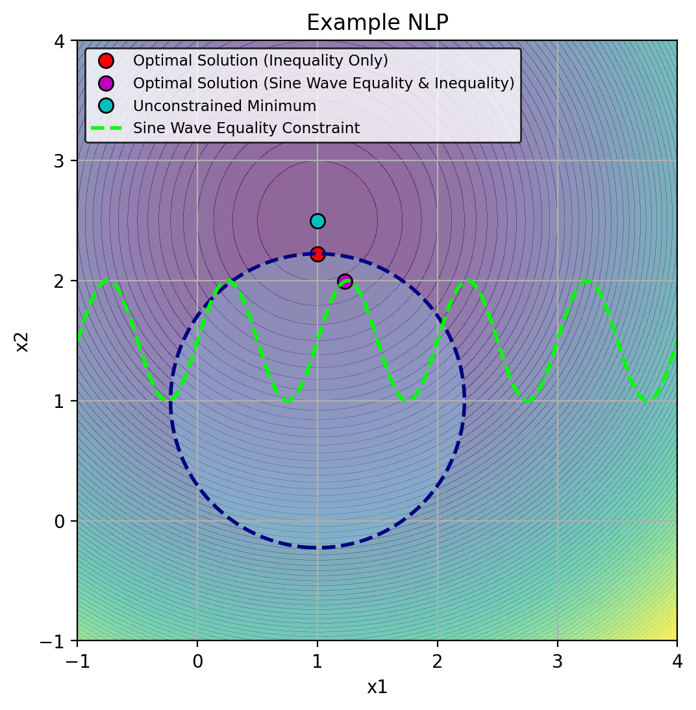
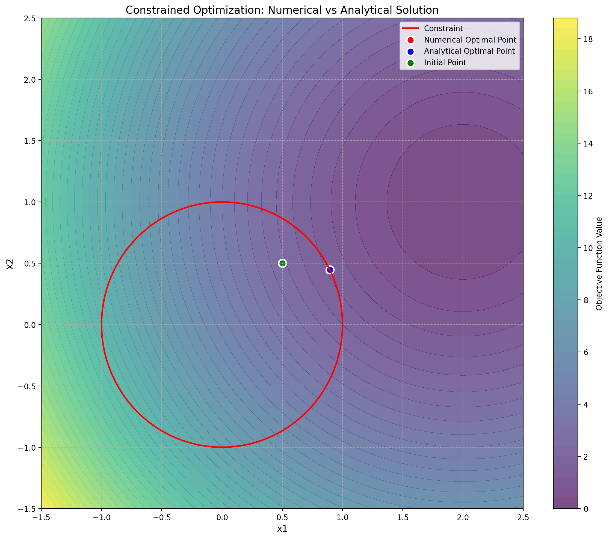
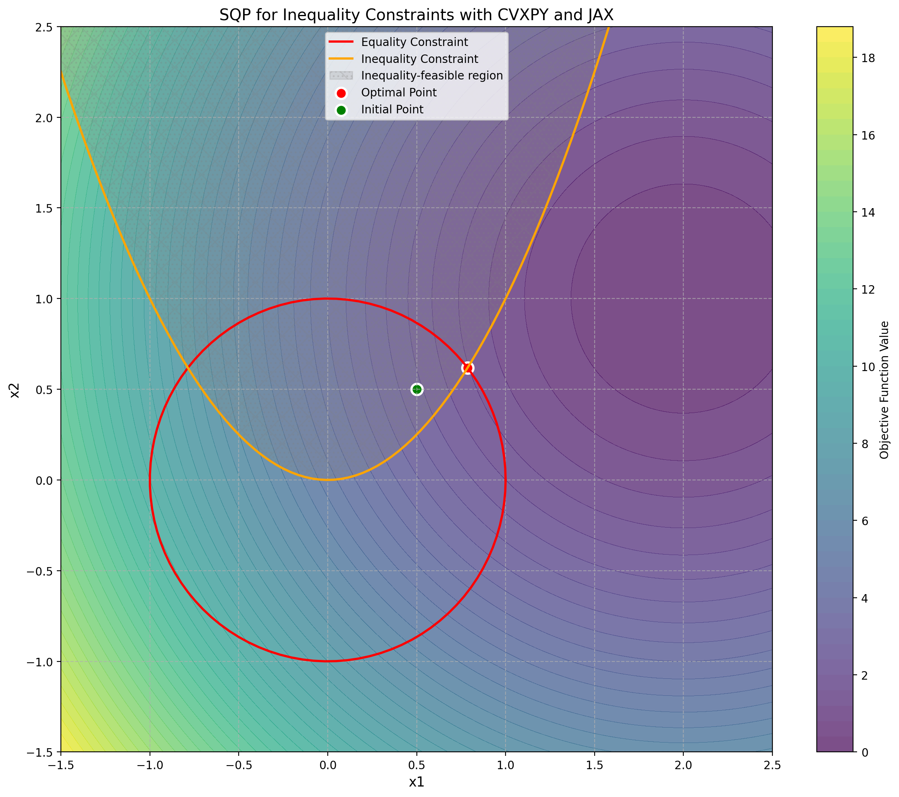
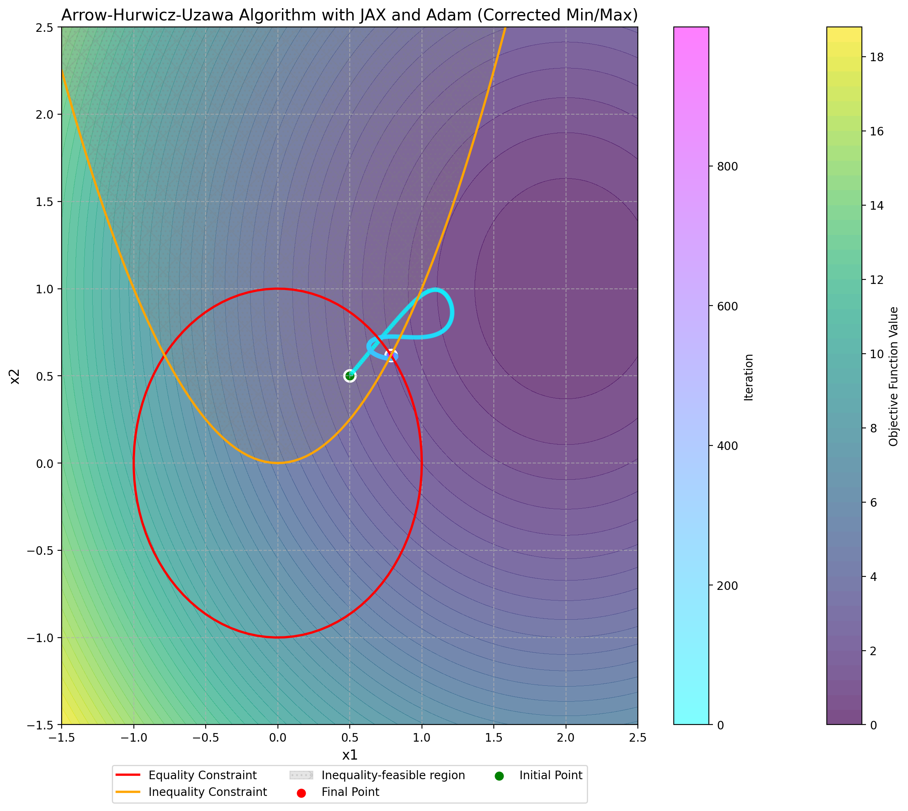

> **Cours de Pierre-Luc Bacon — 31.** [Page publiée](https://pierrelucbacon.com/rlbook/appendix-nlp) · [Source numérotée](../31-appendix-nlp.md)
> Extraction HTML → Markdown, effectuée le 2026-10-11. Les formules LaTeX, figures statiques, solutions et liens sont conservés ; les animations nécessitent le site original.

<a id="skip-to-frontmatter"></a>

# Nonlinear Programming

<a id="skip-to-article"></a>

Unless specific assumptions are made on the dynamics and cost structure, a DOCP is, in its most general form, a nonlinear mathematical program (commonly referred to as an NLP, not to be confused with Natural Language Processing). An NLP can be formulated as follows:

<a id="yAUEcMdnXD"></a>

$$
\begin{aligned}
\text{minimize } & f(\mathbf{x}) \\
\text{subject to } & \mathbf{g}(\mathbf{x}) \leq \mathbf{0} \\
& \mathbf{h}(\mathbf{x}) = \mathbf{0}
\end{aligned}
$$

[(1)](#yAUEcMdnXD "Link to this Equation")

Here $\mathbf x$ denotes a generic decision vector. When applying this appendix to a trajectory problem, it is the stacked vector $\mathbf z$, not just one physical state. The objective $f$ and constraint maps $\mathbf g,\mathbf h$ then correspond to $F,G,H$ in the control chapters.

Where:

-   $f: \mathbb{R}^n \to \mathbb{R}$ is the objective function
    
-   $\mathbf{g}: \mathbb{R}^n \to \mathbb{R}^m$ represents inequality constraints
    
-   $\mathbf{h}: \mathbb{R}^n \to \mathbb{R}^\ell$ represents equality constraints
    

Unlike unconstrained optimization commonly used in deep learning, the optimality of a solution in constrained optimization must consider both the objective value and constraint feasibility. To illustrate this, consider the following problem, which includes both equality and inequality constraints:

<a id="d2K3KXRQqJ"></a>

$$
\begin{align*}
\text{Minimize} \quad & f(x_1, x_2) = (x_1 - 1)^2 + (x_2 - 2.5)^2 \\
\text{subject to} \quad & g(x_1, x_2) = (x_1 - 1)^2 + (x_2 - 1)^2 - 1.5 \leq 0, \\
& h(x_1, x_2) = x_2 - \left(0.5 \sin(2 \pi x_1) + 1.5\right) = 0.
\end{align*}
$$

[(2)](#d2K3KXRQqJ "Link to this Equation")

In this example, the objective function $f(x_1, x_2)$ is quadratic, the inequality constraint $g(x_1, x_2)$ defines a circular feasible region centered at $(1, 1)$ with a radius of $\sqrt{1.5}$ and the equality constraint $h(x_1, x_2)$ requires $x_2$ to lie on a sine wave function. The following code demonstrates the difference between the unconstrained, and constrained solutions to this problem.

<a id="DKGfAPLOfl"></a>

Source

```python
#  label: appendix_nlp-cell-01
#  caption: Rendered output from the preceding code cell.

%config InlineBackend.figure_format = 'retina'
import numpy as np
import matplotlib.pyplot as plt

# Apply book style
try:
    import scienceplots
    plt.style.use(['science', 'notebook'])
except (ImportError, OSError):
    pass  # Use matplotlib defaults
from scipy.optimize import minimize

# Define the objective function
def objective(x):
    return (x[0] - 1)**2 + (x[1] - 2.5)**2

# SciPy SLSQP expects a nonnegative inequality function: return -g(x).
def constraint(x):
    return -(x[0] - 1)**2 - (x[1] - 1)**2 + 1.5

# Define the gradient of the objective function
def objective_gradient(x):
    return np.array([2*(x[0] - 1), 2*(x[1] - 2.5)])

# Define the gradient of the inequality constraint function
def constraint_gradient(x):
    return np.array([-2*(x[0] - 1), -2*(x[1] - 1)])

# Define the sine wave equality constraint function
def sine_wave_equality_constraint(x):
    return x[1] - (0.5 * np.sin(2 * np.pi * x[0]) + 1.5)

# Define the gradient of the sine wave equality constraint function
def sine_wave_equality_constraint_gradient(x):
    return np.array([-np.pi * np.cos(2 * np.pi * x[0]), 1])

# Define the constraints including the sine wave equality constraint
sine_wave_constraints = [{'type': 'ineq', 'fun': constraint, 'jac': constraint_gradient},  # Inequality constraint
                         {'type': 'eq', 'fun': sine_wave_equality_constraint, 'jac': sine_wave_equality_constraint_gradient}]  # Sine wave equality constraint

# Define only the inequality constraint
inequality_constraints = [{'type': 'ineq', 'fun': constraint, 'jac': constraint_gradient}]

# Initial guess
x0 = [1.25, 1.5]

# Solve the optimization problem with the sine wave equality constraint
res_sine_wave_constraint = minimize(objective, x0, method='SLSQP', jac=objective_gradient, 
                                    constraints=sine_wave_constraints, options={'disp': False})

x_opt_sine_wave_constraint = res_sine_wave_constraint.x

# Solve the optimization problem with only the inequality constraint
res_inequality_only = minimize(objective, x0, method='SLSQP', jac=objective_gradient, 
                               constraints=inequality_constraints, options={'disp': False})

x_opt_inequality_only = res_inequality_only.x

# Solve the unconstrained optimization problem for reference
res_unconstrained = minimize(objective, x0, method='SLSQP', jac=objective_gradient, options={'disp': False})
x_opt_unconstrained = res_unconstrained.x

# Generate data for visualization
x = np.linspace(-1, 4, 400)
y = np.linspace(-1, 4, 400)
X, Y = np.meshgrid(x, y)
Z = (X - 1)**2 + (Y - 2.5)**2  # Objective function values
constraint_values = (X - 1)**2 + (Y - 1)**2

# Data for sine wave constraint
x_sine = np.linspace(-1, 4, 400)
y_sine = 0.5 * np.sin(2 * np.pi * x_sine) + 1.5

# Visualization with Improved Color Scheme
plt.figure(figsize=(8, 6))
plt.contourf(X, Y, Z, levels=100, cmap='viridis', alpha=0.6)  # Heatmap for the objective function

# Plot all the optimal points
plt.plot(x_opt_inequality_only[0], x_opt_inequality_only[1], 'ro', label='Optimal Solution (Inequality Only)', markersize=8, markeredgecolor='black')
plt.plot(x_opt_sine_wave_constraint[0], x_opt_sine_wave_constraint[1], 'mo', label='Optimal Solution (Sine Wave Equality & Inequality)', markersize=8, markeredgecolor='black')
plt.plot(x_opt_unconstrained[0], x_opt_unconstrained[1], 'co', label='Unconstrained Minimum', markersize=8, markeredgecolor='black')

# Adjust constraint boundary colors
plt.contour(X, Y, constraint_values, levels=[1.5], colors='navy', linewidths=2, linestyles='dashed')
plt.contourf(X, Y, constraint_values, levels=[0, 1.5], colors='skyblue', alpha=0.3)

# Plot the sine wave equality constraint with a high contrast color
plt.plot(x_sine, y_sine, 'lime', linestyle='--', linewidth=2, label='Sine Wave Equality Constraint')

plt.xlim([-1, 4])
plt.ylim([-1, 4])
plt.xlabel('x1')
plt.ylabel('x2')
plt.title('Example NLP')
plt.legend(loc='upper left', fontsize='small', edgecolor='black', fancybox=True)
plt.grid(True)
# Set the aspect ratio to be equal so the circle appears correctly
plt.gca().set_aspect('equal', adjustable='box')
```



<a id="the-lagrangian-duality-and-optimality-conditions"></a>

## The Lagrangian, Duality, and Optimality Conditions

A constrained optimizer must reduce the objective while respecting the constraints. The Lagrangian combines these two requirements in one function:

<a id="R73SGTMnQ1"></a>

$$
\mathcal L(\mathbf x,\boldsymbol\lambda,\boldsymbol\mu)
=f(\mathbf x)+\sum_{i=1}^m\mu_i g_i(\mathbf x)
+\sum_{j=1}^\ell\lambda_j h_j(\mathbf x),
\qquad \boldsymbol\mu\ge\mathbf0,
\quad \boldsymbol\lambda\in\mathbb R^\ell.
$$

[(3)](#R73SGTMnQ1 "Link to this Equation")

The **Lagrange multipliers** assign weights to the constraint residuals. Inequality multipliers $\mu_i$ are nonnegative because a positive residual $g_i(\mathbf x)>0$ is a violation that should increase the quantity being minimized. Equality multipliers $\lambda_j$ can have either sign because $h_j(\mathbf x)$ can violate its constraint in either direction. These signs follow the convention $\mathbf g(\mathbf x)\le\mathbf0$ used here.

<a id="the-primal-problem-as-a-min-max-problem"></a>

### The primal problem as a min–max problem

Suppose one player chooses $\mathbf x$ to minimize the Lagrangian and a second player chooses the multipliers to maximize it. If the multiplier player can respond after seeing $\mathbf x$, every infeasible choice can be ruled out. For a violated inequality $g_i(\mathbf x)>0$, sending $\mu_i$ to infinity makes the Lagrangian arbitrarily large. For a violated equality, choosing $\lambda_j$ with the same sign as $h_j(\mathbf x)$ and increasing its magnitude has the same effect.

For a feasible $\mathbf x$, all equality terms vanish and every inequality term is nonpositive. The multiplier player can attain $f(\mathbf x)$ by setting $\boldsymbol\mu=\mathbf0$, and cannot obtain a larger value. Thus

<a id="f31vTri9Eb"></a>

$$
\sup_{\boldsymbol\mu\ge\mathbf0,\,\boldsymbol\lambda\in\mathbb R^\ell}
\mathcal L(\mathbf x,\boldsymbol\lambda,\boldsymbol\mu)
=
\begin{cases}
f(\mathbf x),&\mathbf x\text{ is feasible},\\
+\infty,&\mathbf x\text{ is infeasible}.
\end{cases}
$$

[(4)](#f31vTri9Eb "Link to this Equation")

Minimizing this function gives exactly the original constrained problem:

<a id="meZF0sz8vg"></a>

$$
p^\star
:=\inf_{\mathbf x:\,\mathbf g(\mathbf x)\le\mathbf0,\,\mathbf h(\mathbf x)=\mathbf0}
f(\mathbf x)
=\inf_{\mathbf x}\sup_{\boldsymbol\mu\ge\mathbf0,\,\boldsymbol\lambda\in\mathbb R^\ell}
\mathcal L(\mathbf x,\boldsymbol\lambda,\boldsymbol\mu).
$$

[(5)](#meZF0sz8vg "Link to this Equation")

This representation requires no convexity or differentiability. The notation $\inf$ and $\sup$ allows values that are approached without being attained; in particular, no finite multiplier attains $+\infty$ at an infeasible point. The representation also uses unbounded multiplier sets. Capping the multipliers would instead give a finite penalty for constraint violations.

<a id="the-dual-problem-and-lower-bounds"></a>

### The dual problem and lower bounds

Reversing the order changes what the multiplier player can enforce. It must now choose one set of weights before the minimizing player chooses $\mathbf x$. For fixed multipliers, define the **dual function**

<a id="ZMihFQlA2g"></a>

$$
q(\boldsymbol\lambda,\boldsymbol\mu)
=\inf_{\mathbf x}\mathcal L(\mathbf x,\boldsymbol\lambda,\boldsymbol\mu).
$$

[(6)](#ZMihFQlA2g "Link to this Equation")

The inner infimum ranges over all $\mathbf x$, including infeasible choices. For any feasible $\bar{\mathbf x}$ and any $\boldsymbol\mu\ge\mathbf0$,

<a id="gMp2xjMlln"></a>

$$
q(\boldsymbol\lambda,\boldsymbol\mu)
\le\mathcal L(\bar{\mathbf x},\boldsymbol\lambda,\boldsymbol\mu)
\le f(\bar{\mathbf x}).
$$

[(7)](#gMp2xjMlln "Link to this Equation")

Consequently, each multiplier choice supplies a lower bound on the constrained optimal value. The **dual problem** searches for the largest such bound:

<a id="nfVtV9ivRB"></a>

$$
d^\star
:=\sup_{\boldsymbol\mu\ge\mathbf0,\,\boldsymbol\lambda\in\mathbb R^\ell}
q(\boldsymbol\lambda,\boldsymbol\mu)
\le p^\star.
$$

[(8)](#nfVtV9ivRB "Link to this Equation")

This inequality is **weak duality**. It holds for nonconvex problems as well. When $d^\star=p^\star$, **strong duality** holds: choosing the multipliers first yields the same value as letting them respond to $\mathbf x$. Equality of these values does not by itself say that either optimum is attained.

<a id="saddle-points-and-fixed-multipliers"></a>

### Saddle points and fixed multipliers

A **Lagrangian saddle point** is one feasible point $\mathbf x^\star$ and one multiplier pair $(\boldsymbol\mu^\star,\boldsymbol\lambda^\star)$, with $\boldsymbol\mu^\star\ge\mathbf0$, satisfying

<a id="QNm8nGlYie"></a>

$$
\mathcal L(\mathbf x^\star,\boldsymbol\lambda,\boldsymbol\mu)
\le
\mathcal L(\mathbf x^\star,\boldsymbol\lambda^\star,\boldsymbol\mu^\star)
\le
\mathcal L(\mathbf x,\boldsymbol\lambda^\star,\boldsymbol\mu^\star)
$$

[(9)](#QNm8nGlYie "Link to this Equation")

for every $\mathbf x$, $\boldsymbol\mu\ge\mathbf0$, and $\boldsymbol\lambda\in\mathbb R^\ell$. The left inequality says that the multiplier player cannot increase the value with $\mathbf x^\star$ held fixed. The right inequality says that the minimizing player cannot decrease it with these multipliers held fixed. This is an equilibrium of the two-player game.

The right inequality is stronger than solving the primal min–max problem. It requires $\mathbf x^\star$ to minimize the Lagrangian over all $\mathbf x$ against one fixed multiplier pair, even when the competing $\mathbf x$ is infeasible. A saddle point therefore certifies global primal and dual optimality with equal values. Conversely, if the primal and dual optima are both attained and their finite values agree, their optimizers form a saddle point. Convexity is one route to these properties, but is not part of the saddle-point definition.

<a id="karush-kuhn-tucker-conditions"></a>

### Karush-Kuhn-Tucker conditions

For a smooth problem, a global minimum of the Lagrangian in $\mathbf x$ must have zero gradient. The multiplier side of the saddle inequalities also requires feasibility and complementary slackness. These requirements give the **Karush-Kuhn-Tucker (KKT) conditions**:

<a id="kkt-conditions"></a>

[Definition 1](#kkt-conditions "Link to this Definition") (KKT conditions)

A point $(\mathbf x^\star,\boldsymbol\lambda^\star,\boldsymbol\mu^\star)$ satisfies the KKT conditions when

<a id="uFMQXEffa3"></a>

$$
\begin{aligned}
\nabla_{\mathbf x}\mathcal L(\mathbf x^\star,\boldsymbol\lambda^\star,\boldsymbol\mu^\star)
&=\mathbf0 &&\text{(stationarity)},\\
\mathbf g(\mathbf x^\star)\le\mathbf0,\qquad
\mathbf h(\mathbf x^\star)&=\mathbf0 &&\text{(primal feasibility)},\\
\boldsymbol\mu^\star&\ge\mathbf0 &&\text{(dual feasibility)},\\
\mu_i^\star g_i(\mathbf x^\star)&=0\quad\text{for every }i
&&\text{(complementary slackness)}.
\end{aligned}
$$

[(10)](#uFMQXEffa3 "Link to this Equation")

Complementary slackness describes the multiplier player’s response to a feasible point. If $g_i(\mathbf x^\star)<0$, a positive multiplier would reduce the Lagrangian, so maximizing requires $\mu_i^\star=0$. If $g_i(\mathbf x^\star)=0$, any nonnegative multiplier gives the same contribution at that point. A tight constraint can therefore carry a positive weight, although tightness does not require its weight to be positive.

KKT conditions also arise at local constrained minima even when no saddle point exists. If the objective and constraints are continuously differentiable and a **constraint qualification** holds at a local minimizer, then multipliers satisfying KKT exist. One sufficient qualification is **LICQ**, the linear independence of the equality-constraint gradients and the gradients of inequalities active at that point. It ensures that the linearized constraints have enough regularity for the multiplier theorem to apply.

Here, **first-order** means that the conditions use function values and first derivatives at the candidate point. Stationarity requires

<a id="v9jXPXcewW"></a>

$$
\nabla f(\mathbf x^\star)
+\sum_i\mu_i^\star\nabla g_i(\mathbf x^\star)
+\sum_j\lambda_j^\star\nabla h_j(\mathbf x^\star)=\mathbf0.
$$

[(11)](#v9jXPXcewW "Link to this Equation")

This balances the objective gradient against a weighted sum of constraint gradients. It does not compare Lagrangian values at other points or determine its curvature. Thus KKT alone need not imply that $\mathbf x^\star$ minimizes the Lagrangian, even locally. Describing KKT as equations and inequalities at one point should not be confused with the global comparisons in the saddle inequalities.

For example, consider

<a id="Ot6pSVWNgL"></a>

$$
\min_{x\in\mathbb R}-x^2\qquad\text{subject to }x=0,
\qquad \mathcal L(x,\lambda)=-x^2+\lambda x.
$$

[(12)](#Ot6pSVWNgL "Link to this Equation")

The unique feasible point is $x^\star=0$, so $p^\star=0$. The exact primal representation still works: at $x=0$ the inner supremum is zero, and at any $x\ne0$ it is $+\infty$. The equality gradient is 1, so LICQ holds, and stationarity gives $-2x^\star+\lambda^\star=0$. Thus $(0,0)$ satisfies KKT. Yet $\mathcal L(x,0)=-x^2$ has a strict maximum at zero. For every fixed $\lambda$, it is also unbounded below as $|x|$ grows. Hence $q(\lambda)=-\infty$ for every $\lambda$, $d^\star=-\infty$, and no saddle point exists. Even a global constrained optimizer satisfying KKT need not minimize the Lagrangian.

<a id="convexity-and-sufficient-conditions"></a>

### Convexity and sufficient conditions

Suppose $f$ and each $g_i$ are differentiable convex functions on $\mathbb R^n$, and the equality functions $h_j$ are affine. For any $\boldsymbol\mu\ge\mathbf0$, the Lagrangian is then convex in $\mathbf x$. Stationarity becomes sufficient for a global minimum because the convexity inequality gives

<a id="DN89DxxZLj"></a>

$$
\begin{aligned}
\mathcal L(\mathbf x,\boldsymbol\lambda^\star,\boldsymbol\mu^\star)
&\ge \mathcal L(\mathbf x^\star,\boldsymbol\lambda^\star,\boldsymbol\mu^\star)\\
&\quad+\nabla_{\mathbf x}\mathcal L(\mathbf x^\star,\boldsymbol\lambda^\star,\boldsymbol\mu^\star)^\top
(\mathbf x-\mathbf x^\star)\\
&=\mathcal L(\mathbf x^\star,\boldsymbol\lambda^\star,\boldsymbol\mu^\star).
\end{aligned}
$$

[(13)](#DN89DxxZLj "Link to this Equation")

This supplies the right saddle inequality. Primal feasibility and nonnegative multipliers give $\mathcal L(\mathbf x^\star,\boldsymbol\lambda,\boldsymbol\mu)\le f(\mathbf x^\star)$, while complementary slackness gives $\mathcal L(\mathbf x^\star,\boldsymbol\lambda^\star,\boldsymbol\mu^\star)=f(\mathbf x^\star)$. Together they supply the left saddle inequality. Thus any KKT point of this convex problem is a global saddle point; no additional constraint qualification is needed for this sufficiency direction.

A constraint qualification is needed to guarantee the existence of KKT multipliers at an optimizer. For the convex problem just specified, **Slater’s condition** requires a point satisfying all equalities and every inequality strictly. If Slater’s condition holds and the primal optimal value is finite, strong duality holds and the dual optimum is attained. If the primal optimum is attained as well, an optimizer and suitable multipliers satisfy KKT and form a saddle point. These convex duality results are developed in [Chapter 5 of Boyd and Vandenberghe’s _Convex Optimization_](https://web.stanford.edu/~boyd/cvxbook/bv_cvxbook.pdf).

For nonconvex trajectory problems, KKT supplies necessary conditions under regularity, and numerical methods seek points satisfying those conditions. Global saddle inequalities require a separate argument. The exact primal min–max representation remains valid in either case.

<a id="multipliers-in-the-constrained-example"></a>

### Multipliers in the constrained example

Let’s now solve our example problem above, this time using [Ipopt](https://coin-or.github.io/Ipopt/) via the [Pyomo](http://www.pyomo.org/) interface so that we can access the Lagrange multipliers found by the solver.

<a id="ArF3iXqymq"></a>

```python
#  label: appendix_nlp-cell-02
#  caption: Rendered output from the preceding code cell.

from pyomo.environ import *
from pyomo.opt import SolverFactory
import math

# Define the Pyomo model
model = ConcreteModel()

# Define the variables
model.x1 = Var(initialize=1.25)
model.x2 = Var(initialize=1.5)

# Define the objective function
def objective_rule(model):
    return (model.x1 - 1)**2 + (model.x2 - 2.5)**2
model.obj = Objective(rule=objective_rule, sense=minimize)

# Define the inequality constraint (circle)
def inequality_constraint_rule(model):
    return (model.x1 - 1)**2 + (model.x2 - 1)**2 <= 1.5
model.ineq_constraint = Constraint(rule=inequality_constraint_rule)

# Define the equality constraint (sine wave) using Pyomo's math functions
def equality_constraint_rule(model):
    return model.x2 == 0.5 * sin(2 * math.pi * model.x1) + 1.5
model.eq_constraint = Constraint(rule=equality_constraint_rule)

# Create a suffix component to capture dual values
model.dual = Suffix(direction=Suffix.IMPORT)

# Create a solver
solver=SolverFactory('ipopt')

# Solve the problem
results = solver.solve(model, tee=False)

# Check if the solver found an optimal solution
if (results.solver.status == SolverStatus.ok and 
    results.solver.termination_condition == TerminationCondition.optimal):
    
    # Print the results
    print(f"x1: {value(model.x1)}")
    print(f"x2: {value(model.x2)}")
    
    # Print the objective value
    print(f"Objective value: {value(model.obj)}")

    # Print the Lagrange multipliers (dual values)
    print("\nLagrange multipliers:")
    ineq_lambda = None
    eq_lambda = None
    for c in model.component_objects(Constraint, active=True):
        for index in c:
            dual_val = model.dual[c[index]]
            print(f"{c.name}[{index}]: {dual_val}")
            if c.name == "ineq_constraint":
                ineq_lambda = dual_val
            elif c.name == "eq_constraint":
                eq_lambda = dual_val
else:
    print("Solver did not find an optimal solution.")
    print(f"Solver Status: {results.solver.status}")
    print(f"Termination Condition: {results.solver.termination_condition}")
```

```
x1: 1.2271417639244486
x2: 1.994852000302119
Objective value: 0.3067678825174803

Lagrange multipliers:
ineq_constraint[None]: -5.466075458072094e-09
eq_constraint[None]: -1.0102959885190541
```

The computed point lies strictly inside the circle, so complementary slackness requires its inequality multiplier to be zero, up to numerical tolerance. The converse inference would be invalid: a zero multiplier does not by itself show that a constraint is inactive. Every equality must hold at a feasible point regardless of its multiplier’s value. Under suitable sensitivity assumptions, the multipliers also describe how the optimal value changes when the constraint right-hand sides are perturbed; the sign depends on the convention used to write those perturbations.

For a vector constraint map, write $J_h(\mathbf x)$ for its Jacobian, whose $j$th row is $\nabla h_j(\mathbf x)^\top$; define $J_g$ similarly. Gradients of scalar functions are column vectors.

<a id="lagrange-multiplier-theorem"></a>

#### Lagrange Multiplier Theorem

For equality constraints alone, the KKT necessary conditions reduce to the Lagrange multiplier theorem. They identify stationary candidates; further conditions are needed to establish that a candidate is a local minimum.

Theorem 1 (Lagrange Multiplier Theorem)

Consider the constrained optimization problem:

<a id="XUf6fJsrjx"></a>

$$
\begin{aligned}
\min_{\mathbf{x}} \quad & f(\mathbf{x}) \\
\text{subject to} \quad & h_i(\mathbf{x}) = 0, \quad i = 1, \ldots, \ell
\end{aligned}
$$

[(14)](#XUf6fJsrjx "Link to this Equation")

where $\mathbf{x} \in \mathbb{R}^n$, $f: \mathbb{R}^n \to \mathbb{R}$, and $h_i: \mathbb{R}^n \to \mathbb{R}$ for $i = 1, \ldots, \ell$.

Assume that:

1.  $f$ and $h_i$ are continuously differentiable functions.
    
2.  The gradients $\nabla h_i(\mathbf{x}^*)$ are linearly independent at a local minimizer $\mathbf{x}^*$.
    

Then, there exist unique Lagrange multipliers $\lambda_i^* \in \mathbb{R}$, $i = 1, \ldots, \ell$, such that the following first-order optimality conditions hold:

1.  Stationarity: $\nabla f(\mathbf{x}^*) + \sum_{i=1}^\ell \lambda_i^* \nabla h_i(\mathbf{x}^*) = \mathbf{0}$
    
2.  Primal feasibility: $h_i(\mathbf{x}^*) = 0$, for $i = 1, \ldots, \ell$
    

Note that both the stationarity and primal feasibility statements are simply saying that the derivative of the Lagrangian in either the primal or dual variables must be zero at an optimal constrained solution. In other words:

<a id="TXPip9IPz7"></a>

$$
\nabla_{\mathbf{x}, \boldsymbol{\lambda}} \mathcal L(\mathbf{x}^*, \boldsymbol{\lambda}^*) = \mathbf{0}
$$

[(15)](#TXPip9IPz7 "Link to this Equation")

Let $\mathbf F(\mathbf x,\boldsymbol\lambda)$ denote this combined gradient. Under the theorem’s assumptions, a local minimizer and its multipliers give a zero of $\mathbf F$. Newton’s method can seek such zeros, but reaching one alone does not certify a minimum or a Lagrangian saddle point.

<a id="newtons-method"></a>

#### Newton’s Method

For a vector residual $\mathbf F$, write $J_F$ for its Jacobian, with component gradients as rows. This vector residual is distinct from the scalar objective $F$ used in trajectory optimization.

Newton’s method is a numerical procedure for solving root-finding problems. These are nonlinear systems of equations of the form:

Find $\mathbf{z}^* \in \mathbb{R}^n$ such that $\mathbf{F}(\mathbf{z}^*) = \mathbf{0}$

where $\mathbf{F}: \mathbb{R}^n \to \mathbb{R}^n$ is a continuously differentiable function. Newton’s method then consists in applying the following sequence of iterates:

<a id="JFI27kZjAJ"></a>

$$
\mathbf{z}^{k+1} = \mathbf{z}^k - [J_F(\mathbf{z}^k)]^{-1} \mathbf{F}(\mathbf{z}^k)
$$

[(16)](#JFI27kZjAJ "Link to this Equation")

where $\mathbf{z}^k$ is the k-th iterate, and $J_F(\mathbf{z}^k)$ is the Jacobian matrix of $\mathbf{F}$ evaluated at $\mathbf{z}^k$.

Newton’s method exhibits local quadratic convergence: if the initial guess $\mathbf{z}^0$ is sufficiently close to the true solution $\mathbf{z}^*$, and $J_F(\mathbf{z}^*)$ is nonsingular, the method converges quadratically to $\mathbf{z}^*$ Ortega & Rheinboldt (1970). However, the method is sensitive to the initial guess; if it’s too far from the desired solution, Newton’s method might fail to converge or converge to a different root. To mitigate this problem, a set of techniques known as numerical continuation methods Allgower & Georg (1990) have been developed. These methods effectively enlarge the basin of attraction of Newton’s method by solving a sequence of related problems, progressing from an easy one to the target problem. This approach is reminiscent of several concepts in machine learning and statistical inference: curriculum learning in machine learning, where models are trained on increasingly complex data; tempering in Markov Chain Monte Carlo (MCMC) samplers, which gradually adjusts the target distribution to improve mixing; and modern diffusion models, which use a similar concept of gradually transforming noise into structured data.

<a id="efficient-implementation-of-newtons-method"></a>

##### Efficient Implementation of Newton’s Method

Note that each step of Newton’s method involves computing the inverse of a Jacobian matrix. However, a cardinal rule in numerical linear algebra is to avoid computing matrix inverses explicitly: rarely, if ever, should there be a `np.linalg.inv` in your code. Instead, the numerically stable and computationally efficient approach is to solve a linear system of equations at each step. Given the Newton’s method iterate:

<a id="olmn4aN2mo"></a>

$$
\mathbf{z}^{k+1} = \mathbf{z}^k - [J_F(\mathbf{z}^k)]^{-1} \mathbf{F}(\mathbf{z}^k)
$$

[(17)](#olmn4aN2mo "Link to this Equation")

We can reformulate this as a two-step procedure:

1.  Solve the linear system: $\underbrace{[J_F(\mathbf{z}^k)]}_{\mathbf{A}} \Delta \mathbf{z}^k = -\mathbf{F}(\mathbf{z}^k)$
    
2.  Update: $\mathbf{z}^{k+1} = \mathbf{z}^k + \Delta \mathbf{z}^k$
    

The structure of the linear system in step 1 often allows for specialized solution methods. In the context of automatic differentiation, matrix-free linear solvers are particularly useful. These solvers can find a solution without explicitly forming the matrix A, requiring only the ability to evaluate matrix-vector or vector-matrix products. Typical examples of such methods include classical matrix-splitting methods (e.g., Richardson iteration) or conjugate gradient methods through [`sparse.linalg.cg`](https://docs.scipy.org/doc/scipy/reference/generated/scipy.sparse.linalg.cg.html) for example. Another useful method is the Generalized Minimal Residual method (GMRES) implemented in SciPy via [`sparse.linalg.gmres`](https://docs.scipy.org/doc/scipy/reference/generated/scipy.sparse.linalg.gmres.html), which is useful when facing non-symmetric and indefinite systems.

By inspecting the structure of matrix $\mathbf{A}$ in the specific application where the function $\mathbf{F}$ is the derivative of the Lagrangian, we will also uncover an important structure known as the KKT matrix. This structure will then allow us to derive a Quadratic Programming (QP) sub-problem as part of a larger iterative procedure for solving equality and inequality constrained problems via Sequential Quadratic Programming (SQP).

<a id="solving-equality-constrained-programs-with-newtons-method"></a>

#### Solving Equality Constrained Programs with Newton’s Method

To seek stationary candidates for equality-constrained optimization, Newton’s method searches for a zero of the function $\mathbf{F}(\mathbf{z}) = \nabla_{\mathbf{x}, \boldsymbol{\lambda}} \mathcal L(\mathbf{x}, \boldsymbol{\lambda})$. Here, $\mathbf{F}$ represents the derivative of the Lagrangian function, and $\mathbf{z} = (\mathbf{x}, \boldsymbol{\lambda})$ combines both the primal variables $\mathbf{x}$ and the dual variables (Lagrange multipliers) $\boldsymbol{\lambda}$. Explicitly, we have:

<a id="CVxFLqPfhW"></a>

$$
\mathbf{F}(\mathbf{z}) = \begin{bmatrix} \nabla_{\mathbf{x}} \mathcal L(\mathbf{x}, \boldsymbol{\lambda}) \\ \mathbf{h}(\mathbf{x}) \end{bmatrix} = \begin{bmatrix} \nabla f(\mathbf{x}) + \sum_{i=1}^\ell \lambda_i \nabla h_i(\mathbf{x}) \\ \mathbf{h}(\mathbf{x}) \end{bmatrix}.
$$

[(18)](#CVxFLqPfhW "Link to this Equation")

Newton’s method involves linearizing $\mathbf{F}(\mathbf{z})$ around the current iterate $\mathbf{z}^k = (\mathbf{x}^k, \boldsymbol{\lambda}^k)$ and then solving the resulting linear system. At each iteration $k$, Newton’s method updates the current estimate by solving the linear system:

<a id="LGh0WHanVx"></a>

$$
\mathbf{z}^{k+1} = \mathbf{z}^k - [J_F(\mathbf{z}^k)]^{-1} \mathbf{F}(\mathbf{z}^k).
$$

[(19)](#LGh0WHanVx "Link to this Equation")

However, instead of explicitly inverting the Jacobian matrix $J_F(\mathbf{z}^k)$, we solve the linear system:

<a id="tcNLPWcWNK"></a>

$$
\underbrace{J_F(\mathbf{z}^k)}_{\mathbf{A}} \Delta \mathbf{z}^k = -\mathbf{F}(\mathbf{z}^k),
$$

[(20)](#tcNLPWcWNK "Link to this Equation")

where $\Delta \mathbf{z}^k = (\Delta \mathbf{x}^k, \Delta \boldsymbol{\lambda}^k)$ represents the Newton step for the primal and dual variables. Substituting the expression for $\mathbf{F}(\mathbf{z})$ and its Jacobian, the system becomes:

<a id="Pn84bF7FPZ"></a>

$$
\begin{bmatrix}
\nabla^2_{\mathbf{x}\mathbf{x}} \mathcal L(\mathbf{x}^k, \boldsymbol{\lambda}^k) & J_h(\mathbf{x}^k)^T \\
J_h(\mathbf{x}^k) & \mathbf{0}
\end{bmatrix}
\begin{bmatrix}
\Delta \mathbf{x}^k \\
\Delta \boldsymbol{\lambda}^k
\end{bmatrix}
=
-
\begin{bmatrix}
\nabla f(\mathbf{x}^k) + J_h(\mathbf{x}^k)^T \boldsymbol{\lambda}^k \\
\mathbf{h}(\mathbf{x}^k)
\end{bmatrix}.
$$

[(21)](#Pn84bF7FPZ "Link to this Equation")

The matrix on the left-hand side is known as the KKT matrix, as it stems from the Karush-Kuhn-Tucker conditions for this optimization problem The solution of this system provides the updates $\Delta \mathbf{x}^k$ and $\Delta \boldsymbol{\lambda}^k$, which are then used to update the primal and dual variables:

<a id="HUhOMXDeei"></a>

$$
\mathbf{x}^{k+1} = \mathbf{x}^k + \Delta \mathbf{x}^k, \quad \boldsymbol{\lambda}^{k+1} = \boldsymbol{\lambda}^k + \Delta \boldsymbol{\lambda}^k.
$$

[(22)](#HUhOMXDeei "Link to this Equation")

<a id="demonstration"></a>

##### Demonstration

The following code demonstates how we can implement this idea in Jax. In this demonstration, we are minimizing a quadratic objective function subject to a single equality constraint, a problem formally stated as follows:

<a id="cxXz28WFUY"></a>

$$
\begin{aligned}
\min_{x \in \mathbb{R}^2} \quad & f(x) = (x_1 - 2)^2 + (x_2 - 1)^2 \\
\text{subject to} \quad & h(x) = x_1^2 + x_2^2 - 1 = 0
\end{aligned}
$$

[(23)](#cxXz28WFUY "Link to this Equation")

Geometrically speaking, the constraint $h(x)$ describes a unit circle centered at the origin. To solve this problem using the method of Lagrange multipliers, we form the Lagrangian:

<a id="XjzpMN12Rz"></a>

$$
\mathcal L(x, \lambda) = f(x) + \lambda h(x) = (x_1 - 2)^2 + (x_2 - 1)^2 + \lambda(x_1^2 + x_2^2 - 1)
$$

[(24)](#XjzpMN12Rz "Link to this Equation")

For this particular problem, it happens so that we can also find an analytical without even having to use Newton’s method. From the first-order optimality conditions, we obtain the following linear system of equations:

<a id="XwKKukXjby"></a>

$$
\begin{align*}
   2(x_1 - 2) + 2\lambda x_1 &= 0 \\
   2(x_2 - 1) + 2\lambda x_2 &= 0 \\
   x_1^2 + x_2^2 - 1 &= 0\\
\end{align*}
$$

[(25)](#XwKKukXjby "Link to this Equation")

From the first two equations, we then get:

<a id="mntsSnUSiR"></a>

$$
x_1 = \frac{2}{1 + \lambda}, \quad x_2 = \frac{1}{1 + \lambda}
$$

[(26)](#mntsSnUSiR "Link to this Equation")

which we can substitute these into the 3rd constraint equation to obtain:

<a id="Y9lxaDeF7P"></a>

$$
(\frac{2}{1 + \lambda})^2 + (\frac{1}{1 + \lambda})^2 = 1 \Leftrightarrow \lambda = \sqrt{5} - 1
$$

[(27)](#Y9lxaDeF7P "Link to this Equation")

This value of the Lagrange multiplier can then be backsubstituted into the above equations to obtain $x_1 = \frac{2}{\sqrt{5}}$ and $x_2 =  \frac{1}{\sqrt{5}}$. We can verify numerically (and visually on the following graph) that the point $(2/\sqrt{5}, 1/\sqrt{5})$ is indeed the point on the unit circle closest to $(2, 1)$.

<a id="l9656u0TaG"></a>

Source

```python
#  label: appendix_nlp-cell-03
#  caption: Rendered output from the preceding code cell.

%config InlineBackend.figure_format = 'retina'
import jax
import jax.numpy as jnp
from jax import grad, jit, jacfwd
import matplotlib.pyplot as plt

# Apply book style
try:
    import scienceplots
    plt.style.use(['science', 'notebook'])
except (ImportError, OSError):
    pass  # Use matplotlib defaults

# Define the objective function and constraint
def f(x):
    return (x[0] - 2)**2 + (x[1] - 1)**2

def h(x):
    return x[0]**2 + x[1]**2 - 1

# Lagrangian
def L(x, lambda_):
    return f(x) + lambda_ * h(x)

# Gradient and Hessian of Lagrangian
grad_L_x = jit(grad(L, argnums=0))
grad_L_lambda = jit(grad(L, argnums=1))
hess_L_xx = jit(jacfwd(grad_L_x, argnums=0))
hess_L_xlambda = jit(jacfwd(grad_L_x, argnums=1))

# Newton's method
@jit
def newton_step(x, lambda_):
    grad_x = grad_L_x(x, lambda_)
    grad_lambda = grad_L_lambda(x, lambda_)
    hess_xx = hess_L_xx(x, lambda_)
    hess_xlambda = hess_L_xlambda(x, lambda_).reshape(-1)
    
    # Construct the full KKT matrix
    kkt_matrix = jnp.block([
        [hess_xx, hess_xlambda.reshape(-1, 1)],
        [hess_xlambda, jnp.array([[0.0]])]
    ])
    
    # Construct the right-hand side
    rhs = jnp.concatenate([-grad_x, -jnp.array([grad_lambda])])
    
    # Solve the KKT system
    delta = jnp.linalg.solve(kkt_matrix, rhs)
    
    return x + delta[:2], lambda_ + delta[2]

def solve_constrained_optimization(x0, lambda0, max_iter=100, tol=1e-6):
    x, lambda_ = x0, lambda0
    
    for i in range(max_iter):
        x_new, lambda_new = newton_step(x, lambda_)
        if jnp.linalg.norm(jnp.concatenate([x_new - x, jnp.array([lambda_new - lambda_])])) < tol:
            break
        x, lambda_ = x_new, lambda_new
    
    return x, lambda_, i+1

# Analytical solution
def analytical_solution():
    x1 = 2 / jnp.sqrt(5)
    x2 = 1 / jnp.sqrt(5)
    lambda_opt = jnp.sqrt(5) - 1
    return jnp.array([x1, x2]), lambda_opt

# Solve the problem numerically
x0 = jnp.array([0.5, 0.5])
lambda0 = 0.0
x_opt_num, lambda_opt_num, iterations = solve_constrained_optimization(x0, lambda0)

# Compute analytical solution
x_opt_ana, lambda_opt_ana = analytical_solution()

# Verify the result
print("\nNumerical Solution:")
print(f"Constraint violation: {h(x_opt_num):.6f}")
print(f"Objective function value: {f(x_opt_num):.6f}")

print("\nAnalytical Solution:")
print(f"Constraint violation: {h(x_opt_ana):.6f}")
print(f"Objective function value: {f(x_opt_ana):.6f}")

print("\nComparison:")
x_diff = jnp.linalg.norm(x_opt_num - x_opt_ana)
lambda_diff = jnp.abs(lambda_opt_num - lambda_opt_ana)
print(f"Difference in x: {x_diff}")
print(f"Difference in lambda: {lambda_diff}")

# Precision test
rtol = 1e-5  # relative tolerance
atol = 1e-8  # absolute tolerance

x_close = jnp.allclose(x_opt_num, x_opt_ana, rtol=rtol, atol=atol)
lambda_close = jnp.isclose(lambda_opt_num, lambda_opt_ana, rtol=rtol, atol=atol)

print("\nPrecision Test:")
print(f"x values are close: {x_close}")
print(f"lambda values are close: {lambda_close}")

if x_close and lambda_close:
    print("The numerical solution matches the analytical solution within the specified tolerance.")
else:
    print("The numerical solution differs from the analytical solution more than the specified tolerance.")

# Visualize the result
plt.figure(figsize=(12, 10))

# Create a mesh for the contour plot
x1_range = jnp.linspace(-1.5, 2.5, 100)
x2_range = jnp.linspace(-1.5, 2.5, 100)
X1, X2 = jnp.meshgrid(x1_range, x2_range)
Z = jnp.array([[f(jnp.array([x1, x2])) for x1 in x1_range] for x2 in x2_range])

# Plot filled contours
contour = plt.contourf(X1, X2, Z, levels=50, cmap='viridis', alpha=0.7, extent=[-1.5, 2.5, -1.5, 2.5])
plt.colorbar(contour, label='Objective Function Value')

# Plot the constraint
theta = jnp.linspace(0, 2*jnp.pi, 100)
x1 = jnp.cos(theta)
x2 = jnp.sin(theta)
plt.plot(x1, x2, color='red', linewidth=2, label='Constraint')

# Plot the optimal points (numerical and analytical) and initial point
plt.scatter(x_opt_num[0], x_opt_num[1], color='red', s=100, edgecolor='white', linewidth=2, label='Numerical Optimal Point')
plt.scatter(x_opt_ana[0], x_opt_ana[1], color='blue', s=100, edgecolor='white', linewidth=2, label='Analytical Optimal Point')
plt.scatter(x0[0], x0[1], color='green', s=100, edgecolor='white', linewidth=2, label='Initial Point')

# Add labels and title
plt.xlabel('x1', fontsize=12)
plt.ylabel('x2', fontsize=12)
plt.title('Constrained Optimization: Numerical vs Analytical Solution', fontsize=14)
plt.legend(fontsize=10)
plt.grid(True, linestyle='--', alpha=0.7)

# Set the axis limits explicitly
plt.xlim(-1.5, 2.5)
plt.ylim(-1.5, 2.5)

plt.tight_layout()
```

```

Numerical Solution:
Constraint violation: 0.000000
Objective function value: 1.527864

Analytical Solution:
Constraint violation: -0.000000
Objective function value: 1.527864

Comparison:
Difference in x: 5.960464477539063e-08
Difference in lambda: 0.0
```

```

Precision Test:
x values are close: True
lambda values are close: True
The numerical solution matches the analytical solution within the specified tolerance.
```



<a id="the-sqp-approach-taylor-expansion-and-quadratic-approximation"></a>

### The SQP Approach: Taylor Expansion and Quadratic Approximation

Sequential Quadratic Programming (SQP) tackles the problem of solving constrained programs by iteratively solving a sequence of simpler subproblems. Specifically, these subproblems are quadratic programs (QPs) that approximate the original problem around the current iterate by using a quadratic model of the objective function and a linear model of the constraints. Suppose we have the following optimization problem with equality constraints:

<a id="gQNhZHQ35R"></a>

$$
\begin{aligned}
\min_{\mathbf{x}} \quad & f(\mathbf{x}) \\
\text{subject to} \quad & \mathbf{h}(\mathbf{x}) = \mathbf{0}.
\end{aligned}
$$

[(28)](#gQNhZHQ35R "Link to this Equation")

At iteration $k$, we seek a displacement $\Delta\mathbf x=\mathbf x-\mathbf x^k$. A second-order Taylor expansion of the objective gives

<a id="hqgGk4gsPV"></a>

$$
\begin{align*}
f(\mathbf{x}) \approx f(\mathbf{x}^k) + \nabla f(\mathbf{x}^k)^T (\mathbf{x} - \mathbf{x}^k) + \frac{1}{2} (\mathbf{x} - \mathbf{x}^k)^T \nabla^2 f(\mathbf{x}^k) (\mathbf{x} - \mathbf{x}^k).
\end{align*}
$$

[(29)](#hqgGk4gsPV "Link to this Equation")

The Hessian determines how the model’s gradient changes as the displacement grows. For a constrained problem, the Newton equations also involve curvature from the constraints. SQP incorporates that curvature through the Hessian of the Lagrangian,

<a id="KHWOU2DSvA"></a>

$$
B_k=\nabla^2_{\mathbf x\mathbf x}
\mathcal L(\mathbf x^k,\boldsymbol\lambda^k)
=\nabla^2 f(\mathbf x^k)+
\sum_i\lambda_i^k\nabla^2 h_i(\mathbf x^k),
$$

[(30)](#KHWOU2DSvA "Link to this Equation")

and defines the step objective

<a id="dM7fJ35M1w"></a>

$$
m_k(\Delta\mathbf x)=
\nabla f(\mathbf x^k)^\top\Delta\mathbf x
+\frac12\Delta\mathbf x^\top B_k\Delta\mathbf x.
$$

[(31)](#dM7fJ35M1w "Link to this Equation")

This is a model for choosing a constrained step, rather than the Taylor expansion of $f$ alone. We omit the constant $f(\mathbf x^k)$ because it does not affect the minimizing displacement.

Each equality is replaced by its current residual plus its predicted first-order change:

<a id="NmJAss67dB"></a>

$$
\mathbf{h}(\mathbf{x}) \approx \mathbf{h}(\mathbf{x}^k) + J_h(\mathbf{x}^k) (\mathbf{x} - \mathbf{x}^k).
$$

[(32)](#NmJAss67dB "Link to this Equation")

Setting this affine expression to zero asks the step to cancel the current constraint residual. At a feasible point, the condition becomes $J_h(\mathbf x^k)\Delta\mathbf x=\mathbf0$, so the step lies in the tangent space. The resulting QP is

<a id="BH2OjFXyLQ"></a>

$$
\begin{aligned}
\underset{\Delta\mathbf x}{\operatorname{minimize}}\quad&
\nabla f(\mathbf{x}^k)^T \Delta \mathbf{x} + \frac{1}{2} \Delta \mathbf{x}^T B_k \Delta \mathbf{x} \\
\text{subject to} \quad & J_h(\mathbf{x}^k) \Delta \mathbf{x} + \mathbf{h}(\mathbf{x}^k) = \mathbf{0},
\end{aligned}
$$

[(33)](#BH2OjFXyLQ "Link to this Equation")

Solving the QP gives both a displacement $\Delta\mathbf x^k$ and a multiplier vector $\boldsymbol\lambda_{\mathrm{QP}}$. A full SQP step updates the primal and dual estimates by

<a id="NyoxOXQJ46"></a>

$$
\begin{align*}
\mathbf{x}^{k+1} = \mathbf{x}^k + \Delta \mathbf{x}^k,
\qquad
\boldsymbol\lambda^{k+1}=\boldsymbol\lambda_{\mathrm{QP}}.
\end{align*}
$$

[(34)](#NyoxOXQJ46 "Link to this Equation")

The linearized equalities can hold even when $\mathbf h(\mathbf x^k+\Delta\mathbf x^k)\ne\mathbf0$. For example, a nonzero tangent step from a point on a circle leaves the circle. Practical algorithms therefore use a line search or trust region to assess progress on the original problem, and may modify the Hessian or relax inconsistent linearized constraints. The following pseudocode describes the local full-step iteration, assuming its QPs have solutions.

<a id="alg-sqp"></a>

[Algorithm 1](#alg-sqp "Link to this Algorithm") (Sequential Quadratic Programming (SQP))

**Input:** Initial estimate $\mathbf{x}^0$, initial Lagrange multipliers $\boldsymbol{\lambda}^0$, tolerance $\epsilon > 0$.

**Output:** Solution $\mathbf{x}^*$, Lagrange multipliers $\boldsymbol{\lambda}^*$.

**Procedure:**

1.  **Compute the QP Solution:** Solve the QP subproblem to obtain $\Delta \mathbf{x}^k$. The QP solver also provides the updated Lagrange multipliers $\boldsymbol{\lambda}^{k+1}$ associated with the constraints.
    
2.  **Update the Estimates:** Update the primal variables:
    
    <a id="pfFA6bUPSH"></a>
    
    $$
    \mathbf{x}^{k+1} = \mathbf{x}^k + \Delta \mathbf{x}^k.
    $$
    
    [(35)](#pfFA6bUPSH "Link to this Equation")
    
    Set the dual variables to the updated values $\boldsymbol{\lambda}^{k+1}$ from the QP solution.
    
3.  **Repeat Until Convergence:** Continue iterating until $\|\Delta \mathbf{x}^k\| < \epsilon$ and the KKT conditions are satisfied.
    

<a id="connection-to-newtons-method-in-the-equality-constrained-case"></a>

#### Connection to Newton’s Method in the Equality-Constrained Case

Because the QP objective is quadratic and its constraints are affine, its stationarity and feasibility conditions form a linear system:

<a id="O3mhShQg9f"></a>

$$
\begin{bmatrix}
B_k & J_h(\mathbf x^k)^\top\\
J_h(\mathbf x^k) & \mathbf0
\end{bmatrix}
\begin{bmatrix}
\Delta\mathbf x^k\\
\boldsymbol\lambda_{\mathrm{QP}}
\end{bmatrix}
=-
\begin{bmatrix}
\nabla f(\mathbf x^k)\\
\mathbf h(\mathbf x^k)
\end{bmatrix}.
$$

[(36)](#O3mhShQg9f "Link to this Equation")

The QP multiplier is a new estimate, while Newton’s method solves for a change in that estimate. Set $\Delta\boldsymbol\lambda^k=
\boldsymbol\lambda_{\mathrm{QP}}-\boldsymbol\lambda^k$. Substitution gives

<a id="ArrkKA7Jb2"></a>

$$
\begin{align*}
\begin{bmatrix}
B_k & J_h(\mathbf{x}^k)^T \\
J_h(\mathbf{x}^k) & \mathbf{0}
\end{bmatrix}
\begin{bmatrix}
\Delta \mathbf{x}^k \\
\Delta \boldsymbol{\lambda}^k
\end{bmatrix}
=
-
\begin{bmatrix}
\nabla f(\mathbf{x}^k) + J_h(\mathbf{x}^k)^T \boldsymbol{\lambda}^k \\
\mathbf{h}(\mathbf{x}^k)
\end{bmatrix}
\end{align*}
$$

[(37)](#ArrkKA7Jb2 "Link to this Equation")

With the exact Lagrangian Hessian $B_k$, this is Newton’s method applied to the original KKT equations. When $J_h$ has full row rank and $B_k$ is positive definite on nonzero directions in the null space of $J_h$, the linear system determines the unique QP minimizer and its multiplier. Without suitable curvature, a solution of the stationarity equations need not minimize the QP. Replacing $B_k$ by a positive-definite approximation gives a modified Newton method with convex QP subproblems.

The quadratic and affine structure means that all derivative matrices stay fixed within a QP solve. Equality-constrained QPs under the conditions above require only a linear solve; QPs with inequalities require additional work to enforce feasibility and complementarity. Sparse factorizations and reuse across related systems make that work efficient, as discussed in the [SQP section of the optimal-control chapter](06-discrete-time-optimal-control.md#sec-sqp-newton).

<a id="sqp-for-inequality-constrained-optimization"></a>

### SQP for Inequality-Constrained Optimization

So far, we’ve applied the ideas behind Sequential Quadratic Programming (SQP) to problems with only equality constraints. Now, let’s extend this framework to handle optimization problems that also include inequality constraints. Consider a general nonlinear optimization problem that includes both equality and inequality constraints:

<a id="vJvndOhEcw"></a>

$$
\begin{align*}
\min_{\mathbf{x}} \quad & f(\mathbf{x}) \\
\text{subject to} \quad & \mathbf{g}(\mathbf{x}) \leq \mathbf{0}, \\
& \mathbf{h}(\mathbf{x}) = \mathbf{0}.
\end{align*}
$$

[(38)](#vJvndOhEcw "Link to this Equation")

As we did earlier, we approximate this problem by constructing a quadratic approximation to the objective and a linearization of the constraints. QP subproblem at each iteration is then formulated as:

<a id="GIQM6Qb5H0"></a>

$$
\begin{align*}
\text{Minimize} \quad & \nabla f(\mathbf{x}^k)^T \Delta \mathbf{x} + \frac{1}{2} \Delta \mathbf{x}^T \nabla^2_{\mathbf{x}\mathbf{x}} \mathcal L(\mathbf{x}^k, \boldsymbol{\lambda}^k, \boldsymbol{\mu}^k) \Delta \mathbf{x} \\
\text{subject to} \quad & J_g(\mathbf{x}^k) \Delta \mathbf{x} + \mathbf{g}(\mathbf{x}^k) \leq \mathbf{0}, \\
& J_h(\mathbf{x}^k) \Delta \mathbf{x} + \mathbf{h}(\mathbf{x}^k) = \mathbf{0},
\end{align*}
$$

[(39)](#GIQM6Qb5H0 "Link to this Equation")

where $\Delta \mathbf{x} = \mathbf{x} - \mathbf{x}^k$ represents the step direction for the primal variables. As in the equality case, the following pseudocode describes the local full-step iteration and assumes solvable QP subproblems; step selection and subproblem modifications are needed in a general implementation.

<a id="alg-sqp-ineq"></a>

[Algorithm 2](#alg-sqp-ineq "Link to this Algorithm") (Sequential Quadratic Programming (SQP) with Inequality Constraints)

**Input:** Initial estimate $\mathbf{x}^0$, initial multipliers $\boldsymbol{\lambda}^0, \boldsymbol{\mu}^0$, tolerance $\epsilon > 0$.

**Output:** Solution $\mathbf{x}^*$, Lagrange multipliers $\boldsymbol{\lambda}^*, \boldsymbol{\mu}^*$.

**Procedure:**

1.  **Initialization:** Set $k = 0$.
    
2.  **Repeat:**
    
    a. **Construct the QP Subproblem:** Formulate the QP subproblem using the current iterate $\mathbf{x}^k$, $\boldsymbol{\lambda}^k$, and $\boldsymbol{\mu}^k$:
    
    <a id="rW48egOnnl"></a>
    
    $$
    \begin{aligned}
       \text{Minimize} \quad & \nabla f(\mathbf{x}^k)^T \Delta \mathbf{x} + \frac{1}{2} \Delta \mathbf{x}^T \nabla^2_{\mathbf{x}\mathbf{x}} \mathcal L(\mathbf{x}^k, \boldsymbol{\lambda}^k, \boldsymbol{\mu}^k) \Delta \mathbf{x} \\
       \text{subject to} \quad & J_g(\mathbf{x}^k) \Delta \mathbf{x} + \mathbf{g}(\mathbf{x}^k) \leq \mathbf{0}, \\
       & J_h(\mathbf{x}^k) \Delta \mathbf{x} + \mathbf{h}(\mathbf{x}^k) = \mathbf{0}.
       \end{aligned}
    $$
    
    [(40)](#rW48egOnnl "Link to this Equation")
    
    b. **Solve the QP Subproblem:** Solve for $\Delta \mathbf{x}^k$ and obtain the updated Lagrange multipliers $\boldsymbol{\lambda}^{k+1}$ and $\boldsymbol{\mu}^{k+1}$.
    
    c. **Update the Estimates:** Update the primal variables and multipliers:
    
    <a id="JM4Dh9JQwL"></a>
    
    $$
    \mathbf{x}^{k+1} = \mathbf{x}^k + \Delta \mathbf{x}^k.
    $$
    
    [(41)](#JM4Dh9JQwL "Link to this Equation")
    
    d. **Check for Convergence:** If $\|\Delta \mathbf{x}^k\| < \epsilon$ and the KKT conditions are satisfied, stop. Otherwise, set $k = k + 1$ and repeat.
    
3.  **Return:** $\mathbf{x}^* = \mathbf{x}^{k+1}, \boldsymbol{\lambda}^* = \boldsymbol{\lambda}^{k+1}, \boldsymbol{\mu}^* = \boldsymbol{\mu}^{k+1}$.
    

<a id="demonstration-with-jax-and-cvxpy"></a>

#### Demonstration with JAX and CVXPy

Consider the following equality and inequality-constrained problem:

<a id="u9GSlFfB5X"></a>

$$
\begin{align*}
\min_{x \in \mathbb{R}^2} \quad & f(x) = (x_1 - 2)^2 + (x_2 - 1)^2 \\
\text{subject to} \quad & g(x) = x_1^2 - x_2 \leq 0  \\
& h(x) = x_1^2 + x_2^2 - 1 = 0
\end{align*}
$$

[(42)](#u9GSlFfB5X "Link to this Equation")

This example builds on our previous one but adds a parabola-shaped inequality constraint. We require our solution to lie not only on the circle defining our equality constraint but also on or above the parabola. To solve the QP subproblem, we will be using the [CVXPY](https://www.cvxpy.org/) package. While the Lagrangian and derivatives could be computed easily by hand, we use [JAX](https://jax.readthedocs.io/) for generality:

<a id="BA9xrLDmbG"></a>

Source

```python
#  label: appendix_nlp-cell-04
#  caption: Rendered output from the preceding code cell.

%config InlineBackend.figure_format = 'retina'
import jax
import jax.numpy as jnp
from jax import grad, jit, jacfwd, hessian
import numpy as np
import cvxpy as cp
import matplotlib.pyplot as plt

# Apply book style
try:
    import scienceplots
    plt.style.use(['science', 'notebook'])
except (ImportError, OSError):
    pass  # Use matplotlib defaults

# Define the objective function and constraints
@jit
def f(x):
    return (x[0] - 2)**2 + (x[1] - 1)**2

@jit
def h(x):
    return jnp.array([x[0]**2 + x[1]**2 - 1])

@jit
def g(x):
    return jnp.array([x[0]**2 - x[1]])  # Corrected inequality constraint: x[1] >= x[0]^2

# Compute gradients and Jacobians using JAX
grad_f = jit(grad(f))
hess_f = jit(hessian(f))
jac_h = jit(jacfwd(h))
jac_g = jit(jacfwd(g))

@jit
def lagrangian(x, lambda_, mu):
    return f(x) + jnp.dot(lambda_, h(x)) + jnp.dot(mu, g(x))

hess_L = jit(hessian(lagrangian, argnums=0))

def solve_qp_subproblem(x, lambda_, mu):
    n = len(x)
    delta_x = cp.Variable(n)
    
    # Convert JAX arrays to numpy for cvxpy
    grad_f_np = np.array(grad_f(x))
    hess_L_np = np.array(hess_L(x, lambda_, mu))
    jac_h_np = np.array(jac_h(x))
    jac_g_np = np.array(jac_g(x))
    h_np = np.array(h(x))
    g_np = np.array(g(x))
    
    obj = cp.Minimize(grad_f_np.T @ delta_x + 0.5 * cp.quad_form(delta_x, hess_L_np))
    
    constraints = [
        jac_h_np @ delta_x + h_np == 0,
        jac_g_np @ delta_x + g_np <= 0
    ]
    
    prob = cp.Problem(obj, constraints)
    prob.solve()
    
    return delta_x.value, prob.constraints[0].dual_value, prob.constraints[1].dual_value

def sqp(x0, max_iter=100, tol=1e-6):
    x = x0
    lambda_ = jnp.zeros(1)
    mu = jnp.zeros(1)
    
    for i in range(max_iter):
        delta_x, new_lambda, new_mu = solve_qp_subproblem(x, lambda_, mu)
        
        if jnp.linalg.norm(delta_x) < tol:
            break
        
        x = x + delta_x
        lambda_ = new_lambda
        mu = new_mu
        
    return x, lambda_, mu, i+1

# Initial point
x0 = jnp.array([0.5, 0.5])

# Solve using SQP
x_opt, lambda_opt, mu_opt, iterations = sqp(x0)

print(f"Optimal x: {x_opt}")
print(f"Optimal lambda: {lambda_opt}")
print(f"Optimal mu: {mu_opt}")
print(f"Iterations: {iterations}")

# Visualize the result
plt.figure(figsize=(12, 10))

# Create a mesh for the contour plot
x1_range = jnp.linspace(-1.5, 2.5, 100)
x2_range = jnp.linspace(-1.5, 2.5, 100)
X1, X2 = jnp.meshgrid(x1_range, x2_range)
Z = jnp.array([[f(jnp.array([x1, x2])) for x1 in x1_range] for x2 in x2_range])

# Plot filled contours
contour = plt.contourf(X1, X2, Z, levels=50, cmap='viridis', alpha=0.7)
plt.colorbar(contour, label='Objective Function Value')

# Plot the equality constraint
theta = jnp.linspace(0, 2*jnp.pi, 100)
x1_eq = jnp.cos(theta)
x2_eq = jnp.sin(theta)
plt.plot(x1_eq, x2_eq, color='red', linewidth=2, label='Equality Constraint')

# Plot the inequality constraint and shade the feasible region
x1_ineq = jnp.linspace(-1.5, 2.5, 100)
x2_ineq = x1_ineq**2
plt.plot(x1_ineq, x2_ineq, color='orange', linewidth=2, label='Inequality Constraint')

# Shade the feasible region for the inequality constraint
x2_lower = jnp.minimum(x2_ineq, 2.5)
plt.fill_between(x1_ineq, x2_lower, 2.5, color='gray', alpha=0.2, hatch='\\/...', label='Inequality-feasible region')

# Plot the optimal and initial points
plt.scatter(x_opt[0], x_opt[1], color='red', s=100, edgecolor='white', linewidth=2, label='Optimal Point')
plt.scatter(x0[0], x0[1], color='green', s=100, edgecolor='white', linewidth=2, label='Initial Point')

# Add labels and title
plt.xlabel('x1', fontsize=12)
plt.ylabel('x2', fontsize=12)
plt.title('SQP for Inequality Constraints with CVXPY and JAX', fontsize=14)
plt.legend(fontsize=10, loc='upper center')
plt.grid(True, linestyle='--', alpha=0.7)

# Set the axis limits explicitly
plt.xlim(-1.5, 2.5)
plt.ylim(-1.5, 2.5)

plt.tight_layout()

# Verify the result
print(f"\nEquality constraint violation: {h(x_opt)[0]:.6f}")
print(f"Inequality constraint violation: {g(x_opt)[0]:.6f}")
print(f"Objective function value: {f(x_opt):.6f}")
```

```
Optimal x: [0.78615135 0.618034  ]
Optimal lambda: [1.03215619]
Optimal mu: [0.51188314]
Iterations: 5
```

```

Equality constraint violation: -0.000000
Inequality constraint violation: -0.000000
Objective function value: 1.619326
```



<a id="the-arrow-hurwicz-uzawa-algorithm"></a>

### The Arrow-Hurwicz-Uzawa algorithm

The primal min–max representation motivates updates that descend in the primal variables and ascend in the multipliers. The Arrow-Hurwicz-Uzawa method Arrow _et al._ (1958) uses these first derivatives instead of the quadratic subproblems used by SQP. With the notation of the preceding duality discussion, $\mathcal L(\mathbf x,\boldsymbol\lambda,\boldsymbol\mu)
=f(\mathbf x)+\boldsymbol\mu^\top\mathbf g(\mathbf x)
+\boldsymbol\lambda^\top\mathbf h(\mathbf x)$, where equality multipliers are unrestricted and inequality multipliers are nonnegative.

These updates do not compute the inner supremum of the primal formulation. Each iteration takes a finite step in both players’ variables. The resulting method is called gradient descent-ascent. Its convergence requires a separate analysis, even when the problem has a saddle point. For equality constraints, the alternating updates take the following form:

<a id="ahuz-eq"></a>

[Algorithm 3](#ahuz-eq "Link to this Algorithm") (Arrow-Hurwicz-Uzawa for equality constraints only)

**Input:** Initial guess $\mathbf{x}^0$, $\boldsymbol{\lambda}^0$, step sizes $\alpha$, $\beta$ **Output:** Final primal and multiplier iterates $\mathbf{x}^k$, $\boldsymbol{\lambda}^k$

1: **for** $k = 0, 1, 2, \ldots$ until convergence **do**

2: $\mathbf{x}^{k+1} = \mathbf{x}^k - \alpha \nabla_{\mathbf{x}} \mathcal L(\mathbf{x}^k, \boldsymbol{\lambda}^k)$ **(Primal update)**

3: $\boldsymbol{\lambda}^{k+1} = \boldsymbol{\lambda}^k + \beta \nabla_{\boldsymbol{\lambda}} \mathcal L(\mathbf{x}^{k+1}, \boldsymbol{\lambda}^k)$ **(Dual update)**

4: **end for**

5: **return** $\mathbf{x}^k$, $\boldsymbol{\lambda}^k$

Now to account for the fact that the Lagrange multiplier needs to be non-negative for inequality constraints, we can use our previous idea from projected gradient descent for bound constraints and consider a projection, or clipping step to ensure that this condition is satisfied throughout. In this case, the algorithm looks like the following:

<a id="ahuz-full"></a>

[Algorithm 4](#ahuz-full "Link to this Algorithm") (Arrow-Hurwicz-Uzawa for equality and inequality constraints)

**Input:** Initial guess $\mathbf{x}^0$, $\boldsymbol{\lambda}^0$, $\boldsymbol{\mu}^0 \geq 0$, step sizes $\alpha$, $\beta$, $\gamma$ **Output:** Final iterates $\mathbf{x}^k$, $\boldsymbol{\lambda}^k$, $\boldsymbol{\mu}^k$

1: **for** $k = 0, 1, 2, \ldots$ until convergence **do**

2: $\mathbf{x}^{k+1} = \mathbf{x}^k - \alpha \nabla_{\mathbf{x}} \mathcal L(\mathbf{x}^k, \boldsymbol{\lambda}^k, \boldsymbol{\mu}^k)$ **(Primal update)**

3: $\boldsymbol{\lambda}^{k+1} = \boldsymbol{\lambda}^k + \beta \, \nabla_{\boldsymbol{\lambda}} \mathcal L(\mathbf{x}^{k+1}, \boldsymbol{\lambda}^k, \boldsymbol{\mu}^k)$ **(Dual update for equality constraints)**

4: $\boldsymbol{\mu}^{k+1} = [\boldsymbol{\mu}^k + \gamma \nabla_{\boldsymbol{\mu}} \mathcal L(\mathbf{x}^{k+1}, \boldsymbol{\lambda}^k, \boldsymbol{\mu}^k)]_+$ **(Dual update with clipping for inequality constraints)**

5: **end for**

6: **return** $\mathbf{x}^k$, $\boldsymbol{\lambda}^k$, $\boldsymbol{\mu}^k$

Here, $[\cdot]_+$ denotes the projection onto the non-negative orthant, ensuring that $\boldsymbol{\mu}$ remains non-negative.

A saddle point need not attract these iterates. For the bilinear Lagrangian $\mathcal L(x,\lambda)=\lambda x$, the equality-only updates give $x^{k+1}=x^k-\alpha\lambda^k$ and $\lambda^{k+1}=\lambda^k+\beta x^{k+1}$. Their update matrix has determinant one, so it cannot contract in all directions. Convexity and saddle-point existence alone therefore do not guarantee convergence of this iteration. Additional assumptions or modifications, such as augmented terms or extragradient steps, are needed for an applicable convergence guarantee.

<a id="D5oy90Fhx9"></a>

Source

```python
#  label: appendix_nlp-cell-05
#  caption: Rendered output from the preceding code cell.

%config InlineBackend.figure_format = 'retina'
import jax
import jax.numpy as jnp
from jax import grad, jit, value_and_grad
import optax
import matplotlib.pyplot as plt

# Apply book style
try:
    import scienceplots
    plt.style.use(['science', 'notebook'])
except (ImportError, OSError):
    pass  # Use matplotlib defaults

# Define the objective function and constraints
@jit
def f(x):
    return (x[0] - 2)**2 + (x[1] - 1)**2

@jit
def h(x):
    return jnp.array([x[0]**2 + x[1]**2 - 1])

@jit
def g(x):
    return jnp.array([x[0]**2 - x[1]])  # Inequality constraint: x[1] >= x[0]^2

# Define the Lagrangian
@jit
def lagrangian(x, lambda_, mu):
    return f(x) + jnp.dot(lambda_, h(x)) + jnp.dot(mu, g(x))

# Compute gradients of the Lagrangian
grad_L_x = jit(grad(lagrangian, argnums=0))
grad_L_lambda = jit(grad(lagrangian, argnums=1))
grad_L_mu = jit(grad(lagrangian, argnums=2))

# Define the Arrow-Hurwicz-Uzawa update step
@jit
def update(carry, t):
    x, lambda_, mu, opt_state_x, opt_state_lambda, opt_state_mu = carry
    
    # Compute gradients
    grad_x = grad_L_x(x, lambda_, mu)
    grad_lambda = grad_L_lambda(x, lambda_, mu)
    grad_mu = grad_L_mu(x, lambda_, mu)
    
    # Update primal variables (minimization)
    updates_x, opt_state_x = optimizer_x.update(grad_x, opt_state_x)
    x = optax.apply_updates(x, updates_x)
    
    # Update dual variables (maximization)
    updates_lambda, opt_state_lambda = optimizer_lambda.update(grad_lambda, opt_state_lambda)
    lambda_ = optax.apply_updates(lambda_, -updates_lambda)  # Positive update for maximization
    
    updates_mu, opt_state_mu = optimizer_mu.update(grad_mu, opt_state_mu)
    mu = optax.apply_updates(mu, -updates_mu)  # Positive update for maximization
    
    # Project mu onto the non-negative orthant
    mu = jnp.maximum(mu, 0)
    
    return (x, lambda_, mu, opt_state_x, opt_state_lambda, opt_state_mu), x

def arrow_hurwicz_uzawa(x0, lambda0, mu0, max_iter=1000):
    # Initialize optimizers
    global optimizer_x, optimizer_lambda, optimizer_mu
    optimizer_x = optax.adam(learning_rate=0.01)
    optimizer_lambda = optax.adam(learning_rate=0.01)
    optimizer_mu = optax.adam(learning_rate=0.01)
    
    opt_state_x = optimizer_x.init(x0)
    opt_state_lambda = optimizer_lambda.init(lambda0)
    opt_state_mu = optimizer_mu.init(mu0)
    
    init_carry = (x0, lambda0, mu0, opt_state_x, opt_state_lambda, opt_state_mu)
    
    # Use jax.lax.scan for the optimization loop
    (x, lambda_, mu, _, _, _), trajectory = jax.lax.scan(update, init_carry, jnp.arange(max_iter))
    
    return x, lambda_, mu, trajectory

# Initial point
x0 = jnp.array([0.5, 0.5])
lambda0 = jnp.zeros(1)
mu0 = jnp.zeros(1)

# Solve using Arrow-Hurwicz-Uzawa
x_opt, lambda_opt, mu_opt, trajectory = arrow_hurwicz_uzawa(x0, lambda0, mu0, max_iter=1000)

print(f"Final x: {x_opt}")
print(f"Final lambda: {lambda_opt}")
print(f"Final mu: {mu_opt}")

# Visualize the result
plt.figure(figsize=(12, 10))

# Create a mesh for the contour plot
x1_range = jnp.linspace(-1.5, 2.5, 100)
x2_range = jnp.linspace(-1.5, 2.5, 100)
X1, X2 = jnp.meshgrid(x1_range, x2_range)
Z = jnp.array([[f(jnp.array([x1, x2])) for x1 in x1_range] for x2 in x2_range])

# Plot filled contours
contour = plt.contourf(X1, X2, Z, levels=50, cmap='viridis', alpha=0.7)
plt.colorbar(contour, label='Objective Function Value')

# Plot the equality constraint
theta = jnp.linspace(0, 2*jnp.pi, 100)
x1_eq = jnp.cos(theta)
x2_eq = jnp.sin(theta)
plt.plot(x1_eq, x2_eq, color='red', linewidth=2, label='Equality Constraint')

# Plot the inequality constraint and shade the feasible region
x1_ineq = jnp.linspace(-1.5, 2.5, 100)
x2_ineq = x1_ineq**2
plt.plot(x1_ineq, x2_ineq, color='orange', linewidth=2, label='Inequality Constraint')

# Shade the feasible region for the inequality constraint
x2_lower = jnp.minimum(x2_ineq, 2.5)
plt.fill_between(x1_ineq, x2_lower, 2.5, color='gray', alpha=0.2, hatch='\\/...', label='Inequality-feasible region')

# Plot the optimal and initial points
plt.scatter(x_opt[0], x_opt[1], color='red', s=100, edgecolor='white', linewidth=2, label='Final Point')
plt.scatter(x0[0], x0[1], color='green', s=100, edgecolor='white', linewidth=2, label='Initial Point')

# Plot the optimization trajectory using scatter plot
scatter = plt.scatter(trajectory[:, 0], trajectory[:, 1], c=jnp.arange(len(trajectory)), 
                      cmap='cool', s=10, alpha=0.5)
plt.colorbar(scatter, label='Iteration')

# Add labels and title
plt.xlabel('x1', fontsize=12)
plt.ylabel('x2', fontsize=12)
plt.title('Arrow-Hurwicz-Uzawa Algorithm with JAX and Adam (Corrected Min/Max)', fontsize=14)
plt.legend(fontsize=10, loc='upper center', bbox_to_anchor=(0.5, -0.05), ncol=3)
plt.grid(True, linestyle='--', alpha=0.7)

# Set the axis limits explicitly
plt.xlim(-1.5, 2.5)
plt.ylim(-1.5, 2.5)

plt.tight_layout()


# Verify the result
print(f"\nEquality constraint violation: {h(x_opt)[0]:.6f}")
print(f"Inequality constraint violation: {g(x_opt)[0]:.6f}")
print(f"Objective function value: {f(x_opt):.6f}")
```

```
Final x: [0.7861007  0.61806566]
Final lambda: [1.0322341]
Final mu: [0.51208335]
```

```

Equality constraint violation: -0.000041
Inequality constraint violation: -0.000111
Objective function value: 1.619426
```



<a id="projected-gradient-descent"></a>

### Projected Gradient Descent

The Arrow-Hurwicz-Uzawa algorithm provided a way to handle constraints through dual variables and a primal-dual update scheme. Another commonly used approach for constrained optimization is **Projected Gradient Descent (PGD)**. The idea is simple: take a gradient descent step as if the problem were unconstrained, then project the result back onto the feasible set. Formally:

<a id="avHyxLWZhB"></a>

$$
\mathbf{x}_{k+1} = \mathcal{P}_C\big(\mathbf{x}_k - \alpha \nabla f(\mathbf{x}_k)\big),
$$

[(43)](#avHyxLWZhB "Link to this Equation")

where $\mathcal{P}_C$ is the projection onto the feasible set $C$, $\alpha$ is the step size, and $f(\mathbf{x})$ is the objective function.

PGD is particularly effective when the projection is computationally cheap. A common example is **box constraints** (or bound constraints), where the feasible set is a hyperrectangle:

<a id="GVbrnGVJaC"></a>

$$
C = \{ \mathbf{x} \mid \mathbf{x}_{\mathrm{lb}} \leq \mathbf{x} \leq \mathbf{x}_{\mathrm{ub}} \}.
$$

[(44)](#GVbrnGVJaC "Link to this Equation")

In this case, the projection reduces to an element-wise clipping operation:

<a id="kMTEolTqH8"></a>

$$
[\mathcal{P}_C(\mathbf{x})]_i = \max\big(\min([\mathbf{x}]_i, [\mathbf{x}_{\mathrm{ub}}]_i), [\mathbf{x}_{\mathrm{lb}}]_i\big).
$$

[(45)](#kMTEolTqH8 "Link to this Equation")

For bound-constrained problems, PGD is almost as easy to implement as standard gradient descent because the projection step is just a clipping operation. For more general constraints, however, the projection may require solving a separate optimization problem, which can be as hard as the original task. Here is the algorithm for a problem of the form:

<a id="qh0BhjCcp2"></a>

$$
\begin{aligned}
\min_{\mathbf{x}} \quad & f(\mathbf{x}) \\
\text{subject to} \quad & \mathbf{x}_{\mathrm{lb}} \leq \mathbf{x} \leq \mathbf{x}_{\mathrm{ub}}.
\end{aligned}
$$

[(46)](#qh0BhjCcp2 "Link to this Equation")

<a id="proj-grad-descent-bound-constraints"></a>

[Algorithm 5](#proj-grad-descent-bound-constraints "Link to this Algorithm") (Projected Gradient Descent for Bound Constraints)

**Input:** Initial point $\mathbf{x}_0$, step size $\alpha$, bounds $\mathbf{x}_{\mathrm{lb}}, \mathbf{x}_{\mathrm{ub}}$, maximum iterations $\max_\text{iter}$, tolerance $\varepsilon$

1.  Initialize $k = 0$
    
2.  While $k < \max_\text{iter}$ and not converged:
    
    1.  Compute gradient: $\mathbf{g}_k = \nabla f(\mathbf{x}_k)$
        
    2.  Update: $\mathbf{x}_{k+1} = \text{clip}(\mathbf{x}_k - \alpha \mathbf{g}_k,\; \mathbf{x}_{\mathrm{lb}}, \mathbf{x}_{\mathrm{ub}})$
        
    3.  Check convergence: if $\|\mathbf{x}_{k+1} - \mathbf{x}_k\| < \varepsilon$, stop
        
    4.  $k = k + 1$
        
3.  Return $\mathbf{x}_k$
    

The clipping function is defined as:

<a id="fe9cQ3vD4c"></a>

$$
\text{clip}(x, x_{\mathrm{lb}}, x_{\mathrm{ub}}) = \max\big(\min(x, x_{\mathrm{ub}}), x_{\mathrm{lb}}\big).
$$

[(47)](#fe9cQ3vD4c "Link to this Equation")

Under mild conditions such as Lipschitz continuity of the gradient, PGD converges to a stationary point of the constrained problem. Its simplicity and low cost make it a common choice whenever the projection can be computed efficiently.

<a id="references"></a>

References[¶](#references "Link to References")

<a id="cite-ortega_rheinboldt_1970"></a>
2.  Ortega, J. M., & Rheinboldt, W. C. (1970). _Iterative Solution of Nonlinear Equations in Several Variables_. Academic Press.
<a id="cite-allgower_georg_1990"></a>
4.  Allgower, E. L., & Georg, K. (1990). _Numerical Continuation Methods: An Introduction_ (Vol. 13). Springer-Verlag.
<a id="cite-arrow1958studies"></a>
6.  Arrow, K. J., Hurwicz, L., & Uzawa, H. (1958). _Studies in linear and non-linear programming_. Stanford University Press.

[

Appendix

Solving Initial Value Problems


](30-appendix-ivps.md)
